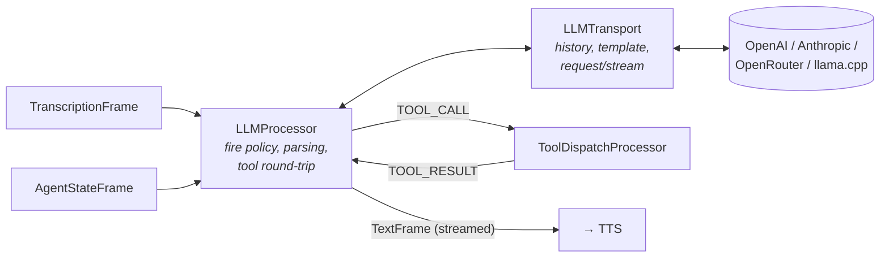

# The LLM stack

*Reference for everything under `va::llm`. Headers in [`VASDK/include/VASDK/llm/`](../../VASDK/include/VASDK/llm/) are the source of truth if this page and the code ever disagree.*

The LLM stack is three cooperating pieces: **`LLMTransport`** talks to the model (cloud API or local GGUF), **`LLMProcessor`** decides when to fire it and parses what comes back, and **`ToolDispatchProcessor`** executes the tools the model calls. Around them: **`PromptTemplate`** renders conversations into each model family's expected format, and **`Tool`** describes a callable function.



## LLMTransport

([`LLMTransport.h`](../../VASDK/include/VASDK/llm/LLMTransport.h), extends [`HttpTransport`](transports.md#httptransport)) One instance = one conversation with one model backend.

**Construction**: `LLMTransport(provider, config)` - or use a subclass (`OpenAITransport`, `AnthropicTransport`, and in `VASDK_3P_IMPL`, `LlamaCppTransport` for local GGUF). The `LLMProvider` enum: `OPENAI`, `ANTHROPIC`, `OPENROUTER`, `CUSTOM`, `LLAMA_CPP`, `LFM` (Liquid Foundation Models via llama.cpp).

**`LLMConfig`** (in [`LLMTypes.h`](../../VASDK/include/VASDK/llm/LLMTypes.h)) - the one struct to know:

| Field | Default | Notes |
| --- | --- | --- |
| `apiKey`, `endpoint`, `model` | - | Cloud credentials/endpoint; `model` also selects the GGUF path for local. |
| `systemPrompt` | - | Base system prompt. |
| `temperature` / `maxTokens` / `timeoutMs` / `streaming` | 0.7 / 1000 / 30000 / false | Generation + request behavior. |
| `nCtx`, `nGpuLayers`, `nThreads`, `nBatch`, `nativeLibDir` | 4096 / 99 / 0 / 512 / - | Local (llama.cpp) inference only. |
| `topP`, `topK`, `minP`, `repetitionPenalty` | 1.0 / 0 / 0.0 / 1.0 (all off) | Extended sampling for local models; the header documents recommended values per LFM model. |

**Conversation history** is owned by the transport: `addMessageToHistory(role, content)`, `clearHistory()`, `getHistory()`, capped at `setMaxHistoryLength()` (default 20 messages), disable with `setHistoryEnabled(false)`. Roles: `SYSTEM`, `USER`, `ASSISTANT`, `TOOL`.

**Prompt templating** is where dynamic prompts plug in:

- `setPromptTemplate(std::unique_ptr<PromptTemplate>)` installs a template rendered into every request; `setPromptChatFormat()` overrides which `ChatFormat` it renders to (defaults to the provider's idiomatic format).
- `registerTemplateVar(name, resolver)` - a resolver called **on every request**, so variables like `{missing_slots}` stay live without touching the template. This is the hook `GoalManager` and `IntentRouter` use.
- `setResponseFormatInstruction(text)` - set once; automatically re-appended as a system message every time the template is swapped (survives `IntentRouter`/`GoalManager` mid-call template changes).

**Tool round-trip**: `injectToolResult(s)()` feeds handler results back and re-requests. While the follow-up runs, `_forcingFinalAnswer` is set - local transports use it to ban the tool-call start token so the model must answer instead of re-emitting the same call.

**Debugging**: `previewRequestPayload()` renders exactly what would be sent right now, without sending - this powers the Android app's model-info screen.

**Errors** surface through `onError(code, message)` with stable `LLMErrorCode` values (`MissingApiKey`, `InvalidEndpoint`, `EmptyResponse`, `RequestFailed`, `ResponseParseFailed`, `OpenAIApiError`, `OpenAIParseFailed`, `AnthropicApiError`, `AnthropicParseFailed`) - switch on the code, not the message text.

**Extending**: subclass and override `buildRequestPayload()`, `parseResponse()`, and `parseStreamingData()` to speak a new API dialect; `sendLLMRequest()` if the whole request flow differs (that's what `LlamaCppTransport` does - no HTTP at all).

## PromptTemplate

([`PromptTemplate.h`](../../VASDK/include/VASDK/llm/PromptTemplate.h)) A builder for multi-turn prompts with `{variable}` substitution, plus per-model-family rendering. One subclass per `ChatFormat`; get one via the factory:

```cpp
auto tmpl = va::llm::PromptTemplate::create(va::llm::ChatFormat::LFM2_5);
tmpl->addSystem("You are a {role}. Task: {goal_objective}")
     ->addUser("{user_input}");
tmpl->set("role", "scheduling assistant");
```

**`ChatFormat`** covers both API JSON formats and local text formats:

| Format | Kind | Used by |
| --- | --- | --- |
| `OPENAI` | JSON messages array | OpenAI + compatible (OpenRouter) |
| `ANTHROPIC` | JSON, system extracted to top level | Anthropic |
| `GOOGLE` | JSON `system_instruction`/`contents` | Gemini-style APIs |
| `CHATML` | text, `<\|im_start\|>` tokens | Qwen, Yi, InternLM |
| `LLAMA3` / `LLAMA2` / `MISTRAL` / `GEMMA` / `PHI3` | text, model-specific tokens | respective model families |
| `LFM2` / `LFM2_5` | ChatML variant + LFM tool-call/response tokens | Liquid LFM models |

Key members: `render()` (throws `PromptTemplateError` on missing variables unless the policy is `LEAVE_PLACEHOLDER` or `EMPTY_STRING`), `missingVariables()`/`unusedVariables()` for validation, `getMessages()` for format-neutral access, and three per-format hooks that keep model quirks out of the pipeline: `reasoningTags()` (e.g. `<think>`/`</think>` wrappers to strip), `toolCallTags()` (e.g. LFM's `<|tool_call_start|>`), and `renderToolPrompt(tools, guidance)` - the system-prompt section teaching the model how to call tools, which **must stay in sync with the response parser**, which is why it lives on the template rather than in app code.

Adding support for a new model family = one `PromptTemplate` subclass (see `LocalPromptTemplates.h` for the text-format precedents) + a `ChatFormat` enum value.

## Tool

([`Tool.h`](../../VASDK/include/VASDK/llm/Tool.h)) A named, described, typed-parameter function the LLM may call:

```cpp
va::llm::Tool tool("get_weather", "Look up current weather for a city");
tool.addParameter({"city", "City name", "string", /*required*/ true})
    .onCall([](const nlohmann::json& args) -> nlohmann::json {
        return {{"tempC", 21}, {"conditions", "clear"}};
    });
```

`toJson()` renders the structured form (API providers); `toPromptDescription()` the text form (local models). `setEnabled(false)` hides a tool from prompts without unregistering; `execute(args)` runs the handler. Handlers run on the dispatcher's thread and their JSON return value goes back to the model verbatim - keep them fast, and encode failures *in the result JSON* (the model can react to `{"error": "..."}`; an exception can't help it).

## ToolDispatchProcessor

([`ToolDispatchProcessor.h`](../../VASDK/include/VASDK/llm/ToolDispatchProcessor.h)) The registry and executor: `registerTool`/`unregisterTool`/`hasTool`/`setToolEnabled`/`getToolNames`. Consumes `TOOL_CALL` frames only. For prompts and UIs: `renderToolDescriptions(ChatFormat)` (delegates to the template's `renderToolPrompt`) and `getEnabledToolsJson()`. `setTextFieldGuidance()` customizes how the model is told to use the plain-text response field.

## LLMProcessor

([`LLMProcessor.h`](../../VASDK/include/VASDK/llm/LLMProcessor.h)) The pipeline-side coordinator. What it manages, in the order a turn experiences it:

1. **Caching partials** - every partial `TranscriptionFrame` above `setConfidenceThreshold()` (default 0.5) is cached.
2. **Firing** - on `AgentStateFrame{USER_STOPPED_SPEAKING}`, the fire policy decides whether to send the cached partial immediately or wait for the final transcript. A watchdog (`setFinalWatchdogTimeoutMs`, default 2000 ms) fires anyway if the final never arrives.
3. **Streaming out** - response chunks stream downstream as `TextFrame{isFinal=false}` (UIs and transports render them live; `TTSFrameProcessor` deliberately ignores them); the last chunk carries `isFinal=true` with the full speech text - that's the one TTS synthesizes - plus `isExpecting`/`choices` when the model set them.
4. **Tool calls** - parsed tool invocations go to the dispatcher as `ToolCallFrame`s; results come back, get injected into the transport, and the model continues. Depth is capped at 5 nested batches, and an exact repeat of the previous batch is detected and broken (small local models loop otherwise).
5. **Cancellation** - `AgentStateFrame{INTERRUPTED / USER_SPOKE_WHILE_THINKING}` cancels the in-flight request; a generation counter discards responses that arrive after cancellation.
6. **Reasoning models** - `<think>…</think>`-style spans are stripped before TTS, using the template's `reasoningTags()` or an explicit `setReasoningTags()` override.

### Fire policies - when does the LLM fire?

([`LLMFirePolicy.h`](../../VASDK/include/VASDK/llm/LLMFirePolicy.h)) The latency/accuracy trade-off is pluggable via `setFirePolicy()`:

| Policy | Behavior | Choose when |
| --- | --- | --- |
| `EagerFirePolicy` *(default)* | Fire on any non-empty partial at turn end | Lowest latency; STT partials are trustworthy |
| `FinalOnlyFirePolicy` | Always wait for the final transcript | Accuracy-critical (e.g. collecting a phone number) |
| `ConfidenceGatedFirePolicy` | Fire early only if turn confidence ≥ 0.7, partial confidence ≥ 0.85, ≥ 3 words (all configurable) | Middle ground |

Implement `LLMFirePolicyInterface` (`evaluate(ctx) → FIRE_NOW | WAIT_FOR_FINAL` over `{partialText, partialConfidence, turnConfidence, wordCount}`) for custom heuristics.

### AggregatingLLMProcessor

([`llm/AggregatingLLMProcessor.h`](../../VASDK/include/VASDK/llm/AggregatingLLMProcessor.h)) An `LLMProcessor` subclass that batches multiple incoming messages into a single LLM request instead of firing per message, controlled by `setAggregationTimeout(ms)` and `setMaxAggregationCount(n)`, with a manual `flush()`. Useful when inputs arrive in rapid fragments (e.g. text channels) and one coherent request beats several partial ones.

## Wiring it all together

```cpp
auto transport = std::make_shared<va::llm::OpenAITransport>(config);
auto llm       = std::make_shared<va::llm::LLMProcessor>(transport);
auto tools     = std::make_shared<va::llm::ToolDispatchProcessor>();

tools->registerTool(getWeather);
llm->setToolDispatcher(tools);
transport->setResponseFormatInstruction(formatInstruction);

pipeline.addProcessor(/* … */).addProcessor(llm).addProcessor(tools).addProcessor(tts);
```

For local models, additionally make sure the rendered tool descriptions are in the system prompt (`renderToolDescriptions(format)`) - see [llm-tools.md](../examples/llm-tools.md) and [`VASDK_APP/main_pipeline.cpp`](../../VASDK_APP/main_pipeline.cpp) for the complete wiring, including the goal layer's use of template variables.
