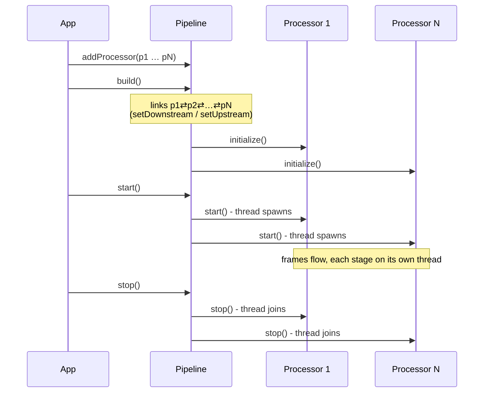

# Pipeline

*Reference for `va::pipeline::Pipeline`. Header: [`Pipeline.h`](../../VASDK/include/VASDK/Pipeline.h) - the source of truth if this page and the code ever disagree.*

The `Pipeline` class is deliberately small: it owns an ordered list of processors, wires them into a doubly-linked chain, and manages their collective lifecycle. All the interesting behavior lives in the [processors](processors.md); the pipeline is the harness.

## API

```cpp
va::pipeline::Pipeline pipeline;                       // or PipelineBuilder::create() for a shared_ptr

pipeline.addProcessor(p1).addProcessor(p2) /* … */;     // order = chain order
pipeline.setInputTransport(inTransport);                // optional bookkeeping
pipeline.setOutputTransport(outTransport);              // optional bookkeeping

pipeline.build();    // links neighbors (setDownstream/setUpstream) + initialize()s each
pipeline.start();    // start()s every processor - each spawns its thread
// … conversation runs …
pipeline.stop();     // stop()s every processor - threads join
```

`getProcessors()` exposes the chain read-only (used by metrics reporting and debugging tools).

## Lifecycle



Things worth knowing before you wire one up:

- **Order of `addProcessor()` calls is the chain order.** There is no reordering, no graph - a pipeline is a straight line. Fan-in/fan-out happens at the ends via `TransportInputProcessor`/`TransportOutputProcessor`, not in the middle.
- **`build()` must precede `start()`**, and processor-specific setup that must happen "before `initialize()`" (e.g. `TransportInputProcessor::addTransport()`, ring-buffer wiring) must happen **before `build()`**, because `build()` is what calls `initialize()`.
- **`setInputTransport`/`setOutputTransport` don't route frames by themselves** - frame I/O goes through `TransportInputProcessor`/`TransportOutputProcessor` in the chain. The pipeline-level setters exist so the pipeline can manage the transports' lifecycle alongside the processors'.
- **A `Pipeline` is one session.** For concurrent sessions (multiple simultaneous calls), build one pipeline per session and pool the expensive providers - that's exactly what [`SessionManager`](goal.md#sessionmanager--many-calls-at-once) does.

## How frames move once running

Nothing in `Pipeline` moves frames. After `build()`, each processor holds weak pointers to its neighbors; `pushDownstream()`/`pushUpstream()` enqueue directly into the neighbor's priority queue, and each processor's own thread drains its queue. Downstream is the media path (audio → text → response → speech); upstream is the control path (errors, interrupts, TTS lifecycle). A `CRITICAL` frame - a barge-in interrupt, a fatal error - overtakes any backlog of queued audio at every hop, which is what makes cancellation feel instant even under load.

## Minimal working example

See [docs/examples/minimal-pipeline.md](../examples/minimal-pipeline.md) for a complete six-stage pipeline with construction of each provider, and [`VASDK_APP/main_pipeline.cpp`](../../VASDK_APP/main_pipeline.cpp) for the full production wiring including turn detection, agent state, tools, and metrics.
