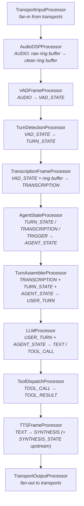
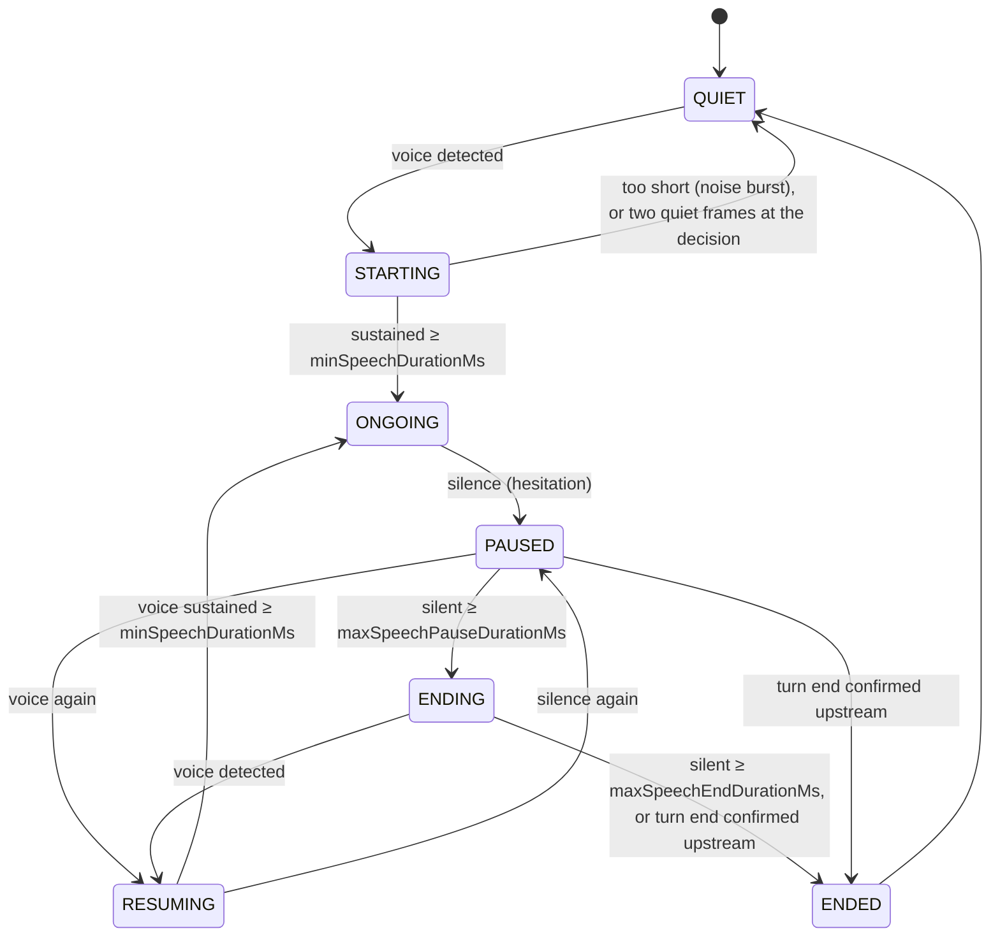
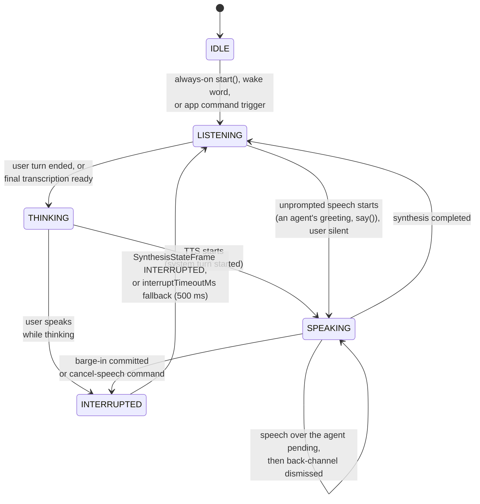

# Frame processors

*Reference for `va::pipeline::FrameProcessor` and every built-in processor. Base header: [`FrameProcessor.h`](../../VASDK/include/VASDK/FrameProcessor.h) - the source of truth if this page and the code ever disagree.*

A processor is one stage of the pipeline: it owns a thread, consumes frames from a queue, and pushes results to its neighbors. Providers do the actual AI work (inference, synthesis); processors do the orchestration around them (state machines, buffering, gating, threading).

## The FrameProcessor contract

```cpp
class FrameProcessor : public std::enable_shared_from_this<FrameProcessor> {
public:
    virtual std::string getName() const = 0;                       // required
    virtual std::string getProviderName() const;                  // provider doing the work, "" by default
    virtual void processFrame(std::shared_ptr<transport::Frame> frame,
                              FlowDirection direction) = 0;        // required

    virtual bool initialize();   // acquire resources; called by Pipeline::build()
    virtual bool start();        // spawns the processing thread
    virtual void stop();         // joins the thread
    virtual void release();      // free resources

protected:
    virtual bool shouldProcess(std::shared_ptr<transport::Frame>) const; // filter, default: everything
    void pushDownstream(std::shared_ptr<transport::Frame> frame);
    void pushUpstream(std::shared_ptr<transport::Frame> frame);
    void enqueueFrame(std::shared_ptr<transport::Frame> frame, FlowDirection direction);
};
```

What the base class gives you for free:

- **A dedicated thread** running `processingLoop()`, so a slow stage (LLM inference) never blocks a fast one (audio capture).
- **A priority queue** - `CRITICAL` frames (interrupts, fatal errors) jump ahead of queued audio, with FIFO order preserved within a priority level. System frames additionally get their own queue so they can't be starved.
- **Chain links** - `setDownstream()`/`setUpstream()` are wired for you by `Pipeline::build()`; you never call them by hand in normal use.
- **Base metrics** - per-processor processing latency, queue wait, and frame count, configurable via `setMetricsConfig()`.

The processors that wrap a provider (VAD, turn detection, transcription, speaker ID, DSP, TTS, VizAnim, the LLM with its model, and the transport processors) report it from `getProviderName()`. `Pipeline::describeAsJson()` lists the chain for UIs: `{"processors":[{"name":"VADFrameProcessor","provider":"SileroVAD"}, ...]}`.

The minimal custom processor is just `getName()` + `processFrame()`:

```cpp
class UppercaseProcessor : public va::pipeline::FrameProcessor {
public:
    std::string getName() const override { return "UppercaseProcessor"; }

    void processFrame(std::shared_ptr<va::transport::Frame> frame,
                      va::pipeline::FlowDirection direction) override {
        if (direction == va::pipeline::FlowDirection::DOWNSTREAM &&
            frame->getType() == va::transport::FrameType::TEXT) {
            auto text = std::static_pointer_cast<va::transport::TextFrame>(frame);
            std::transform(text->text.begin(), text->text.end(),
                           text->text.begin(), ::toupper);
        }
        // ALWAYS forward - a processor that consumes without forwarding breaks the chain
        direction == va::pipeline::FlowDirection::DOWNSTREAM
            ? pushDownstream(frame) : pushUpstream(frame);
    }
};
```

Rules that keep a custom processor well-behaved:

1. **Forward what you don't handle.** Frames you ignore must still be pushed onward in their original direction, or everything behind you goes deaf. Override `shouldProcess()` to filter *before* your queue instead of dropping inside `processFrame()` - filtered frames are forwarded automatically.
2. **Never block `processFrame()` indefinitely.** Long work (network calls, inference) belongs in the provider or a worker thread; your queue backs up while `processFrame()` runs.
3. **Report failures as `ErrorFrame`s pushed upstream**, not exceptions - that's what `RecoveryProcessor` and the app listen for.
4. **`PassThroughProcessor` and `LoggingProcessor`** (both in `FrameProcessor.h`) are the reference minimal implementations - start from them.

## The standard chain

The order used by the showcase apps, with each processor's frame diet:

Arrows show the downstream direction; errors, interrupts, and TTS lifecycle frames travel the same chain upstream.



This order matters in a few places: `AgentStateProcessor` must sit between transcription and the LLM (it gates stale transcriptions), `TurnAssemblerProcessor` must sit after it and before the LLM, and `TurnDetectionProcessor` must see `VADStateFrame`s before transcription consumes the turn - and sit directly after the VAD, since it sends early end-of-turn requests upstream to it. Optional stages that read the whole utterance (speaker ID) belong after transcription so they don't delay the transcript. Beyond those constraints, the chain is yours to rearrange - that's the point of the architecture.

## Built-in processors, one by one

### TransportInputProcessor / TransportOutputProcessor

The pipeline's endpoints ([`TransportInputProcessor.h`](../../VASDK/include/VASDK/TransportInputProcessor.h), [`TransportOutputProcessor.h`](../../VASDK/include/VASDK/TransportOutputProcessor.h)). Input is **fan-in**: `addTransport()` any number of transports and each one's `onFrameReceived` callback enqueues directly - no polling thread. Output is **fan-out**: each added transport takes an optional `FrameType` filter (`nullopt` = everything), and frames are still pushed downstream after fan-out so the rest of the chain sees them. Both require `addTransport()` calls **before** `initialize()`.

### AudioDSPProcessor

([`AudioDSPProcessor.h`](../../VASDK/include/VASDK/AudioDSPProcessor.h)) Reads each `AudioFrame`'s range from the **raw** ring buffer, runs it through a `GenericAudioDSPProvider` (e.g. RNNoise), writes the result to a separate **clean** ring buffer advanced in lock-step, and forwards the frame unchanged - the same offsets are valid in both buffers, so downstream processors just point at whichever buffer they want. Both buffers must have identical capacity and sample size. Optional: omit the processor entirely and point VAD/STT at the raw buffer. Full design discussion: [root README, "The audio ring buffer"](../../README.md#the-audio-ring-buffer).

### VADFrameProcessor

([`VADFrameProcessor.h`](../../VASDK/include/VASDK/VADFrameProcessor.h)) Wraps a `VADProvider` and turns per-block speech probabilities into a debounced acoustic state machine, emitting a `VADStateFrame` on every transition:



Tunables live in `VADConfig` (defaults: `vadThresholdMs` 200, `minSpeechDurationMs` 250, `maxSpeechPauseDurationMs` 500, `maxSpeechEndDurationMs` 1000, `resumingSilenceFramesToPause` 3). The constructor's `lookbackMultiplier` (default 4.0 × frame size) backdates `speechStartOffset` so the first syllable isn't clipped - the audio is already sitting in the ring buffer, so pre-roll is free; `minSpeechDurationMs` is counted from when STARTING began, not from that backdated offset. At that point one quiet frame right after voice is tolerated (the decision waits a frame), so a dip in steady speech isn't thrown away; two quiet frames in a row, or a lone blip, still go back to `QUIET`. `bargeInMinSpeechDurationMs` replaces `minSpeechDurationMs` while the assistant speaks (`setAgentSpeaking(callback)`): echo cancellation turns the user's voice down during the overlap, so waiting the full time loses interruptions. Sessions use 150 ms. A `TurnStateFrame(USER, END)` arriving **upstream** while `PAUSED` or `ENDING` ends the segment immediately instead of waiting out the pause/end timers (see below). Needs `setRingBuffer()`.

### TurnDetectionProcessor

([`TurnDetectionProcessor.h`](../../VASDK/include/VASDK/TurnDetectionProcessor.h)) Converts acoustic boundaries into conversation-level `TurnStateFrame`s. Without a provider it's a passthrough rule: VAD `STARTING` → user turn start, VAD `ENDED` → user turn end. Inject a [`TurnDetectionProvider`](providers.md#turndetectionprovider) (e.g. SmartTurn v3) for model-based end-of-turn decisions, INTERRUPT classification, and confidence thresholds. `setAgentSpeaking(bool)` tells it whether TTS is playing so providers can classify a user turn as an interruption (barge-in).

Two behaviors sit on top of either path:

- **User turn starts wait for confirmed speech.** A user `START` produced while the VAD is only `STARTING` is held and emitted on the first `ONGOING`; if the VAD falls back to `QUIET` it is dropped. A noise or echo blip therefore can't barge in on the agent or cancel the LLM - the cost is that a real barge-in takes `bargeInMinSpeechDurationMs` (150 ms in sessions) or else `minSpeechDurationMs` to land.
- **Early end of turn.** When the provider returns `TURN_END` for the user while the VAD segment is still open (e.g. SmartTurn scoring a pause with `setEvaluateOnPause(true)`), the processor emits the turn `END` and also sends a `TurnStateFrame(USER, END)` upstream so the VAD closes the segment and transcription runs right away. In the showcase apps this takes the gap from the pause to the final transcript from ~1 s to ~0.1 s when the model is confident. Ending at a pause needs the provider's `pauseThreshold()` (default 0.85, `setPauseThreshold()`), higher than its regular threshold: a pause is often just a breath, and an uncertain turn still ends once the VAD confirms silence. If the user resumes after the turn did end, `LLMProcessor` merges both utterances into one message ([follow-ups](llm.md#follow-ups)).

### SpeakerIdentificationProcessor

([`SpeakerIdentificationProcessor.h`](../../VASDK/include/VASDK/SpeakerIdentificationProcessor.h)) Enrolls users by voice and tags each utterance with who said it. On VAD `ENDED` it reads the utterance from the ring buffer and embeds it with a [`SpeakerEmbeddingProvider`](providers.md#speakerembeddingprovider). It tracks the current speaker's voice print: an utterance scoring below `threshold` against it is a new speaker and replaces it, otherwise it is averaged into it (logged as SAME/NEW speaker, and carried in the frame as `isNewSpeaker` / `trackedSimilarity`). If an enrollment is pending (`requestEnrollment(id)` or a `SpeakerEnrollmentFrame` with `REQUESTED`), the voice print is stored and a `SpeakerEnrollmentFrame` (`ENROLLED`/`FAILED`) is emitted; otherwise it emits a `SpeakerIdentificationFrame` with the tracking result and the best enrolled cosine match above `threshold` (default 0.3, pyannote 3.1's clustering threshold). Utterances shorter than `minSpeechSec` (default 1 s) are skipped. `getSpeakers()` / `addSpeaker()` save and restore voice prints. Place it after VAD; the showcase apps put it after transcription, since embedding the whole utterance (~70 ms per second of speech) would otherwise delay the transcript. Needs `setRingBuffer()`.

### TranscriptionFrameProcessor

([`TranscriptionProcessor.h`](../../VASDK/include/VASDK/TranscriptionProcessor.h) - note the class is `TranscriptionFrameProcessor`) Feeds speech audio to a `GenericTranscriptionProvider` and emits `TranscriptionFrame`s. It is VAD-gated: it reads from the ring buffer starting at the `speechStartOffset` a `VADStateFrame` gives it, in **streaming mode** (audio pushed continuously while speech is ongoing - for providers with their own endpointing, like cloud STT) or **non-streaming mode** (whole segment submitted at once on VAD `ENDED`, via the provider's `writeFullAudioData`). `configSilenceBehavior()` can pad the segment with silence at either end - some models need trailing silence to emit a final result. It also caches the latest partial transcription (`getLatestPartialText()`), which `LLMProcessor` uses to fire the LLM before the final transcript lands. Needs `setRingBuffer()`.

### AgentStateProcessor - the conversation state machine

([`AgentStateProcessor.h`](../../VASDK/include/VASDK/AgentStateProcessor.h)) The pipeline's brainstem: tracks whose turn it is and gates the stages behind it. Emits an `AgentStateFrame` downstream on every transition, which is how the LLM knows to fire and how the LLM/TTS know to cancel in-flight work - no manual callback wiring.



Key behaviors: `TranscriptionFrame`s arriving outside `LISTENING` are **dropped** (they're stale - e.g. echo of the assistant's own voice); `setAlwaysOn(false)` switches to wake-word mode, where the agent stays `IDLE` until a `TriggerFrame` arrives *and* returns to `IDLE` once the follow-up window after a reply closes (`setFollowUpListenMs`; 0, the processor default, closes it as soon as the reply ends or an interrupt resolves); an `APP_COMMAND` trigger with data `"deactivate"` forces `IDLE` from any state; and the `INTERRUPTED` state has a timeout fallback (`setInterruptTimeoutMs`, default 500 ms) in case TTS never confirms the cancellation.

#### Back-channels: speech over the agent that isn't an interruption

People say "mm-hmm", "yeah" and "right" while someone talks, and expect them to keep going. With `setBackchannelConfig()` (on by default), a user turn start while `SPEAKING` doesn't interrupt at once. It opens a **pending barge-in**: the agent stays `SPEAKING` and an `AgentStateFrame` with transition `BARGE_IN_PENDING` goes out. TTS then ducks or pauses playback through `setPlaybackHold()`. The speech is then classified by `classifyBackchannel()`:

- **Commit** (a real interruption, the usual `BARGE_IN_INTERRUPT`), as soon as one of these holds:
  - a word from `interruptWords` is heard ("stop", "wait", "no", "actually", "but"…);
  - two words that aren't back-channel phrases are heard, or a final has one;
  - more than `maxBackchannelWords` (4) are heard;
  - the speech runs past `commitAfterPendingMs` (600 ms after the pending start, about 850 ms of speech).
- **Dismiss** (`BACKCHANNEL`, the agent carries on at full volume): the user stops and the final transcript holds only `backchannelPhrases`, or nothing. A final of up to `lowConfidenceMaxWords` (2) words below `minInterruptConfidence` (0.6) with no interrupt word is dismissed too: short words heard over the agent's own voice are often misrecognised, and a garble ("Hey, hey." at 0.48) shouldn't cut it off. If no final arrives within `finalTranscriptionWaitMs` (300 ms of audio), the latest partial decides.

Time is counted from the `AUDIO` frames passing through, so decisions follow the audio clock, not the wall clock.

| Situation | What happens |
|---|---|
| "mm-hmm" (350 ms) | Pending at ~250 ms, the final "Mm-hmm." dismisses it. The agent never stopped, and was quieter for `duckDurationMs` (2.5 s). |
| "Wait, how much is it?" | The partial "wait" commits. The STT buffer is kept, so the turn includes "wait". |
| 1 s of speech with batch STT (no partials) | Commits on duration. |
| "Okay, Tuesday." (500 ms) | The user's turn already ended unseen while the agent kept talking. "Tuesday" commits it **late**: once the interrupt resolves, the turn is replayed (`USER_STOPPED_SPEAKING`, then the held final) so the LLM answers it exactly once. |
| "Yes" over "…shall I book it?" | Less than `tailOverlapMs` (700 ms) of reply was left (`setPlaybackRemainingMsProvider`, e.g. `TTSFrameProcessor::getRemainingReplyPlaybackMs`). With `TailOverlapMode::TreatAsTurn` the reply finishes and "yes" is answered. With `Classify` it's dismissed. |
| The reply ends while the user is still talking | It becomes an ordinary user turn. |
| The reply ends after a back-channel but before its final | The final is classified when it arrives. A back-channel isn't answered; anything else is replayed as a turn. |

The policy is chosen when building the pipeline:

| Setting | Values (default first) |
|---|---|
| `pendingPlaybackMode` | `Duck`, `Pause` (resume from the same sample as soon as the speech is dismissed), `Continue` |
| `duckGainDecibels` | Level while ducked, default −12 dB |
| `duckDurationMs` | Minimum duck length from the start of the overlap, default 2500 ms. A back-channel doesn't bring the volume straight back up; speaking again within it keeps the duck; a committed barge-in or the reply ending releases it at once. |
| `historyMode` | `Drop`, or `AppendToHistory`: the dismissed final is forwarded with `TranscriptionFrame::isBackchannel`. LLMProcessor puts it in front of the user's next message, e.g. `(While you were speaking I said "mm-hmm".) What about Tuesday?`, so history keeps strict user/assistant alternation. |
| `tailOverlapMode` | `TreatAsTurn`, `Classify` |

`enabled = false` restores the plain hard barge-in. Back-channels while `THINKING` aren't covered: any speech then still cancels the reply. The phrase and interrupt-word lists are English by default; set your own for other languages.

### TurnAssemblerProcessor

([`TurnAssemblerProcessor.h`](../../VASDK/include/VASDK/TurnAssemblerProcessor.h)) Decides when the user's turn is complete and emits one `UserTurnFrame` for it. A turn needs both the turn end (`AgentStateFrame{USER_STOPPED_SPEAKING}` or `TurnStateFrame{USER, END}`) and its final transcription, in either order. If the final never arrives, a watchdog (default 2000 ms, `setFinalWatchdogTimeoutMs`) sends what it has. A pluggable [fire policy](llm.md#fire-policies---when-does-the-llm-fire) (`setFirePolicy`, default `EagerFirePolicy`) decides whether a partial may stand in for a late or empty final. It also merges a resumed turn into the one before it ([follow-ups](llm.md#follow-ups), `setResumeMergeMs`). Every frame passes through unchanged. Anything that answers the user, such as `LLMProcessor`, answers `UserTurnFrame`s, so turn-taking behaves the same whatever does the answering.

### LLMProcessor

([`llm/LLMProcessor.h`](../../VASDK/include/VASDK/llm/LLMProcessor.h)) Bridges the pipeline to an [`LLMTransport`](llm.md#llmtransport). Answers each `UserTurnFrame` from the `TurnAssemblerProcessor` before it, parses the model's structured response into speech text + tool calls, and coordinates the tool round-trip with `ToolDispatchProcessor` (bounded at 5 nested tool batches, with self-imitation-loop detection). Agent-state transitions cancel replies in flight. Details of parsing, reasoning tags, speculative firing and streaming: [llm.md](llm.md).

### ToolDispatchProcessor

([`llm/ToolDispatchProcessor.h`](../../VASDK/include/VASDK/llm/ToolDispatchProcessor.h)) Registry + executor for [`Tool`](llm.md#tool)s. Consumes only `TOOL_CALL` frames: matches the name, runs the handler, emits a `TOOL_RESULT` frame. Also renders the tool catalog into the system prompt for local models (`renderToolDescriptions(ChatFormat)`) and exposes a structured JSON view for UIs (`getEnabledToolsJson()`).

### TTSFrameProcessor

([`TTSFrameProcessor.h`](../../VASDK/include/VASDK/TTSFrameProcessor.h)) Sends final `TextFrame`s to a `GenericVoiceSynthesisProvider`, wraps the returned audio in `SynthesisFrame`s, and - critically - emits `SynthesisStateFrame`s **upstream** (`STARTED`/`COMPLETED`/`INTERRUPTED`/`ERROR`) so agent state and turn detection track TTS activity without bespoke wiring. Handles barge-in cancellation when an `AgentStateFrame{INTERRUPTED}` arrives, and runs a drain-wait timer so `COMPLETED` means "playback actually finished", padded by `setHardwareBufferMarginMs` (default 150 ms) for hardware buffer latency. `setPlaybackFlush()` hooks the transport's fade-and-flush for click-free interruption. `setPlaybackHold()` hooks the transport's `holdOutputAudio()`: it ducks or pauses playback on `BARGE_IN_PENDING` and releases it on `BACKCHANNEL`, `INTERRUPT_RESOLVED` or `SYNTHESIS_COMPLETED`, with the mode, duck level and minimum duck duration set by `setPendingPlayback()`; after a back-channel the duck is released once `duckDurationMs` has passed since it began. While paused, the drain timer stops, so `COMPLETED` still means the audio played. `getRemainingReplyPlaybackMs()` reports how much of a fully received reply is left to play.

### RecoveryProcessor

([`RecoveryProcessor.h`](../../VASDK/include/VASDK/RecoveryProcessor.h)) Watches `ErrorFrame`s flowing upstream and answers with a spoken recovery prompt downstream, per-source retry budgets (defaults: STT 2, LLM 2, TTS 1), and an `onFatalError` callback when a budget is exhausted or a `FATAL` error arrives - the app typically escalates to a human there. All prompts are configurable via `RecoveryProcessor::Config`. Because errors flow upstream past everything, a single instance at the head of the pipeline catches all sources.

### TriggerProcessor

([`TriggerProcessor.h`](../../VASDK/include/VASDK/TriggerProcessor.h)) The safe entry point for events born outside the pipeline - a UI button, a wake-word engine, JNI. `trigger(type, data, confidence)` is callable from any thread; it enqueues a `TriggerFrame` through the normal queue machinery rather than touching another processor's internals.

### AudioBufferProcessor

([`AudioBufferProcessor.h`](../../VASDK/include/VASDK/AudioBufferProcessor.h)) Stores incoming audio into a ring buffer from inside the chain. The showcase apps don't use it - `LocalTransport` writes the shared ring buffer directly - but it's there for wiring audio from a transport that doesn't own a ring buffer.

## Threading model in one paragraph

Every processor runs its own consumer thread; `pushDownstream()`/`pushUpstream()` are just cross-thread enqueues. This means: frames are processed in priority-then-FIFO order *per processor*, but there is no global ordering across processors; any state shared between `processFrame()` and other threads (callbacks from providers, public getters) must be synchronized - see `TranscriptionFrameProcessor::_latestPartialMutex` for the house pattern; and the pipeline's end-to-end latency is the sum of queue waits, which is what the per-processor queue-wait metric measures.
