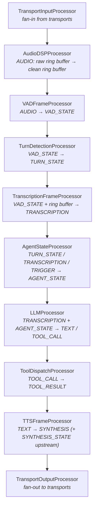
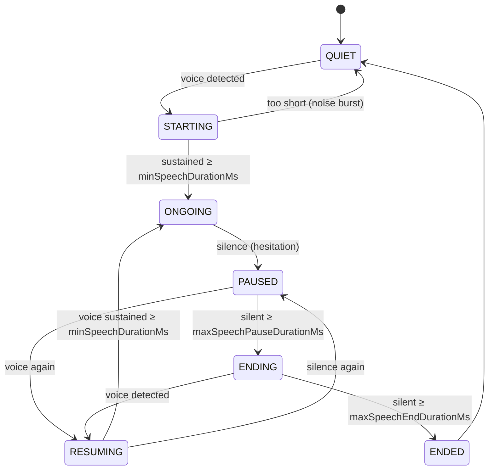
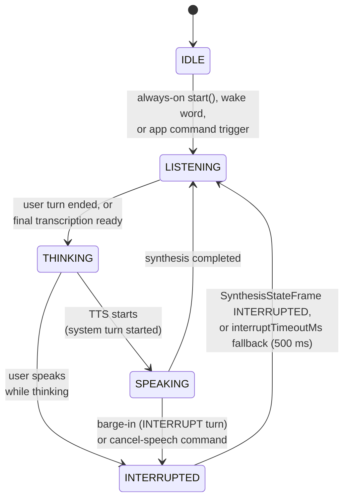

# Frame processors

*Reference for `va::pipeline::FrameProcessor` and every built-in processor. Base header: [`FrameProcessor.h`](../../VASDK/include/VASDK/FrameProcessor.h) - the source of truth if this page and the code ever disagree.*

A processor is one stage of the pipeline: it owns a thread, consumes frames from a queue, and pushes results to its neighbors. Providers do the actual AI work (inference, synthesis); processors do the orchestration around them (state machines, buffering, gating, threading).

## The FrameProcessor contract

```cpp
class FrameProcessor : public std::enable_shared_from_this<FrameProcessor> {
public:
    virtual std::string getName() const = 0;                       // required
    virtual void processFrame(std::shared_ptr<transport::Frame> frame,
                              FlowDirection direction) = 0;        // required

    virtual bool initialize();   // acquire resources; called by Pipeline::build()
    virtual bool start();        // spawns the processing thread
    virtual void stop();         // joins the thread
    virtual void release();      // free resources

protected:
    virtual bool shouldProcess(std::shared_ptr<transport::Frame>) const; // filter, default: everything
    void pushDownstream(std::shared_ptr<transport::Frame> frame);
    void pushUpstream(std::shared_ptr<transport::Frame> frame);
    void enqueueFrame(std::shared_ptr<transport::Frame> frame, FlowDirection direction);
};
```

What the base class gives you for free:

- **A dedicated thread** running `processingLoop()`, so a slow stage (LLM inference) never blocks a fast one (audio capture).
- **A priority queue** - `CRITICAL` frames (interrupts, fatal errors) jump ahead of queued audio, with FIFO order preserved within a priority level. System frames additionally get their own queue so they can't be starved.
- **Chain links** - `setDownstream()`/`setUpstream()` are wired for you by `Pipeline::build()`; you never call them by hand in normal use.
- **Base metrics** - per-processor processing latency, queue wait, and frame count, configurable via `setMetricsConfig()`.

The minimal custom processor is just `getName()` + `processFrame()`:

```cpp
class UppercaseProcessor : public va::pipeline::FrameProcessor {
public:
    std::string getName() const override { return "UppercaseProcessor"; }

    void processFrame(std::shared_ptr<va::transport::Frame> frame,
                      va::pipeline::FlowDirection direction) override {
        if (direction == va::pipeline::FlowDirection::DOWNSTREAM &&
            frame->getType() == va::transport::FrameType::TEXT) {
            auto text = std::static_pointer_cast<va::transport::TextFrame>(frame);
            std::transform(text->text.begin(), text->text.end(),
                           text->text.begin(), ::toupper);
        }
        // ALWAYS forward - a processor that consumes without forwarding breaks the chain
        direction == va::pipeline::FlowDirection::DOWNSTREAM
            ? pushDownstream(frame) : pushUpstream(frame);
    }
};
```

Rules that keep a custom processor well-behaved:

1. **Forward what you don't handle.** Frames you ignore must still be pushed onward in their original direction, or everything behind you goes deaf. Override `shouldProcess()` to filter *before* your queue instead of dropping inside `processFrame()` - filtered frames are forwarded automatically.
2. **Never block `processFrame()` indefinitely.** Long work (network calls, inference) belongs in the provider or a worker thread; your queue backs up while `processFrame()` runs.
3. **Report failures as `ErrorFrame`s pushed upstream**, not exceptions - that's what `RecoveryProcessor` and the app listen for.
4. **`PassThroughProcessor` and `LoggingProcessor`** (both in `FrameProcessor.h`) are the reference minimal implementations - start from them.

## The standard chain

The order used by the showcase apps, with each processor's frame diet:

Arrows show the downstream direction; errors, interrupts, and TTS lifecycle frames travel the same chain upstream.



This order matters in a few places: `AgentStateProcessor` must sit between transcription and the LLM (it gates stale transcriptions), and `TurnDetectionProcessor` must see `VADStateFrame`s before transcription consumes the turn. Beyond those constraints, the chain is yours to rearrange - that's the point of the architecture.

## Built-in processors, one by one

### TransportInputProcessor / TransportOutputProcessor

The pipeline's endpoints ([`TransportInputProcessor.h`](../../VASDK/include/VASDK/TransportInputProcessor.h), [`TransportOutputProcessor.h`](../../VASDK/include/VASDK/TransportOutputProcessor.h)). Input is **fan-in**: `addTransport()` any number of transports and each one's `onFrameReceived` callback enqueues directly - no polling thread. Output is **fan-out**: each added transport takes an optional `FrameType` filter (`nullopt` = everything), and frames are still pushed downstream after fan-out so the rest of the chain sees them. Both require `addTransport()` calls **before** `initialize()`.

### AudioDSPProcessor

([`AudioDSPProcessor.h`](../../VASDK/include/VASDK/AudioDSPProcessor.h)) Reads each `AudioFrame`'s range from the **raw** ring buffer, runs it through a `GenericAudioDSPProvider` (e.g. RNNoise), writes the result to a separate **clean** ring buffer advanced in lock-step, and forwards the frame unchanged - the same offsets are valid in both buffers, so downstream processors just point at whichever buffer they want. Both buffers must have identical capacity and sample size. Optional: omit the processor entirely and point VAD/STT at the raw buffer. Full design discussion: [root README, "The audio ring buffer"](../../README.md#the-audio-ring-buffer).

### VADFrameProcessor

([`VADFrameProcessor.h`](../../VASDK/include/VASDK/VADFrameProcessor.h)) Wraps a `VADProvider` and turns per-block speech probabilities into a debounced acoustic state machine, emitting a `VADStateFrame` on every transition:



Tunables live in `VADConfig` (defaults: `vadThresholdMs` 200, `minSpeechDurationMs` 250, `maxSpeechPauseDurationMs` 500, `maxSpeechEndDurationMs` 1000, `resumingSilenceFramesToPause` 3). The constructor's `lookbackMultiplier` (default 4.0 × frame size) backdates `speechStartOffset` so the first syllable isn't clipped - the audio is already sitting in the ring buffer, so pre-roll is free. Needs `setRingBuffer()`.

### TurnDetectionProcessor

([`TurnDetectionProcessor.h`](../../VASDK/include/VASDK/TurnDetectionProcessor.h)) Converts acoustic boundaries into conversation-level `TurnStateFrame`s. Without a provider it's a passthrough rule: VAD `STARTING` → user turn start, VAD `ENDED` → user turn end. Inject a [`TurnDetectionProvider`](providers.md#turndetectionprovider) (e.g. SmartTurn v3) for model-based end-of-turn decisions, INTERRUPT classification, and confidence thresholds. `setAgentSpeaking(bool)` tells it whether TTS is playing so providers can classify a user turn as an interruption (barge-in).

### TranscriptionFrameProcessor

([`TranscriptionProcessor.h`](../../VASDK/include/VASDK/TranscriptionProcessor.h) - note the class is `TranscriptionFrameProcessor`) Feeds speech audio to a `GenericTranscriptionProvider` and emits `TranscriptionFrame`s. It is VAD-gated: it reads from the ring buffer starting at the `speechStartOffset` a `VADStateFrame` gives it, in **streaming mode** (audio pushed continuously while speech is ongoing - for providers with their own endpointing, like cloud STT) or **non-streaming mode** (whole segment submitted at once on VAD `ENDED`, via the provider's `writeFullAudioData`). `configSilenceBehavior()` can pad the segment with silence at either end - some models need trailing silence to emit a final result. It also caches the latest partial transcription (`getLatestPartialText()`), which `LLMProcessor` uses to fire the LLM before the final transcript lands. Needs `setRingBuffer()`.

### AgentStateProcessor - the conversation state machine

([`AgentStateProcessor.h`](../../VASDK/include/VASDK/AgentStateProcessor.h)) The pipeline's brainstem: tracks whose turn it is and gates the stages behind it. Emits an `AgentStateFrame` downstream on every transition, which is how the LLM knows to fire and how the LLM/TTS know to cancel in-flight work - no manual callback wiring.



Key behaviors: `TranscriptionFrame`s arriving outside `LISTENING` are **dropped** (they're stale - e.g. echo of the assistant's own voice); `setAlwaysOn(false)` switches to wake-word mode, where the agent stays `IDLE` until a `TriggerFrame` arrives *and* returns to `IDLE` instead of `LISTENING` after synthesis completes or an interrupt resolves; an `APP_COMMAND` trigger with data `"deactivate"` forces `IDLE` from any state; and the `INTERRUPTED` state has a timeout fallback (`setInterruptTimeoutMs`, default 500 ms) in case TTS never confirms the cancellation.

### LLMProcessor

([`llm/LLMProcessor.h`](../../VASDK/include/VASDK/llm/LLMProcessor.h)) Bridges the pipeline to an [`LLMTransport`](llm.md#llmtransport). Listens for transcriptions and agent-state transitions, decides *when* to fire a request (pluggable [`LLMFirePolicy`](llm.md#fire-policies--when-does-the-llm-fire), default `EagerFirePolicy`: fire on the cached partial as soon as the turn ends), parses the model's structured response into speech text + tool calls, and coordinates the tool round-trip with `ToolDispatchProcessor` (bounded at 5 nested tool batches, with self-imitation-loop detection). A watchdog (default 2000 ms, `setFinalWatchdogTimeoutMs`) fires the request from the best available partial if the final transcript never arrives. Details of parsing, reasoning tags, and streaming: [llm.md](llm.md).

### ToolDispatchProcessor

([`llm/ToolDispatchProcessor.h`](../../VASDK/include/VASDK/llm/ToolDispatchProcessor.h)) Registry + executor for [`Tool`](llm.md#tool)s. Consumes only `TOOL_CALL` frames: matches the name, runs the handler, emits a `TOOL_RESULT` frame. Also renders the tool catalog into the system prompt for local models (`renderToolDescriptions(ChatFormat)`) and exposes a structured JSON view for UIs (`getEnabledToolsJson()`).

### TTSFrameProcessor

([`TTSFrameProcessor.h`](../../VASDK/include/VASDK/TTSFrameProcessor.h)) Sends final `TextFrame`s to a `GenericVoiceSynthesisProvider`, wraps the returned audio in `SynthesisFrame`s, and - critically - emits `SynthesisStateFrame`s **upstream** (`STARTED`/`COMPLETED`/`INTERRUPTED`/`ERROR`) so agent state and turn detection track TTS activity without bespoke wiring. Handles barge-in cancellation when an `AgentStateFrame{INTERRUPTED}` arrives, and runs a drain-wait timer so `COMPLETED` means "playback actually finished", padded by `setHardwareBufferMarginMs` (default 150 ms) for hardware buffer latency. `setPlaybackFlush()` hooks the transport's fade-and-flush for click-free interruption.

### RecoveryProcessor

([`RecoveryProcessor.h`](../../VASDK/include/VASDK/RecoveryProcessor.h)) Watches `ErrorFrame`s flowing upstream and answers with a spoken recovery prompt downstream, per-source retry budgets (defaults: STT 2, LLM 2, TTS 1), and an `onFatalError` callback when a budget is exhausted or a `FATAL` error arrives - the app typically escalates to a human there. All prompts are configurable via `RecoveryProcessor::Config`. Because errors flow upstream past everything, a single instance at the head of the pipeline catches all sources.

### TriggerProcessor

([`TriggerProcessor.h`](../../VASDK/include/VASDK/TriggerProcessor.h)) The safe entry point for events born outside the pipeline - a UI button, a wake-word engine, JNI. `trigger(type, data, confidence)` is callable from any thread; it enqueues a `TriggerFrame` through the normal queue machinery rather than touching another processor's internals.

### AudioBufferProcessor

([`AudioBufferProcessor.h`](../../VASDK/include/VASDK/AudioBufferProcessor.h)) Stores incoming audio into a ring buffer from inside the chain. The showcase apps don't use it - `LocalTransport` writes the shared ring buffer directly - but it's there for wiring audio from a transport that doesn't own a ring buffer.

## Threading model in one paragraph

Every processor runs its own consumer thread; `pushDownstream()`/`pushUpstream()` are just cross-thread enqueues. This means: frames are processed in priority-then-FIFO order *per processor*, but there is no global ordering across processors; any state shared between `processFrame()` and other threads (callbacks from providers, public getters) must be synchronized - see `TranscriptionFrameProcessor::_latestPartialMutex` for the house pattern; and the pipeline's end-to-end latency is the sum of queue waits, which is what the per-processor queue-wait metric measures.
