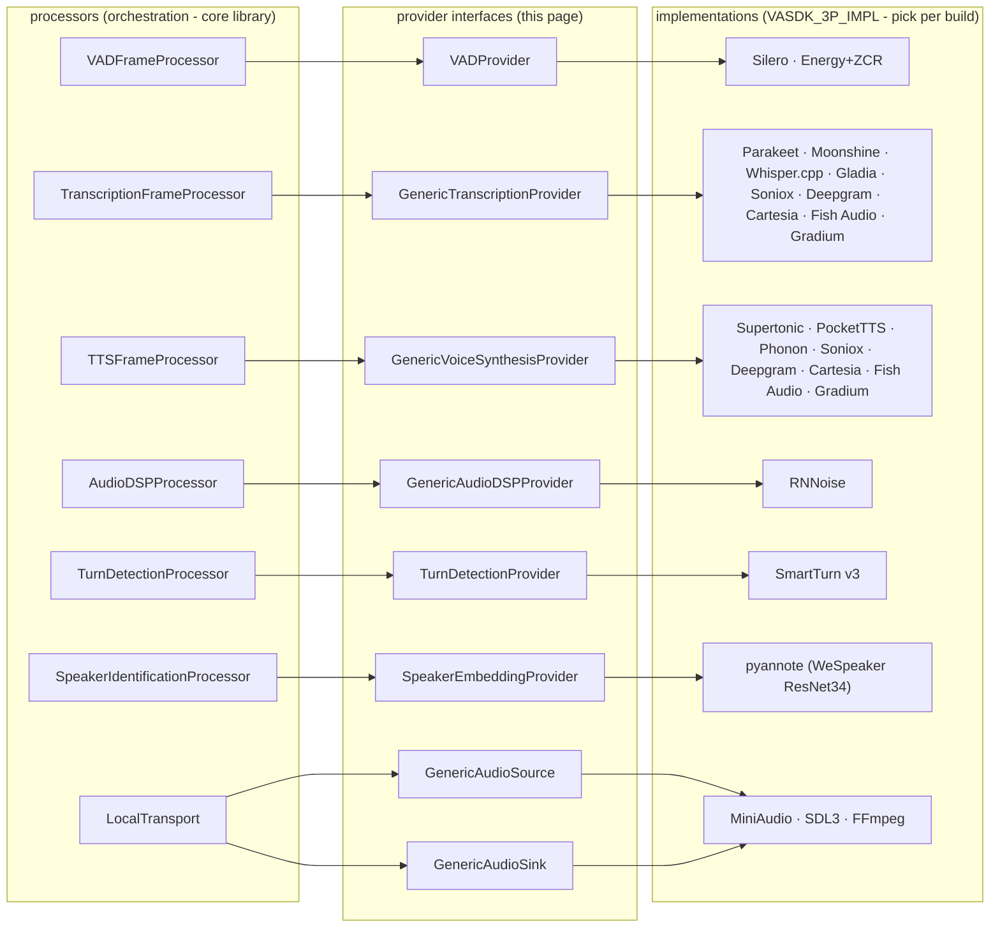

# Provider interfaces

*Reference for every provider (backend) interface in the core library. Headers under [`VASDK/include/VASDK/`](../../VASDK/include/VASDK/) are the source of truth if this page and the code ever disagree.*

A **provider** is the swappable engine behind a pipeline stage: the thing that actually detects speech, transcribes it, synthesizes a voice, or runs the model. Processors orchestrate; providers compute. Every provider interface is a plain abstract C++ class - implement it, hand it to the matching processor, and the rest of the pipeline neither knows nor cares what's behind it.



Sources, GitHub links, and licenses for every implementation: [root README, "Provider sources and licenses"](../../README.md#provider-sources-and-licenses).

Common conventions across all provider interfaces:

- **`AudioConfig`** (`CommonAudioUtils.h`) describes the audio format everywhere: `sampleRate`, `format` (`BYTE`/`SHORT`/`INT`/`FLOAT`), `channels`; `getSampleSizeInBytes()` = size of one sample × channels. Providers receive it at initialization and must handle (or reject) what they're given.
- **Buffers are raw `char*` bytes** in the configured format; offsets and lengths are in **samples**, not bytes, unless a parameter says otherwise.
- **Async providers report through listener interfaces** (STT, TTS) fired from the provider's own thread - implementations must make their listener calls thread-safe from the consumer's perspective, and consumers must not block inside a callback.
- **Optional capabilities default to safe no-ops** (`clearAudioBuffer()`, `cancelSynthesis()`, `waitForData()`, …). You can implement a provider incrementally: the pure-virtual core first, the quality-of-life overrides when you need them. New optional methods are added in this style specifically so existing providers keep compiling - expect the interfaces to grow this way.

---

## Audio I/O

### GenericAudioSource

([`GenericAudioSource.h`](../../VASDK/include/VASDK/GenericAudioSource.h)) Where microphone (or file) audio comes from. Consumed by `LocalTransport`'s capture thread.

| Member | Contract |
| --- | --- |
| `initializeAudioSource(config)` / `releaseAudioSource()` | Acquire/free the device. |
| `startAudioSource()` / `stopAudioSource()` / `isAudioSourceStarted()` | Begin/end capture. |
| `isAudioSourceReady()` | Device usable? |
| `readAudio(buffer, offset, length)` | Fill `buffer` (offset/length in **samples**); return samples read, `-1` on error. |
| `getAvailableAudioSamples()` | Samples ready to read; `-1` = streaming/unknown (default). |
| `waitForData(timeoutMs)` *(optional)* | Block until data is available. Default returns `true` immediately (polling-compatible); override with a condition variable to eliminate capture-thread sleeps and dropped frames under CPU load. |

### GenericAudioSink

([`GenericAudioSink.h`](../../VASDK/include/VASDK/GenericAudioSink.h)) Where playback audio goes. The barge-in-related members are what distinguish a good implementation:

| Member | Contract |
| --- | --- |
| `initializeAudioSink(config)` / `releaseAudioSink()` / `startAudioSink()` / `stopAudioSink()` / `isAudioSinkStarted()` / `isAudioSinkReady()` | Lifecycle, mirroring the source. |
| `writeAudio(buffer, offset, length)` | Queue samples for playback; return samples written, `-1` on error. |
| `getPendingAudioBytes()` *(optional)* | Bytes queued but not yet played (default 0). Used by drain logic to know when playback truly finished. |
| `flushAudio()` *(optional)* | Instantly discard queued audio (barge-in). |
| `fadeAndFlush()` *(optional)* | Ramp down then discard - prevents the audible click of a hard cut. Default falls back to `flushAudio()`. |
| `setPlaybackCallback(cb)` *(optional)* | Fired per block actually sent to hardware; for playback-synchronized visualization. |

---

## VADProvider

([`VADProvider.h`](../../VASDK/include/VASDK/VADProvider.h)) Answers one question per audio block: *where is speech in this buffer?* Stateless from the caller's perspective.

```cpp
struct VADResult { size_t offset; size_t length; float confidence; }; // samples, samples, 0–1

virtual bool initialize(const AudioConfig&, int bufferSize) = 0;
virtual void release() = 0;
virtual std::vector<VADResult> detectVoiceActivity(const char* buffer,
                                                   size_t offset, size_t numSamples) const = 0;
```

Return one `VADResult` per detected speech region (empty vector = silence). All the temporal logic - debouncing, hesitation vs. end-of-utterance, lookback - belongs to `VADFrameProcessor`, **not** the provider; keep implementations pure per-buffer classifiers. Implementations: Silero (ONNX), Energy+ZCR (no ML, embedded-friendly).

## GenericTranscriptionProvider

([`GenericTranscriptionProvider.h`](../../VASDK/include/VASDK/GenericTranscriptionProvider.h)) Speech-to-text. The largest interface, because it supports both streaming and batch models behind one contract.

**Results** arrive via `TranscriptionResultListener` (set with `setTranscriptionResultListener()`): `onTranscriptionStarted/Stopped`, `onPartialTranscription`, `onFinalTranscription`, `onTranscriptionError`. A `TranscriptionResult` carries text + confidence + segment timing, optional word-level detail (per-word timing/confidence/alternatives), and `languageTags` for detected languages, ordered by first appearance - multiple tags mean code-switching.

**Two feeding modes** - implement whichever fits the model, or both:

| Mode | Method | Fits |
| --- | --- | --- |
| Streaming | `writeAudioData(data, size)` - buffer continuously, emit partials/finals via listener | Cloud STT (Gladia, Soniox, Deepgram, Cartesia, Gradium), models with internal endpointing |
| Batch | `writeFullAudioData(data, size)` - one complete VAD-segmented utterance in, one `TranscriptionResult` back | Local encoder-decoder models (Parakeet, Moonshine, Whisper), REST-only cloud STT (Fish Audio) |

`writeFullAudioData` **throws by default** - a provider that doesn't override it is streaming-only, and `TranscriptionFrameProcessor` must run with `setStreamingMode(true)`.

| Optional member | Purpose |
| --- | --- |
| `commitEndOfSpeech()` | VAD says the utterance ended - finalize buffered audio now instead of waiting for an idle timeout. |
| `clearAudioBuffer()` | Barge-in: discard in-progress audio (it may contain the assistant's own voice as echo). Keep prior-turn context at your discretion. |
| `setTimingObserver(observer)` | Report per-stage inference latency (e.g. `"encoder"`, `"decoder"`) into the metrics system. |

Plus lifecycle (`initializeTranscriptionProvider`, `start/stopTranscriptionProvider`, `isTranscriptionProviderRunning`, `releaseTranscriptionProvider`) and audio config get/set.

## GenericVoiceSynthesisProvider

([`GenericVoiceSynthesisProvider.h`](../../VASDK/include/VASDK/GenericVoiceSynthesisProvider.h)) Text-to-speech. Audio streams back through `VoiceSynthesisResultListener::onAudioDataReceived(data, size)` chunk by chunk, bracketed by `onSynthesisStarted`/`onSynthesisCompleted` (or `onSynthesisError`).

```cpp
virtual bool synthesizeSpeech(const std::string& text) = 0;
virtual void cancelSynthesis() {}   // optional but important - see below
```

The **`cancelSynthesis()` contract** is what makes barge-in work: it must be non-blocking, stop audio emission promptly, and still fire `onSynthesisCompleted()` (or `onSynthesisError()`) once cancellation is confirmed - that completion is what lets `TTSFrameProcessor` emit `SynthesisStateFrame{INTERRUPTED}` upstream and unblock the agent state machine. A provider that can't cancel leaves the assistant talking over the user.

Implementations: Supertonic and PocketTTS (local ONNX), Phonon (local GGUF on ggml), Soniox, Deepgram, Cartesia, Fish Audio, and Gradium (cloud).

## GenericAudioDSPProvider

([`GenericAudioDSPProvider.h`](../../VASDK/include/VASDK/GenericAudioDSPProvider.h)) In-line audio processing - noise suppression, echo cancellation, dynamic-range compression. The simplest provider interface:

```cpp
virtual std::string getName() const = 0;                        // e.g. "RNNoise"
virtual bool initialize(const AudioConfig&) = 0;
virtual void release() = 0;
virtual size_t processAudio(const char* input, char* output, size_t numSamples) = 0;
```

`processAudio` must write exactly `numSamples` samples of output in the same format as the input - the caller (`AudioDSPProcessor`) advances the clean ring buffer in lock-step with the raw one, so a provider that changes the sample count would desynchronize every downstream offset. Any internal format conversion (e.g. RNNoise wanting floats from 16-bit PCM) is the implementation's job, both directions.

## TurnDetectionProvider

([`TurnDetectionProvider.h`](../../VASDK/include/VASDK/TurnDetectionProvider.h)) Decides when a conversational turn starts or ends - the difference between "the audio went quiet" and "they're done talking; answer now."

```cpp
struct TurnEvaluation {
    Decision decision;    // NONE | TURN_START | TURN_END
    float    confidence;  // 0–1
    transport::TurnStateFrame::TurnActor actor;  // USER | SYSTEM
    transport::TurnStateFrame::TurnType  type;   // NORMAL | INTERRUPT | OVERLAP
};

virtual TurnEvaluation evaluate(const std::shared_ptr<transport::Frame> frame,
                                bool agentIsSpeaking) = 0;
```

`evaluate()` is called per frame (VAD state frames and others); return `NONE` to stay silent, or a `TURN_START`/`TURN_END` decision and `TurnDetectionProcessor` emits the corresponding `TurnStateFrame`. `agentIsSpeaking` is how you classify `INTERRUPT` (user barged in over TTS) vs `NORMAL`. The built-in fallback (no provider) maps VAD `STARTING`→start, `ENDED`→end at VAD confidence; the SmartTurn v3 implementation in `VASDK_3P_IMPL` adds a semantic end-of-turn model, thresholds, rolling averages, and minimum-duration suppression.

## SpeakerEmbeddingProvider

([`SpeakerEmbeddingProvider.h`](../../VASDK/include/VASDK/SpeakerEmbeddingProvider.h)) Turns one utterance into a fixed-size voice print. Enrollment and matching (cosine similarity) live in `SpeakerIdentificationProcessor`, so a provider only wraps the model.

```cpp
virtual std::vector<float> computeEmbedding(const float* samples, size_t numSamples) = 0;  // mono, [-1, 1]
AudioConfig getAudioConfig() const;  // format of the pipeline audio, set by the implementation's initialize()
```

Return an empty vector on failure. The `PyannoteSpeaker` implementation in `VASDK_3P_IMPL` (`-DVASDK_BUILD_PYANNOTE_SPEAKER=ON`) runs the embedding model of [pyannote/speaker-diarization-3.1](https://huggingface.co/pyannote/speaker-diarization-3.1) (WeSpeaker ResNet34-LM, ONNX export downloaded at configure time) with a Kaldi fbank front end matched to torchaudio; it needs 16 kHz mono.

---

## Writing a new provider: the checklist

1. **Pick the interface** above and implement the pure-virtual core. Leave the optional overrides for later - the defaults are safe.
2. **Respect `AudioConfig`.** Validate what you're given at initialize time and fail loudly (return `false`) rather than misinterpreting the byte stream.
3. **Own your threads.** If your engine is async, results go out through the listener from your thread - document that, don't block in callbacks, and make `stop*()` join cleanly.
4. **Make it a separate CMake target** under `VASDK_3P_IMPL/` linking against `VASDK`, guarded by a `VASDK_HAS_<NAME>` option, so apps opt in per build like every existing provider. Model files, if any, get a `Download<Name>Model.cmake` script and a `VASDK_DOWNLOAD_*` switch.
5. **Record the license.** Add the implementation and its model(s) to [THIRD_PARTY_NOTICES.md](../../THIRD_PARTY_NOTICES.md) and the root README's provider table.
6. **Test without hardware** using [`MockTransport`](transports.md#mocktransport) to inject `AudioFrame`s / assert on emitted frames - see [testing-with-mock-transport.md](../examples/testing-with-mock-transport.md).
