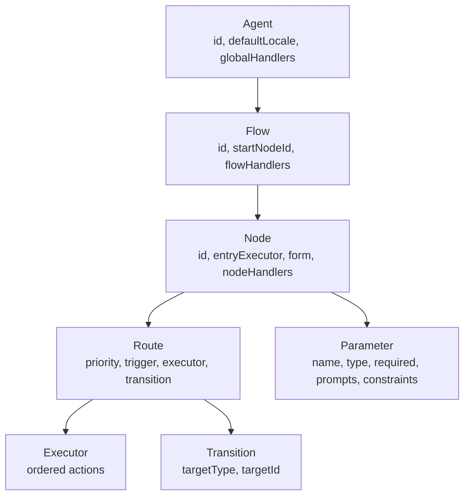
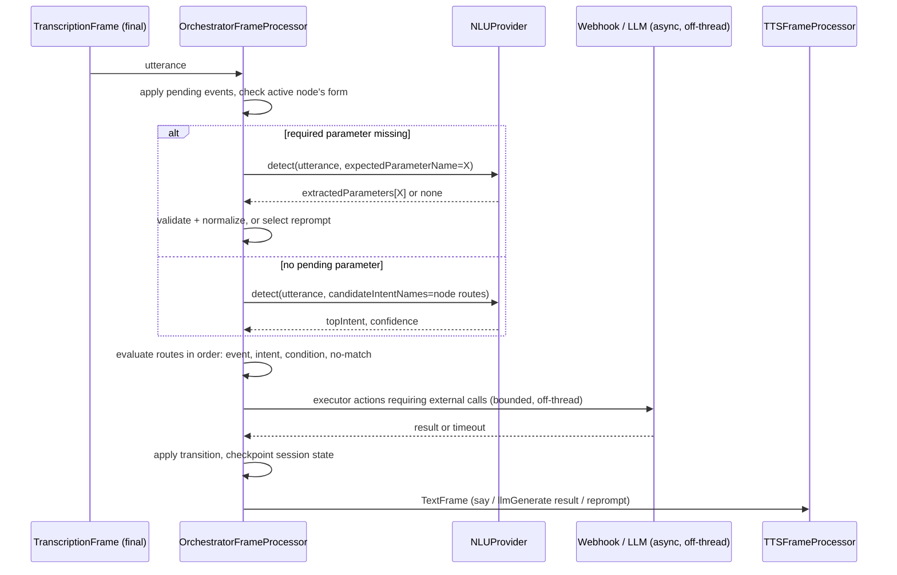

# RequestFlow: Conversation Orchestrator Spec

Reference target: RequestFlow, a deterministic, NLU-first flow/node/route orchestration layer for VASDK that is frame-native to the existing pipeline.

Status: **Draft v2.3** - event parameters and explicit multi-turn control, layered on Draft v2.2's cross-vertical extensions (proactive/scheduled triggers, multi-intent co-firing, mid-task interrupts, a minimal permission gate, shared/context CEL state, offline-resilient webhooks), themselves layered on the Draft v2.1 protobuf/textproto foundation; the v2.1 domain model and mechanism are otherwise unchanged. See [§0](#0-what-changed-from-draft-v1)/[§0.1](#01-what-changed-in-draft-v21)/[§0.2](#02-what-changed-in-draft-v22) for prior history and [§0.3](#03-what-changed-in-draft-v23) for this revision. `goal/` is untouched by this document: it keeps working as-is for the existing call center showcase, and this spec introduces a new, independent module rather than extending or migrating it. See [§3](#3-relationship-to-existing-vasdk-components) and [§17](#17-explicitly-out-of-scope-for-v1) for exactly what that means.

## 0. What changed from Draft v1

Draft v1 modeled the orchestrator as a superset of `goal/` (extend `GoalDefinition`, reuse `GoalManager`'s LLM-side-channel mechanism, add a migration adapter) and specified a full enterprise release surface (versioning, environment promotion, RBAC, audit trail, chaos testing) alongside it. Draft v2 changed both of those:

- **Mechanism**: the orchestrator is a real pipeline processor (`OrchestratorFrameProcessor`) that consumes `TranscriptionFrame`s and drives routing/prompts deterministically from config, using a new `NLUProvider` interface for intent/entity extraction. It does **not** require an LLM in the pipeline at all - the LLM becomes optional infrastructure, called out-of-band, only when a build actually wants LLM-backed NLU or generative fallback. This is closer to an NLU-first, node-based conversational architecture (NLU + deterministic nodes, LLM optional) than to `goal/`'s "LLM drives every turn, tools update state" model.
- **Scope**: versioning/environment promotion, RBAC, audit trail, and chaos testing were dropped for v1 (see [§17](#17-explicitly-out-of-scope-for-v1)). Runtime robustness was kept and, in two places, increased: a richer condition/expression language and resilient webhook execution with retry/circuit-breaker ([§9.2](#92-callwebhook-execution-model)).
- **No migration path in v1**: `goal/` and the call center showcase are unaffected. The orchestrator ships as a new, additive capability with its own tests, not a breaking change to anything that exists today.

## 0.1 What changed in Draft v2.1

Draft v2 authored the Agent/Flow/Node/Route config as freeform JSON, validated against a hand-maintained JSON Schema at load time ([§15](#15-rollout-plan) Phase 1). Draft v2.1 replaces that with a `.proto`-defined schema, authored as textproto:

- **Structural validation becomes mostly free.** A `.proto` message definition *is* the schema - wrong types, unknown fields, and malformed nesting are parser errors, not something a hand-written JSON Schema has to separately encode and keep in sync. What's left for the [§15](#15-rollout-plan) Phase 1 validator is genuinely semantic: referential integrity (do all `target_id`s resolve), reachability, and handler coverage - none of which any schema language expresses on its own.
- **The condition/expression language is now CEL** (Common Expression Language, [google/cel-spec](https://github.com/google/cel-spec)) instead of a hand-rolled JSON tree. Once conditions live inside a proto schema they'd need a nested `oneof` expression message to stay JSON-shaped - which just re-derives, badly, something Google already built specifically to evaluate safe, sandboxed expressions against a typed/protobuf environment. This also resolves Draft v2's open question about the expression language's growth path, and - a genuine side benefit - collapses the old "Phase 2: richer expression language" rollout milestone entirely, since CEL already has full arithmetic and string functions from day one.
- **A latent inconsistency got fixed along the way.** Draft v1 and v2 both listed `NO_MATCH`/`NO_INPUT` as `Route` trigger types, while *also* describing dedicated node/flow/global `EventHandlers` as the actual no-match/no-input fallback mechanism ([§6](#6-route-evaluation-semantics) step 3). Those were always the same mechanism described twice; a proto `oneof` can't quietly carry a redundant enum value the way a duck-typed JSON object could, so `Route.trigger` now only has three shapes - `intent`, `condition_cel`, `event` - and no-match/no-input live exclusively in `EventHandlers`, matching what §6 already specified.
- **New dependencies: `protobuf` and `cel-cpp`**, `FetchContent`-pulled like every other VASDK dependency, each behind its own concern in the build. This is a deliberate, scoped exception to VASDK's `nlohmann::json` convention (used throughout `goal/`, metrics, `ConditionEvaluator`) - confined to the orchestrator module's config, NLU boundary, and session persistence. Nothing outside `va::orchestrator` changes.
- Not everything becomes a proto message. `OrchestratorConfig` (in-process engine tuning, never serialized) and `SlotValidationResult` (an in-process validator return, never crosses a boundary) stay plain C++ structs - proto is reserved for things that are actually authored as a file, cross the `NLUProvider` boundary, or get persisted. `callWebhook`'s HTTP request/response bodies also stay plain JSON ([§9.2](#92-callwebhook-execution-model)) - forcing an integrator's own REST backend to speak protobuf would be a much bigger imposition than adopting it for VASDK's own config. See [§13](#13-public-api-surface-proposed-c) for the rest of where the line falls.

## 0.2 What changed in Draft v2.2

Draft v2.1 shipped a complete deterministic core assuming a single conversational vertical (call-center-style appointment booking) as its worked example. Reviewing the spec against three concrete deployment targets - an automotive infotainment/HVAC head unit, a field-deployed agricultural assistant, and a homelab hub replacing Alexa/Siri/Google Home - surfaced gaps that don't fit inside v2.1's domain model as-is. Draft v2.2 closes the ones worth specifying now and explicitly documents the ones worth deferring:

- **Proactive/scheduled triggers** ([§9.7](#97-external-and-scheduled-triggers)) - `OrchestratorFrameProcessor` now consumes `TriggerFrame` (the existing core-pipeline entry point for wake words, app commands, and scheduled events) instead of only `TranscriptionFrame`, so an external signal can drive a flow without a preceding user utterance.
- **Multi-intent co-firing** ([§6.1](#61-multi-intent-co-firing), [§5](#5-nluprovider-interface)) - `NLUResult` can report more than one independently-actionable intent per turn ("play some jazz and turn up the AC"), and route evaluation can fire more than one matching route in the same turn under an explicit conflict rule.
- **Interrupt intents / mid-task cancel** ([§6.2](#62-interrupt-intents-and-mid-task-cancel)) - resolves the Draft v2.1 [§18](#18-open-decisions) open item on `EventHandlers.user_cancel` having no trigger path; a small agent/flow/node-scoped intent set is now checked ahead of parameter extraction and generative-node input.
- **A minimal permission gate** ([§9.8](#98-permission-gate)) - `Route.required_role` plus a `speaker_id`/actor identity carried on `NLUContext`/`SessionSnapshot` ([§4](#4-domain-model)), deliberately scoped far below the RBAC surface [§17](#17-explicitly-out-of-scope-for-v1) still defers.
- **`context.*` and `shared.*` CEL namespaces** ([§8.1](#81-external-context-and-shared-state-namespaces)) - a read-only, app-pushed, per-turn-refreshed namespace for continuously-changing external facts (vehicle speed, time of day), and a small read/write namespace shared across independent `OrchestratorEngine` instances (whole-home state) - deliberately two mechanisms, not one; see §8.1 for why.
- **Offline-resilient `callWebhook`** ([§9.9](#99-offline-resilient-callwebhook-store-and-forward)) - an optional durable outbox for webhook calls that outlast §9.2's transient-failure retry/circuit-breaker model, for deployments with extended connectivity gaps.
- **An opt-in audit sink** ([§11.1](#111-audit-sink-for-consequential-actions)) - structured logging of consequential actions, scoped well below the audit-trail system [§17](#17-explicitly-out-of-scope-for-v1) still defers.
- **Single-file hot-reload** ([§13.1](#131-hot-reloading-a-running-agent)) - narrower than the versioning/environment-promotion system [§17](#17-explicitly-out-of-scope-for-v1) still defers.
- **Two items deliberately scoped down instead of built**: multi-locale in-session switching (documented as "one `Agent` config per locale" instead, [§4](#4-domain-model)) and multimodal input (documented as an application-layer `customTool` argument instead of a new `Frame` type, [§17](#17-explicitly-out-of-scope-for-v1)) - both tracked as open decisions ([§18](#18-open-decisions)) rather than built speculatively.

None of this changes the v2.1 domain model's existing fields or removes any mechanism; every addition is either a new optional field, a new message, or a new subsection.

One naming change accompanies this revision: **`Fulfillment` is renamed to `Executor`** throughout - `Node.entry_executor`, `Route.executor`, every `EventHandlers` member, and all prose - because "Fulfillment" was Draft v2.1's inherited term from Dialogflow CX's identically-named concept, and RequestFlow's vocabulary is meant to stand on its own rather than read as a CX rewrite. This is a rename only: field numbers, semantics, and every mechanism described above and below are unchanged.

## 0.3 What changed in Draft v2.3

Two more gaps surfaced from continued review, both about how information carries across a turn boundary:

- **Event parameters and a unified `event.*` namespace** ([§8.2](#82-the-event-namespace)) - `EmitEventAction` now carries a `params` payload, and every event the engine can raise - author-defined, or the built-in `webhook_error`/`webhook_deferred`/`permission_denied`/`generative_exit`/`no_match`/`no_input` - exposes it the same way to whatever route or `EventHandlers` fallback ultimately handles it. Draft v2.2's `trigger.*` namespace ([§9.7](#97-external-and-scheduled-triggers)) turns out to be a special case of this rather than something separate, and is folded into it.
- **Explicit, enumerable turn-spanning** ([§9.5](#95-expect-and-inline-slot-elicitation)) - `ExpectAction.parameter` can now be left unset for a bare turn-wait (wait for a reply without extracting a typed value), and `OrchestratorConfigLoader::validate()` flags a node that can complete without transitioning, emitting an event, or invoking one of the three turn-spanning mechanisms as a load-time dead end rather than a silent runtime hang. This also resolves the [§18](#18-open-decisions) question of a `generative_exit_reason` signal, since `generative_exit` now carries one as an ordinary event param.

Both are additive: `EmitEventAction.params` and `ExpectAction.no_input_timeout_ms` are new fields with safe empty/zero defaults, so no Draft v2.2 config needs to change.

## 1. Purpose and Scope

Define RequestFlow, a conversational orchestration system for VASDK: deterministic multi-turn task completion driven by an explicit flow/node/route graph, with probabilistic language understanding confined to well-defined extension points (NLU, optional generative fallback).

Primary goals:

- Move from intent-only, LLM-driven routing to explicit, deterministic, config-driven flow control that runs the same way every time given the same inputs.
- Let a build run entirely without an LLM: canned prompts, rule- or embedding-based NLU, deterministic routes.
- Keep validation and business actions deterministic in C++, evaluated in well under a turn's audio round-trip.
- Preserve VASDK's low-latency, frame-priority, barge-in-capable pipeline model - the orchestrator is a citizen of that pipeline, not a side-channel bolted onto the LLM stack.

Out of scope for v1 (see [§17](#17-explicitly-out-of-scope-for-v1) for the full list and rationale): versioning/environment promotion, RBAC/security hardening, audit trail, chaos testing, multi-session pooling, a graphical flow editor, cross-locale auto-translation, and any migration path off `goal/`.

## 2. Design Principles

- **Deterministic orchestration, probabilistic language understanding** - the LLM (if present at all) never decides what state the conversation is in; it only ever contributes an NLU classification or a piece of generated text that the orchestrator's deterministic logic consumes.
- **LLM-optional by construction** - a pipeline with no `LLMProcessor`, no `ToolDispatchProcessor`, and a rule-based `NLUProvider` is a fully supported, first-class deployment shape, not a degraded one.
- **Config-driven with strict validation** - flows are authored as data (textproto, against a `.proto` schema), with structural validation coming from the schema itself and semantic validation (referential integrity, reachability, handler coverage) run offline before a session ever loads a config.
- **Never block a processor thread on an external call** - webhook calls and any LLM-fallback calls run off-thread with hard timeouts; the pipeline never stalls behind a slow HTTP endpoint or model.
- **Reuse the pipeline's own recovery and instrumentation** - failures surface as `ErrorFrame` upstream (so the existing `RecoveryProcessor` catches them from one insertion point) and every processor's built-in latency/queue metrics apply automatically; no parallel error or metrics system.

## 3. Relationship to Existing VASDK Components

Reused as-is:

- `Frame` / `FrameProcessor` / `Pipeline` - the orchestrator is one more processor in the chain, nothing about the core needs to change.
- `TranscriptionFrame`, `TurnStateFrame`, `TextFrame`, `SynthesisStateFrame`, `ControlFrame::INTERRUPT`, `ErrorFrame` - existing frame types cover everything the orchestrator needs to consume and emit.
- `HttpInterface` / `CurlHttpProvider` (`network/`) - the transport `CallWebhookAction`'s executor calls through.
- `MetricsCollector` / `CallMetrics` (`metrics/`) - the sink for orchestrator-specific per-turn metrics ([§11](#11-observability)).
- The provider pattern itself (pure-virtual core + optional overrides, one CMake target per implementation) - `NLUProvider` follows the exact same shape as `VADProvider`/`TurnDetectionProvider`.
- The slot type/validation semantics from `goal/`'s `GoalSlot` (phone/email/date/enum/object/composite normalization, `condition`/`validator` escape hatches) - the logic is proven and generic, so it is ported into the new `Parameter` model rather than redesigned ([§7](#7-parameter-model-and-collection-policy)).
- The deterministic-simulator pattern from `GoalConversationSimulator` - same idea, new engine ([§12](#12-testing-strategy)).
- The three-method persistence contract from `GoalStatePersistence` (`save`/`load`/`clear`) and its dev-grade file-based implementation ([§10](#10-session-state-and-persistence)).
- The `fromFile`/`fromDirectory` split from `GoalDefinitionLoader` - `OrchestratorConfigLoader` mirrors it exactly so each vertical's flow can be authored, reviewed, and owned as its own file ([§13](#13-public-api-surface-proposed-c), [§14.1](#141-splitting-config-across-files)).

New to this module, not used elsewhere in VASDK:

- **`protobuf`** - schema and serialization for config, NLU results, and session snapshots ([§4](#4-domain-model), [§5](#5-nluprovider-interface), [§10](#10-session-state-and-persistence)).
- **`cel-cpp`** - the [§8](#8-condition--expression-language) expression evaluator for route conditions and computed parameter values.

Both are `FetchContent`-pulled and gated behind the orchestrator module's own CMake option, following the same one-target-per-dependency convention as every existing provider. Nothing outside `va::orchestrator` needs either.

Explicitly **not** reused or extended:

- `GoalManager`, `GoalState`, `IntentRouter` - the orchestrator does not wrap or attach to these. It is a standalone `va::orchestrator` module.
- `goal/`'s side-channel mechanism (registering prompt template variables and tools directly on `LLMTransport`/`ToolDispatchProcessor` so the LLM drives every turn) - the orchestrator drives turns itself; an LLM, if configured, is called *by* the orchestrator, not the other way around.

`goal/` and the call center showcase keep working unchanged. Whether `goal/` is deprecated later, coexists indefinitely for different use cases, or gets a migration path is an open decision ([§18](#18-open-decisions)), not something v1 decides.

## 4. Domain Model



The domain model *is* a `.proto` schema - not a prose field list validated separately, as Draft v2 had it:

```proto
syntax = "proto3";
package va.orchestrator;

import "google/protobuf/struct.proto";
import "google/protobuf/wrappers.proto";

message Agent {
  string id = 1;
  string display_name = 2;
  string default_locale = 3;   // one Agent config per locale is the supported multi-locale pattern - see §18
  repeated Flow flows = 4;
  EventHandlers global_handlers = 5;
  repeated string interrupt_intent_names = 6;   // §6.2 - checked ahead of parameter extraction and generative-node input, agent-wide
}

message Flow {
  string id = 1;
  string display_name = 2;
  string description = 3;
  string start_node_id = 4;
  repeated Node nodes = 5;
  EventHandlers flow_handlers = 6;
  repeated string interrupt_intent_names = 7;   // §6.2 - merged with Agent's list while this flow is active
}

// The actual no-match/no-input/webhook-error/user-cancel fallback mechanism -
// see the §0.1 note on why these are not Route trigger types.
message EventHandlers {
  Executor no_match = 1;
  Executor no_input = 2;
  Executor webhook_error = 3;
  Executor user_cancel = 4;
  Executor permission_denied = 5;   // §9.8 - a required_role check failed
  Executor webhook_deferred = 6;    // §9.9 - queued for offline replay rather than failed outright
}

message Node {
  string id = 1;
  string display_name = 2;
  Executor entry_executor = 3;
  repeated Parameter form = 4;
  repeated Route routes = 5;
  EventHandlers node_handlers = 6;
  bool generative = 7;
  GenerativeConfig generative_config = 8;   // required when generative is true
  repeated string interrupt_intent_names = 9;   // §6.2 - merged with Agent's/Flow's list while this node is active
  bool accepts_ambient_triggers = 10;           // §9.7 - true => a TriggerFrame-originated event evaluates against this node directly instead of redirecting to the flow's start_node_id
}

// The LLM-tool-loop escape hatch - see §9.4 for runtime mechanics, §21 for a worked example.
message GenerativeConfig {
  string system_prompt_template = 1;   // templated like `say` text, e.g. "{current_volume}"
  message ToolRef {
    string name = 1;
    bool terminal = 2;                 // calling this tool ends the loop
  }
  repeated ToolRef tools = 2;          // the *only* customTool handlers exposed to the LLM for this node
  int32 max_turns = 3;                 // 0 => use OrchestratorConfig::defaultGenerativeMaxTurns
  string exit_event = 4;               // defaults to "generative_exit" if empty
}

message Route {
  string id = 1;
  int32 priority = 2;                  // lower evaluates earlier
  Trigger trigger = 3;
  Executor executor = 4;
  Transition transition = 5;
  google.protobuf.BoolValue stop_evaluation = 6;   // unset => true; see the proto3-default note below
  string required_role = 7;            // §9.8 - empty = no permission check; checked against the turn's actor before this route fires
  bool co_fireable = 8;                // §6.1 - true => may fire alongside another matched route in the same turn if it carries no transition
}

message Trigger {
  oneof kind {
    IntentTrigger intent = 1;
    string condition_cel = 2;          // a CEL expression, compiled once at load time - see §8
    EventTrigger event = 3;
  }
}

message IntentTrigger { string intent_name = 1; float min_confidence = 2; }
message EventTrigger  { string name = 1; }

message Parameter {
  enum Type {
    STRING = 0; PHONE = 1; EMAIL = 2; DATE = 3; TIME = 4; DATETIME = 5;
    NUMBER = 6; INTEGER = 7; BOOLEAN = 8; ENUM = 9; OBJECT = 10; COMPOSITE = 11;
  }
  string name = 1;
  Type type = 2;
  bool required = 3;
  Prompts prompts = 4;
  google.protobuf.Struct constraints = 5;   // shape depends on `type` - see §7
  string condition_cel = 6;                 // optional; empty = always required
  string validator_ref = 7;                 // optional; names a C++ validator registered on the engine
  bool redact_in_logs = 8;
  int32 no_input_timeout_ms = 9;            // 0 => OrchestratorConfig::defaultNoInputTimeout; see §9.5
}

message Prompts {
  string initial = 1;
  repeated string reprompts = 2;
  string escalation = 3;
}

message Executor {
  repeated Action actions = 1;
}

message Action {
  oneof kind {
    SayAction say = 1;
    CallWebhookAction call_webhook = 2;
    SetParameterAction set_parameter = 3;
    ClearParameterAction clear_parameter = 4;
    EmitEventAction emit_event = 5;
    HandoffAction handoff = 6;
    CustomToolAction custom_tool = 7;
    LlmGenerateAction llm_generate = 8;
    ExpectAction expect = 9;
  }
}

message SayAction          { string text = 1; }                        // "{parameter_name}" substitution
message SetParameterAction { string name = 1; string value_cel = 2; }  // CEL, evaluated against session parameters
message ClearParameterAction { string name = 1; }
message EmitEventAction    { string name = 1; google.protobuf.Struct params = 2; }   // §8.2 - surfaced to whatever handles this event via event.*
message HandoffAction      { string reason = 1; }
message LlmGenerateAction  { string prompt_template = 1; }
message CustomToolAction {
  string tool = 1;
  map<string, string> args_cel = 2;   // each value is a CEL expression, evaluated before the tool handler runs
}
message CallWebhookAction {
  string url = 1;
  string method = 2;        // default POST
  int32 timeout_ms = 3;     // 0 => use OrchestratorConfig::webhookTimeout
}
message ExpectAction {
  Parameter parameter = 1;        // ephemeral - same shape as a form Parameter, never added to Node.form. Unset => a bare turn-wait, see §9.5
  bool transient = 2;             // true => cleared from session parameters once the route consuming it finishes evaluating. Meaningless when parameter is unset.
  int32 no_input_timeout_ms = 3;  // used only when parameter is unset; when parameter is set, Parameter.no_input_timeout_ms takes precedence (unchanged from Draft v2.1)
}

message Transition {
  enum TargetType { NODE = 0; FLOW = 1; END_SESSION = 2; NONE = 3; }
  TargetType target_type = 1;
  string target_id = 2;
  google.protobuf.BoolValue preserve_parameters = 3;   // unset => true; see the proto3-default note below
}
```

Three things worth flagging about the schema itself, not just what it models:

- **The `Trigger` oneof replaces Draft v2's separate `triggerType` enum entirely.** There's no longer a way to set the discriminant to `CONDITION` while accidentally filling in `trigger.event` - the schema doesn't allow it, where a duck-typed JSON object could carry exactly that bug silently.
- **`google.protobuf.BoolValue`, not bare `bool`, for `stop_evaluation` and `preserve_parameters`.** Both fields want a default of `true` when the author leaves them unset - but a proto3 bare `bool` always defaults to `false` and can't distinguish "unset" from "explicitly false." The wrapper type lets the loader ask `has_stop_evaluation()` / `has_preserve_parameters()` and apply `true` only when the author genuinely left it out.
- **`required_role` and `co_fireable` are additive, zero-value-safe fields ([§9.8](#98-permission-gate), [§6.1](#61-multi-intent-co-firing)).** An empty `required_role` (the default) means no permission check, and `co_fireable = false` (the default) means a route never fires alongside another - every Draft v2.1 config parses and behaves identically under Draft v2.2 with no author changes required.

`CustomToolAction.args_cel` and `SetParameterAction.value_cel` are both CEL expression strings for the same reason: executor actions need to reference values computed earlier in the same turn (like a `target_volume` set two actions ago - see [§21](#21-worked-example-nlu-only-vs-a-generative-node)), and CEL is already the evaluator on hand, so no separate templating mechanism was worth introducing for one field. `say.text` keeps its own lightweight `{parameter_name}` substitution instead of CEL, deliberately - it's prose with occasional variable interpolation, not a single-value computation, and CEL doesn't have a template-string feature that fits that job well.

### Session State

Also a proto message, since it crosses the [§10](#10-session-state-and-persistence) persistence boundary:

```proto
message SessionSnapshot {
  string session_id = 1;
  string active_flow_id = 2;
  string active_node_id = 3;
  map<string, google.protobuf.Value> parameters = 4;
  map<string, ParameterMeta> parameter_meta = 5;
  repeated string route_history = 6;      // bounded ring buffer, oldest-evicted at load/save time
  map<string, int32> event_counters = 7;
  PendingAsk pending_ask = 8;              // set by an ExpectAction, see §9.5 - replaces the old awaiting_confirmation/confirmation_attempts fields, which were never wired to any described behavior
  int64 created_at_unix_ms = 10;
  int64 updated_at_unix_ms = 11;
  string active_speaker_id = 12;   // §9.8/§9.10 - last-known actor identity, persisted so a restored session still has it for permission checks
}

message ParameterMeta {
  int32 attempts = 1;
  string source = 2;    // "nlu" | "prefill" | "webhook_patch" | "expect" | ...
  int64 last_updated_unix_ms = 3;
}

message PendingAsk {
  Parameter parameter = 1;      // the ephemeral definition - not in any node's static form, so it has to travel with the snapshot. Absent for a bare turn-wait, see §9.5
  int32 attempts = 2;
  bool transient = 3;
  string origin_route_id = 4;   // which route's `expect` armed this - debugging/metrics only
}
```

## 5. NLUProvider Interface

New provider interface, same shape as every other provider in the core library: pure-virtual core, optional overrides, one CMake target per implementation, no ML framework dependency forced on anyone who doesn't build that target.

```proto
message NLUContext {
  string locale = 1;
  string active_flow_id = 2;
  string active_node_id = 3;
  optional string expected_parameter_name = 4;   // set during slot-filling
  repeated string candidate_intent_names = 5;    // from the active node's intent routes
  repeated string interrupt_intent_names = 6;    // §6.2 - the merged agent/flow/node interrupt set, checked first
  optional string speaker_id = 7;                // §9.8/§9.10 - app-supplied actor identity, opaque to the provider, passed through for CEL/permission use
}

message RankedIntent { string name = 1; float confidence = 2; }

message NLUResult {
  string top_intent = 1;      // empty string = no intent match
  float confidence = 2;
  repeated RankedIntent ranked_intents = 3;
  map<string, google.protobuf.Value> extracted_parameters = 4;
  google.protobuf.Struct raw_metadata = 5;
  repeated RankedIntent co_intents = 6;   // §6.1 - additional independently-actionable intents beyond top_intent, each already above its own route's min_confidence
}
```

```cpp
namespace va {

class NLUProvider {
public:
    virtual ~NLUProvider() = default;
    virtual bool initialize(const google::protobuf::Struct& config) = 0;
    virtual void release() = 0;
    virtual va::orchestrator::NLUResult detect(const std::string& utterance,
                                                const va::orchestrator::NLUContext& context) = 0;
    virtual void setCandidateIntents(const std::vector<std::string>& names) {}  // optional: restrict/hint classification scope
};

}  // namespace va
```

v1 ships **two** implementations:

- An LLM-tool-backed `NLUProvider` that sends the utterance plus `candidate_intent_names` to a configured `LLMTransport` as a structured classification call (not a free-form chat turn) and parses the result into `NLUResult`. This is the only place an LLM enters a default v1 build, and only if the app actually wants LLM-backed NLU instead of a deterministic one.
- `TrainingPhraseNLUProvider` - a fully local, pattern-matching implementation with no model and no network call, compiled from curated example utterances ([§22](#22-nlu-training-data)). This is the concrete instance of "LLM-optional by construction" ([§2](#2-design-principles)), not just a hypothetical rule-based option.

Both read the same training data ([§22.2](#222-two-consumers-one-file-format)), so nothing in the interface assumes an LLM and a third, embedding-based implementation later is a natural extension.

`detect()` is also how parameter values get extracted from free text during slot-filling: `context.expected_parameter_name` tells the provider what it's being asked to extract, and a hit lands in `extracted_parameters[name]` for the orchestrator to validate against that `Parameter`'s type ([§7](#7-parameter-model-and-collection-policy)).

Draft v2.2 asks more of `detect()` on every call, not just during slot-filling: `context.interrupt_intent_names` ([§6.2](#62-interrupt-intents-and-mid-task-cancel)) is always populated, and a provider is expected to check it first, regardless of what else the call is for. When the call is a plain intent-classification call (no `expected_parameter_name`), a provider may also populate `NLUResult.co_intents` ([§6.1](#61-multi-intent-co-firing)) with any additional intents it's confident enough to consider independently actionable - `TrainingPhraseNLUProvider` does this by running its phrase matcher against the remainder of the utterance after the top match's span is consumed (splitting on conjunctions is the common case); the LLM-backed provider does it by asking its classification prompt to return a list instead of a single label. Neither implementation is required to populate `co_intents` - an empty list is exactly Draft v2.1's behavior.

## 6. Route Evaluation Semantics

Runs inside `OrchestratorFrameProcessor::processFrame()` on every finalized `TranscriptionFrame` (and on internally re-entered turns from `emitEvent`):



If the active node has `generative: true`, none of the following applies - see [§9.4](#94-generative-nodes) instead. Everything below describes a deterministic node.

Per turn:

1. Apply any pending internally-emitted events from the previous step.
2. `NLUProvider.detect()` runs once, as in Draft v2.1, but `context.interrupt_intent_names` (the merged agent/flow/node set, [§6.2](#62-interrupt-intents-and-mid-task-cancel)) is now always populated alongside whatever else this step is asking for - `expected_parameter_name` when `pending_ask` is set ([§9.5](#95-expect-and-inline-slot-elicitation)) or the active node's `form` has a required, currently-unfilled parameter (per its `condition_cel`), or `candidate_intent_names` otherwise. A provider is expected to check the interrupt set first: if `NLUResult.top_intent` matches an entry in it, that wins regardless of what else the result contains, and evaluation skips straight to step 3 with it as the winning intent - no parameter is extracted or stored this turn. Otherwise, proceed exactly as in Draft v2.1: validate and store an extracted parameter value or select the next reprompt (this step does not consult routes) when a parameter was being asked for, or fall through to step 3 with the classification result - now possibly including `co_intents` ([§6.1](#61-multi-intent-co-firing)) - when an intent was being asked for.
3. Otherwise, evaluate routes in strict order: `event` routes first, then `intent` routes (including any `co_intents`, each evaluated against its own matching route - [§6.1](#61-multi-intent-co-firing)), then `condition` routes, then the node's no-match fallback (`EventHandlers.no_match`, falling back to the flow's, then the agent's).
4. Execute the matched route's `executor` actions in order, awaiting any async ones (bounded by `turnExternalCallBudget`, [§9.2](#92-callwebhook-execution-model)).
5. Apply the `transition`, if any.
6. Checkpoint session state and emit per-turn metrics.

The runtime also auto-emits a synthetic `node_enter` event the instant a node becomes active - on session start, or immediately after any transition into it, before waiting for user input. This is how a node's `entryExecutor` (a `say`) can be followed by an `event`-triggered route that acts immediately, with no utterance in between (see the `triage` flow in [§19](#19-worked-example-turn-by-turn-flow)).

Tie-break rules: first matching route wins when `stop_evaluation` is true (the default when unset); if false, evaluation continues and later matches can still fire. No match and no explicit no-match route runs the node/flow/agent default handler chain.

### 6.1 Multi-Intent Co-Firing

Draft v2.1's tie-break rule assumed exactly one route wins per turn. That's still the default - `co_fireable` defaults to `false` ([§4](#4-domain-model)) - but a single utterance can carry more than one independently-actionable request ("play some jazz and turn up the AC"), and forcing that through two separate turns is a worse experience than acting on both at once.

When `NLUResult.co_intents` ([§5](#5-nluprovider-interface)) is non-empty, step 3 of [§6](#6-route-evaluation-semantics) evaluates routes for `top_intent` exactly as in Draft v2.1, then separately evaluates routes for each `co_intent`, in the order `co_intents` lists them. A route only fires as part of co-firing if both its trigger matches and `Route.co_fireable` is `true` - an author has to opt each route in explicitly, since not every action makes sense fired twice in one turn or fired without exclusive control of the transition.

**The conflict rule:** at most one of the routes that fire this turn - whether the `top_intent` route or any co-fired route - may carry a non-empty `Transition`. If more than one matched route specifies a transition, that's a config error caught by `OrchestratorConfigLoader::validate()` ([§13](#13-public-api-surface-proposed-c)) at load time, not a runtime ambiguity: an author writing co-fireable routes is expected to give at most one of them a `Transition` and leave the rest executor-only (the "increase volume" and "raise the AC temperature" routes both just call their own `customTool` and stay on the current node).

Executor actions across co-fired routes execute in `co_intents` order, each route's `executor.actions` running to completion before the next route starts - the same in-order, non-blocking rules from [§9.1](#91-non-blocking-rule) apply per action, just across a slightly longer action list for that turn. Two co-fired routes writing the same session `parameter` is a last-write-wins race an author needs to design around (route order, or simply not aiming two co-fireable routes at the same parameter) - the engine does not detect or reject it.

This does not extend to `condition_cel` routes or `event` routes - only `intent` routes participate in co-firing, since `co_intents` is specifically the NLU layer's output.

### 6.2 Interrupt Intents and Mid-Task Cancel

Draft v2.1 left this as an open decision ([§18](#18-open-decisions)): step 2 of [§6](#6-route-evaluation-semantics) "does not consult routes," so nothing let an out-of-band utterance like "actually, cancel" preempt slot-filling, and `EventHandlers.user_cancel` had no described trigger path. Draft v2.2 resolves it.

`Agent.interrupt_intent_names`, `Flow.interrupt_intent_names`, and `Node.interrupt_intent_names` ([§4](#4-domain-model)) merge (agent ∪ active flow ∪ active node) into `NLUContext.interrupt_intent_names` on every `detect()` call, regardless of what else that call is doing - extracting a pending parameter, classifying an intent, or (see below) feeding a generative node's LLM loop. If `NLUResult.top_intent` matches an entry in that merged set, it takes priority over whatever step 2 was otherwise about to do with the result: no parameter is extracted or stored, and evaluation proceeds straight to step 3 treating the interrupt intent as the turn's winning intent. An author handles it with an ordinary `intent`-triggered `Route` on the node (or flow, or agent, via `EventHandlers`) - typically transitioning to `EventHandlers.user_cancel`'s executor, but nothing requires that; it's just a normal route like any other.

**Generative nodes.** [§9.4](#94-generative-nodes) step 2 already skips `NLUProvider` entirely, handing every utterance straight to the LLM - that's exactly the case an interrupt can't reach today without this mechanism. Draft v2.2 adds one `NLUProvider.detect()` call *ahead of* the LLM turn, scoped only to `interrupt_intent_names` (an empty `expected_parameter_name` and `candidate_intent_names` - the call exists purely to check the interrupt set). A match ends the generative loop immediately (as if `generativeConfig.exit_event` fired, [§9.4](#94-generative-nodes) step 4) and re-enters ordinary route evaluation at step 3 with the interrupt intent as the winner, without waiting for `maxTurns` or a `terminal` tool call. This is a deliberate, cheap classification gate ahead of the more expensive LLM call - "actually, cancel" during a multi-turn volume calibration ([§21.2](#212-generative-node-turn-it-up-until-it-sounds-right)) no longer depends on the LLM recognizing and acting on it itself.

**Scope, deliberately kept narrow.** `interrupt_intent_names` is a short, curated list an author maintains explicitly - it is not "any intent from anywhere in the agent." A large or careless interrupt set risks false-positive hijacking of ordinary slot-filling (a `DATE` parameter's answer containing the word "cancel" as part of an appointment reason, say); tuning that boundary is tracked as an open decision ([§18](#18-open-decisions)), not resolved by the mechanism itself.

## 7. Parameter Model and Collection Policy

Ported wholesale from `goal/`'s `GoalSlot` validation semantics, renamed to fit this module:

| Type | Validation / normalization |
| --- | --- |
| `STRING` | passed through |
| `PHONE` | normalized to `NXX-NXX-XXXX` (US) or `NXX-XXXX` |
| `EMAIL` | basic format check |
| `DATE` / `TIME` / `DATETIME` | ISO 8601 / `HH:MM`; a `mustBeFuture` constraint key is supported |
| `NUMBER` / `INTEGER` | optional `min`/`max` constraint keys |
| `BOOLEAN` | accepts yes/no/true/false/1/0 |
| `ENUM` | must match the `allowedValues` constraint list (case-insensitive); shown in the prompt |
| `OBJECT` | validated against an `objectSchema` constraint (a list of `{name, description, jsonType, required}`) |
| `COMPOSITE` | named sub-slots, filled one at a time via dot-path (`"vehicle.year"`) |

Same two escape hatches as `GoalSlot`: `condition_cel` (a CEL expression - only required when it evaluates true against live session state) and `validator_ref` (names a C++ validator registered on the engine, replaces built-in validation entirely; returns `SlotValidationResult{valid, normalizedValue, errorMessage}` - a plain C++ struct, not a proto message, since it's an in-process callback return that never crosses a serialization boundary).

`Parameter.constraints` is a `google.protobuf.Struct` rather than a typed sub-message, deliberately: the shape genuinely varies per `Parameter.Type` (`allowedValues` for `ENUM`, `min`/`max` for `NUMBER`, `objectSchema` for `OBJECT`, `mustBeFuture` for `DATE`), and giving every type its own message would mean a growing `oneof` for something that's fundamentally a small, per-type key/value bag. It's the one deliberate use of dynamic typing inside an otherwise fully static schema - whether it should eventually get a lightweight secondary schema of its own is tracked in [§18](#18-open-decisions).

Collection policy:

- Prompt order: `initial`, then `reprompts[0]`, `reprompts[1]`, ..., then `escalation` (default max 2 reprompts before escalation, configurable per-agent).
- Validation errors produce a machine-readable code plus a user-facing message (the message drives the reprompt).
- `COMPOSITE` parameters accept dot-path updates one sub-slot at a time; `OBJECT` parameters are validated whole against their schema before being accepted.

## 8. Condition / Expression Language

Route conditions (`Trigger.condition_cel`) and computed values (`SetParameterAction.value_cel`, `CustomToolAction.args_cel`) are [CEL](https://github.com/google/cel-spec) (Common Expression Language) expressions, evaluated against an activation built from session `parameters`, well-known context variables (`turnCount`, `repromptCount`, `sessionElapsedMs`, `speaker_id` - [§9.8](#98-permission-gate)), and - for the turn's winning route - `nlu.*` (that turn's `NLUResult.extracted_parameters`). Draft v2.2 added `context.*` and `shared.*` ([§8.1](#81-external-context-and-shared-state-namespaces)); Draft v2.3 adds `event.*` ([§8.2](#82-the-event-namespace)), available to whatever route or `EventHandlers` fallback a given event reaches.

Compilation happens once, at config-load time: the expression is parsed and type-checked against the declared environment, and a malformed expression fails offline validation, never evaluation - the same "compile once, throw on malformed input at load time" rule this spec already committed to for the JSON DSL it replaces.

```text
// Route.trigger.condition_cel
visit_reason == "urgent"

// SetParameterAction.value_cel - absolute increase
current_volume + nlu.amount

// SetParameterAction.value_cel - percent increase
current_volume + current_volume * (nlu.amount / 100.0)

// A richer route condition
party_size >= 5 && visit_reason.contains("urgent")

// Parameter presence, CEL's own idiom for "exists"
has(visit_reason)
```

CEL ships with `contains`/`startsWith`/`endsWith`/`size`, full arithmetic, and `&&`/`||`/`!`/`==`/`>=` as native operators - an earlier draft of this spec hand-rolled a JSON function table (`{"fn": "contains", "args": [...]}`) for exactly this, which disappears entirely once CEL is in place. It was reinventing something that already exists and already fits.

`cel-cpp`'s evaluator is sandboxed by construction - no side effects, no unbounded loops, a fixed standard library - so config authors get a real expression language without the orchestrator taking on an arbitrary-code-execution surface from webhook-supplied or LLM-influenced input.

### 8.1 External Context and Shared State Namespaces

Draft v2.1's CEL activation only ever saw session `parameters`, the well-known counters, and (for the winning route) `nlu.*`. Two more sources of external state matter enough across the automotive/agriculture/homelab scenarios to warrant their own namespaces - deliberately two, not one, because they have different write semantics.

**`context.*` - read-only, app-pushed, refreshed every turn.** `OrchestratorEngine::setContextProvider(std::function<google::protobuf::Struct()>)` ([§13](#13-public-api-surface-proposed-c)) is called once at the start of every turn, and its result is flattened into the `context.*` namespace for that turn's CEL evaluations - `context.vehicle_speed_kmh > 0`, `context.hour_of_day >= 22`. The orchestrator never writes to it; it exists purely so an app doesn't have to remember to call `setParameter` every turn just to keep continuously-changing facts (vehicle telemetry, time of day, equipment status) visible to route conditions. If the callback is unset, `context.*` resolves empty, same as an unset session parameter.

**`shared.*` - read/write, shared across independent `OrchestratorEngine` instances.** A deployment with multiple engines - one per vehicle zone, one per home-automation room - sometimes needs a small set of facts visible to all of them ("are all the lights off," "who's home"). `OrchestratorEngine::setSharedStateStore(std::shared_ptr<SharedStateStore>)` wires a small key/value interface:

```cpp
namespace va::orchestrator {

class SharedStateStore {
public:
    virtual ~SharedStateStore() = default;
    virtual std::optional<google::protobuf::Value> get(const std::string& key) = 0;
    virtual void set(const std::string& key, google::protobuf::Value value) = 0;
    virtual void subscribe(std::function<void(const std::string& key, const google::protobuf::Value&)> onChange) = 0;
};

}  // namespace va::orchestrator
```

`shared.*` reads flow into CEL the same way `context.*` does; writes only ever happen from a `customTool` handler calling `store.set(...)` directly (the same "state changes go through customTool, never through a route condition" discipline [§9.6](#96-the-customtool-contract) already establishes for `SessionState`) - there's no `SetParameterAction`-equivalent that targets `shared.*`. `subscribe()` exists so an app can wire cross-engine reactivity (a light switching off in one room updates `shared.all_lights_off` for every other room's engine) without polling; the orchestrator itself only ever reads the callback-delivered snapshot, it doesn't manage subscriptions on the CEL evaluator's behalf.

This is deliberately a small local (in-process or same-host) store, not a distributed database - consistent with VASDK's local-first design ([overview.md](../overview.md)). A deployment that needs real distributed consistency is expected to put that behind its own `SharedStateStore` implementation; the interface doesn't assume anything about how `get`/`set`/`subscribe` are actually backed.

Whether `context.*` and `shared.*` eventually collapse into one mechanism once real usage patterns emerge is tracked as an open decision ([§18](#18-open-decisions)) - they're kept separate for now because merging them would either make `context.*` writable (breaking the "app pushes it, orchestrator never mutates it" guarantee) or make `shared.*` require a per-turn callback round-trip across every engine instance just to read one shared flag.

### 8.2 The `event.*` Namespace

`EmitEventAction` ([§4](#4-domain-model)) carries a `params` field: a `google.protobuf.Struct` attached to the event, not just its bare `name`. Whatever route's `EventTrigger` catches that event - or, absent one, whichever `EventHandlers` fallback ultimately handles it - sees `params` flattened into an `event.*` CEL namespace for that turn, the same pattern `nlu.*` already establishes for a matched intent route's extracted parameters. `event.*` is valid only for the turn evaluating that specific event; an executor that needs the value on a later turn has to copy it into a session parameter via `setParameter` explicitly, the same discipline every other ephemeral namespace in this spec already follows.

This isn't limited to author-defined custom events. The engine's own internally-emitted conditions carry `params` the same way, so an `EventHandlers` fallback finally has something to say beyond a generic apology:

| Event | `params` |
| --- | --- |
| `webhook_error` / `webhook_deferred` ([§9.2](#92-callwebhook-execution-model), [§9.9](#99-offline-resilient-callwebhook-store-and-forward)) | `status_code`, `error_message`, `url` |
| `permission_denied` ([§9.8](#98-permission-gate)) | `required_role`, `speaker_id` |
| `generative_exit` ([§9.4](#94-generative-nodes)) | `exit_reason` (`"terminal_tool"` \| `"max_turns"` \| `"interrupt"`) - resolves the [§18](#18-open-decisions) question of whether generative nodes need their own exit-reason signal |
| `no_match` / `no_input` | `attempts` (the reprompt count at the moment the fallback fired) |
| `node_enter` | none - nothing meaningful to attach |

[§9.7](#97-external-and-scheduled-triggers)'s `TriggerFrame`-originated events are the same mechanism, not a separate one: a `TriggerFrame`'s parsed JSON payload *is* that synthesized event's `params`, so `event.*` is also how a trigger-driven turn's payload surfaces - Draft v2.2's `trigger.*` namespace is folded into this one rather than kept as a second, parallel mechanism.

## 9. Executor Actions and Execution Model

### 9.1 Non-blocking rule

No executor action may block the processor thread `OrchestratorFrameProcessor` runs on. `say`, `setParameter`, `clearParameter`, `emitEvent`, and `customTool` (if the handler is fast/local) execute inline. `callWebhook` and `llmGenerate` execute on a small dedicated thread pool owned by the engine (`OrchestratorConfig::executorThreadPoolSize`, default 2), and the turn *waits* on the result with a hard timeout (`turnExternalCallBudget`, default 2000 ms) rather than either blocking the pipeline indefinitely or letting the conversation move on before the result is known - this keeps turn ordering simple at the cost of a bounded wait.

### 9.2 `callWebhook` execution model

- Request: session metadata, active flow/node, matched route id, current parameters snapshot, last user utterance, trace id (reuses `Frame::sourceId`/sequence for correlation, no new tracing system). **The request and response bodies are plain JSON over HTTP** - unlike the rest of this module, the webhook wire contract is not protobuf, since it talks to an integrator's own REST backend, which almost certainly already speaks JSON.
- Response: `messages[]?`, `parameterPatches[]?`, `transition?`, `emitEvents[]?`, `handoff?`, `endSession?`.
- Reliability: per-endpoint timeout (default 1500 ms), one retry on transient/network errors only (never on 4xx), a small circuit breaker per endpoint (failure-count threshold opens it for a cooldown window), idempotency key = `sessionId + turnIndex`.
- On failure after retries or on the outer `turnExternalCallBudget` timeout: emit the `webhook-error` event and re-enter route evaluation at step 3 of [§6](#6-route-evaluation-semantics) so `EventHandlers.webhook_error` (node, then flow, then agent) decides what happens next - no silent turn failure.
- Unrecoverable failures (circuit open, no handler defined) surface as `ErrorFrame` upstream so the existing `RecoveryProcessor` catches them the same way it catches STT/LLM/TTS failures.
- The exact JSON schema, authentication (request signing), idempotency handling, and per-language (Java/Spring Boot, Python, Go) implementation guidance for the backend on the other end of this call are specified separately in [requestflow-backend-spec.md](requestflow-backend-spec.md) - this section covers only the engine's own execution model.

### 9.3 `llmGenerate` and barge-in

Both `llmGenerate` and `callWebhook` calls are cancelled if an upstream `ControlFrame::INTERRUPT` arrives while they're in flight (the user barged in before the turn resolved) - the in-flight future is abandoned, its eventual result discarded, and no stale `TextFrame` is emitted for a turn the user has already moved past. `say`-only turns are unaffected by this; TTS playback of their output is interruptible the same way any other `SynthesisFrame` is, with no orchestrator-specific handling needed.

### 9.4 Generative nodes

While the active node has `generative: true` ([§4](#4-domain-model)), `OrchestratorFrameProcessor` skips NLU-based intent/parameter extraction and steps 1-3 of [§6](#6-route-evaluation-semantics) entirely. Instead:

1. The node's `entryExecutor` (if any) still runs once, on entry, exactly as for a deterministic node.
2. Each subsequent turn's utterance goes straight to the configured `LLMTransport`, with the conversation scoped to only the tools listed in `generativeConfig` - the LLM cannot see or call anything outside that list. This mirrors `goal/`'s `ToolDispatchProcessor` mechanism precisely, just scoped per-node instead of process-wide.
3. Every tool call the LLM makes still runs through the ordinary `customTool` handler registered via `OrchestratorEngine::setCustomToolHandler` - deterministic C++, validated the same as any other tool. State changes only ever happen this way; the LLM's free-form text becomes the next `TextFrame` to TTS, nothing more.
4. The loop ends the instant a `terminal: true` tool is called, or when `maxTurns` is reached - whichever comes first. Either way, the orchestrator emits `generativeConfig.exit_event` (default `generative_exit`) and resumes ordinary route evaluation at step 3 of [§6](#6-route-evaluation-semantics), so a node-defined event route decides what happens next (see [§21](#21-worked-example-nlu-only-vs-a-generative-node)).
5. The same non-blocking rule and barge-in cancellation from [§9.1](#91-non-blocking-rule) and [§9.3](#93-llmgenerate-and-barge-in) apply to every LLM call inside the loop - each one runs off-thread under `turnExternalCallBudget`, and an upstream `ControlFrame::INTERRUPT` cancels an in-flight call the same way.

A generative node never touches `NLUProvider` and its routes are never evaluated against the raw user utterance - only against the loop's exit event and safety-valve conditions (like a `turnCount >= maxTurns` condition route). That split is deliberate: it keeps "what did the LLM's tool calls actually do" fully auditable through the same `customTool` mechanism every other executor action uses, even while the conversation itself is open-ended.

### 9.5 `expect` and inline slot elicitation

`ExpectAction` asks for a value without pre-declaring it in the node's static `form` ([§4](#4-domain-model)) - useful when the question only makes sense down one specific branch (a confirmation before `handoff`, a one-off disambiguation) rather than being a property of the node as a whole. `say` composes with it for free: `say` then `expect` in the same `Executor` is "ask a question, then wait for the answer"; `expect` alone, with its own `parameter.prompts.initial`, folds both into one action. No separate "ask" or "say and expect" action type is needed. This is also RequestFlow's explicit multi-turn primitive - the graph itself is turn-agnostic (a route just runs its `Executor` and transitions), and `expect` is how an author declares "this specific point needs to wait for a reply" instead of leaving that as something the engine has to infer.

**Placement constraint.** `expect` must be the last action in its `Executor.actions` list - nothing after it can run until the answer comes back, since an `Executor`'s actions run atomically within one `processFrame()` call ([§9.1](#91-non-blocking-rule)) and an `expect` answer, by definition, can only arrive on a future turn. `OrchestratorConfigLoader::validate()` ([§13](#13-public-api-surface-proposed-c)) flags any action following an `expect` as unreachable - the same "fail loudly at load time" treatment already applied to flow-id collisions ([§14.1](#141-splitting-config-across-files)) and malformed CEL ([§8](#8-condition--expression-language)).

**Mechanics.** Executing an `expect` action says `parameter.prompts.initial` (if `parameter` is set) as a `TextFrame`, exactly like a `SayAction`; writes a `PendingAsk` into `SessionSnapshot` ([§4](#4-domain-model)) carrying the ephemeral `Parameter` definition itself (type, prompts, constraints, `validator_ref`) - it has to be persisted here, not just referenced by name, since it isn't part of the node's static config and needs to survive a mid-ask session restore ([§10](#10-session-state-and-persistence)); and ends the turn. On the next turn, [§6](#6-route-evaluation-semantics) step 2 checks `pending_ask` before the active node's static `form` - if one is set, extraction (`NLUProvider.detect()` with `expected_parameter_name` set to the ephemeral parameter's name), validation, and reprompt/escalation selection all run through the exact same code path a static-form parameter already uses. Once the value validates, `pending_ask` clears, the value lands in `parameters`/`parameter_meta` (tagged `source: "expect"`), and evaluation falls through to step 3 the same turn - an ordinary `condition_cel` route (`confirm_handoff == true`) is what branches on the answer, no new trigger kind needed. If `transient` is set, the value is removed from `parameters` again immediately after the route that consumes it finishes evaluating, so a throwaway confirmation doesn't linger in session state, webhook payloads, or later CEL expressions.

**Bare turn-wait.** When `parameter` is left unset, `expect` skips extraction and validation entirely - it just ends the turn and waits, with `PendingAsk.parameter` absent. The very next turn's utterance, whatever it is, isn't checked against anything (there's no parameter to validate); it falls straight through to ordinary route evaluation (step 3 of [§6](#6-route-evaluation-semantics)) against the current node, exactly as if the node had just started a fresh turn. This is the general "expect a reply, but don't commit to extracting a typed value from it" primitive - useful when what happens next is genuinely open-ended ("anything you'd like to add?") and better resolved by the node's own intent/condition routes than by a slot type. `no_input_timeout_ms` on the action itself (rather than `parameter.no_input_timeout_ms`, which doesn't exist in this mode) governs the no-input timer, via the same `ControlFrame::SET_LISTEN_TIMEOUT` mechanism described below. There's no reprompt/escalation cycle in this mode - there's nothing to validate as wrong, only silence to time out on.

**No-input duration.** `Parameter.no_input_timeout_ms` (applies to both static-form and `expect` parameters - the need isn't specific to `expect`, so it lives on `Parameter` itself) overrides how long the pipeline waits for a reply before treating it as no input; `0` means "use `OrchestratorConfig::defaultNoInputTimeout`." A node asking someone to read back an account number wants this longer than default; a quick yes/no confirmation wants it shorter. A shorter-than-default value needs nothing new - the orchestrator can just enforce its own timer as an additional, tighter bound. A longer-than-default value does need something new, since no downstream component can make an upstream silence-detector wait past a threshold it's already about to fire on: `OrchestratorFrameProcessor` pushes a new `ControlFrame` variant (`SET_LISTEN_TIMEOUT`, sibling to the existing `ControlFrame::INTERRUPT`) upstream toward the turn-detection stage the moment a non-default-duration parameter starts prompting, and pushes it again with the default value the instant the ask resolves - filled, escalated, or timed out - so the override never leaks into an unrelated later turn. *(This assumes `ControlFrame` in `core/` is structured as an extensible variant set that can carry a payload, the way this spec has otherwise only needed to treat it based on `INTERRUPT` alone - worth confirming against the actual type before implementation.)*

Whichever timer fires first - the orchestrator's own bound or the turn-detection layer's default - produces the same outcome: a no-input signal flows back through `TurnStateFrame` exactly as it already does today, and the orchestrator emits `EventHandlers.no_input` (node, then flow, then agent) and re-enters route evaluation at step 3, the identical re-entry pattern [§9.2](#92-callwebhook-execution-model) already specifies for `webhook_error`. No new event type, no new escalation counter - "abandon" is whatever the author's own `no_input` handler already does (retry, apologize and transition elsewhere, hand off), the same decision every other no-input case already makes.

**Barge-in.** Nothing new is needed. TTS of `expect`'s own prompt is interruptible like any other `SynthesisFrame` ([§9.3](#93-llmgenerate-and-barge-in)) - whatever the caller says over or immediately after the interruption is exactly the input step 2 wants to extract from next, the same as barging in on a static-form prompt today. If the barge-in instead lands on a `callWebhook`/`llmGenerate` action earlier in the same `Executor`, before `expect` is even reached, [§9.3](#93-llmgenerate-and-barge-in)'s existing rule applies unchanged: the in-flight future is abandoned and the turn is dropped, so `expect` never arms a `pending_ask` at all - the interrupting utterance simply starts a fresh turn against whatever state existed before this one began. `expect` doesn't add a second interruption path to reason about.

**Turn-spanning is enumerable.** Since routes and node entry all execute atomically within one `processFrame()` call ([§9.1](#91-non-blocking-rule)), there are exactly three ways an `Executor`'s effects can span into a future turn, and nothing else: a `Node.form` with a required, currently-unfilled parameter; an `expect` action (typed or bare); or a `generative: true` node's LLM loop ([§9.4](#94-generative-nodes)). Anything else - a route with a `Transition`, an `emitEvent`, or an executor that simply runs out of actions - completes within the current turn; there's no fourth, implicit way for a conversation to "just wait." `OrchestratorConfigLoader::validate()` ([§13](#13-public-api-surface-proposed-c)) flags a node whose every route can complete without a `Transition`, an `emitEvent`, and without any of the three turn-spanning mechanisms above as a dead end - the conversation would otherwise just silently stop with no way to continue, which is far easier to catch at load time than to notice from a bug report about a call that "just hangs there."

One related gap Draft v2.1 flagged here is resolved as of Draft v2.2: an out-of-band utterance (e.g. "actually, cancel") can now preempt slot-filling - both the static-form case and a `pending_ask`, bare or typed - via `interrupt_intent_names` ([§6.2](#62-interrupt-intents-and-mid-task-cancel)), checked ahead of extraction on every `detect()` call regardless of what step 2 would otherwise be asking for.

### 9.6 The `customTool` Contract

`CustomToolAction`/`setCustomToolHandler` is this module's general escape hatch into custom C++ - the way to add new *behavior* without touching the `.proto` schema (a new *kind* of `Action`, like `expect` above, is a different, heavier thing: `Action` is a proto3 `oneof`, a closed set that always needs a schema change and recompile; `customTool` dispatches by string name to a handler registered at wiring time, so nothing about the schema has to change to add one). It's used throughout this spec, but three things about its contract are worth pinning down explicitly:

**The returned `Struct` has exactly one consumer.** In a generative node's LLM-tool loop ([§9.4](#94-generative-nodes)), it becomes the tool's JSON response handed back to the LLM - the loop genuinely needs a value to keep the conversation going. In a deterministic route's `executor`, it is discarded. A handler that wants a value visible to later logic has to write it into `SessionState` (via `setParameter`) itself, from inside the handler - that's the only channel, deliberately, so "how does a tool's result become visible to later logic" has exactly one answer instead of two competing ones (no `tool.*` CEL namespace mirroring `nlu.*` is introduced for this). See [§21.3](#213-worked-example-customtool-writing-to-sessionstate) for this round trip end to end.

**No control-flow authority.** A handler can read and write `SessionState`'s parameters; it cannot trigger a transition, emit an event, or push a `TextFrame` directly. What happens next is still decided entirely by the declarative route/transition graph reacting to whatever the handler just wrote - the same "the LLM never decides conversation state" principle from [§2](#2-design-principles), extended to custom C++ code. If a tool's result needs to change what happens next, the pattern is: write the fact, transition unconditionally to a node whose `condition_cel` routes react to it - there's no conditional-branch construct inside an `Executor` itself, so this is the only way, not a workaround.

**No blocking, and no separate error path.** `customTool` executes inline on the processor thread ([§9.1](#91-non-blocking-rule)) - there is no thread pool, timeout, retry, or circuit breaker backing it the way `callWebhook` has ([§9.2](#92-callwebhook-execution-model)). A handler doing network I/O or anything else that can stall belongs behind `callWebhook`, not `customTool` - reaching for `customTool` for slow work silently reintroduces exactly the blocking this module was designed to avoid. A handler that throws is caught by the engine and surfaces as `ErrorFrame` upstream, the same treatment [§9.2](#92-callwebhook-execution-model)'s last bullet already gives an unrecoverable webhook failure - no separate error event type needed.

### 9.7 External and Scheduled Triggers

Draft v2.1's `OrchestratorFrameProcessor` only ever starts a turn from a finalized `TranscriptionFrame` ([§13](#13-public-api-surface-proposed-c)). That leaves no path for a signal born outside the conversation - a scheduled reminder, a sensor crossing a threshold, a companion-app button - to speak into a session or drive a flow. VASDK's core pipeline already has an entry point built for exactly this shape of problem: `TriggerProcessor` accepts `trigger(type, data, confidence)` from any thread and enqueues a `TriggerFrame` (`WAKE_WORD` / `BUTTON_PRESS` / `APP_COMMAND` / `SCHEDULED`) through the normal frame queue (see [processors.md](processors.md#triggerprocessor)); today it only drives `AgentStateProcessor`'s `IDLE → LISTENING` transition. Draft v2.2 has `OrchestratorFrameProcessor` consume it too.

**Payload.** `TriggerFrame.data` is a bare string in `core/` today - enough to say *that* something happened, not *what*. `OrchestratorFrameProcessor` treats a `TriggerFrame` whose `data` parses as JSON as carrying a structured payload (`{"event_name": "irrigation_complete", "field_id": "3", "duration_min": 12}`); a `data` string that isn't JSON is treated as a bare event name, for the simple `BUTTON_PRESS`/`WAKE_WORD` cases that don't need one. This is a convention `OrchestratorFrameProcessor` applies on its own side of the boundary - `core/`'s `TriggerFrame` type itself is unchanged, so every other `TriggerFrame` consumer (`AgentStateProcessor` included) keeps working exactly as before.

**Turn shape.** A `TriggerFrame` produces a turn that skips [§6](#6-route-evaluation-semantics) steps 1-2 entirely (there's no utterance to run `NLUProvider.detect()` against) and instead synthesizes the equivalent of an `EmitEventAction` with `name = event_name` and `params` set from the rest of the parsed payload, landing it as a pending event exactly like an internally-emitted one - step 3's `event` routes catch it the same way they catch `node_enter` ([§6](#6-route-evaluation-semantics)). The payload's other fields (`field_id`, `duration_min`, ...) are exposed via `event.*` ([§8.2](#82-the-event-namespace)) exactly like any other event's `params` - a `TriggerFrame` isn't a special case, it's just one more way an event gets synthesized.

**Targeting.** An ambient trigger isn't scoped to whatever node a stale conversation happens to have left the session on. A `TriggerFrame`-originated event, when the session is idle (no turn in progress) or on a node that hasn't opted in, transitions to its flow's `start_node_id` before the event routes there evaluate - the same entry point a fresh session already uses, so no new "ambient entry node" concept is needed. A node that *wants* to keep handling ambient events while a user conversation is already in progress on it sets `accepts_ambient_triggers: true` ([§4](#4-domain-model)); the event's routes then evaluate against that node directly instead of redirecting to `start_node_id`. Which *flow* an ambient trigger targets in the first place (as opposed to which node within it) is resolved the same way any `EmitEventAction` is today - the event name maps to whichever flow declares a matching `event`-triggered route at its `start_node_id`, checked in the order flows are declared in `Agent.flows`. In a multi-engine deployment (one engine per room, [§8.1](#81-external-context-and-shared-state-namespaces)), which physical engine instance a given `TriggerFrame` reaches at all is an app-level routing decision, not something the orchestrator resolves.

**Proactive speech.** A trigger-driven turn that reaches an `entryExecutor` with a `say` action produces a `TextFrame` to TTS the same as any other turn - but `AgentStateProcessor` today only knows `IDLE → LISTENING` on a `TriggerFrame` (wait for user speech next), not `IDLE → SPEAKING` (speak first, unprompted). Enabling genuinely proactive announcements ("the irrigation on field 3 just finished") needs a corresponding `AgentStateProcessor` change outside this module - `IDLE → SPEAKING` on a `TriggerFrame` that resolves to a flow whose entry executor actually says something, falling back to `LISTENING` once TTS completes exactly as `SPEAKING → LISTENING` already works today (see [processors.md](processors.md#agentstateprocessor---the-conversation-state-machine)). This spec defines the orchestrator-side half; the `AgentStateProcessor` half is tracked as a dependency, not restated here since it isn't `va::orchestrator`'s code to own.

### 9.8 Permission Gate

Full RBAC (role hierarchies, signed configs, field-level encryption, least-privilege webhook identity) stays out of scope for the reasons [§17](#17-explicitly-out-of-scope-for-v1) already gives. But "only a certified operator may authorize this chemical application" and "a child's voice shouldn't unlock the front door" are common enough - and consequential enough - that some check belongs in v1 rather than waiting on the full surface.

**Identity.** `NLUContext.speaker_id` and `SessionSnapshot.active_speaker_id` ([§4](#4-domain-model)) carry an opaque, app-supplied actor identifier - RequestFlow does not perform speaker identification itself; it just threads a field through from whatever the app already has (a voice-ID provider, a paired companion-app session, a physical key fob read). `speaker_id` is also exposed as a well-known CEL variable ([§8](#8-condition--expression-language)) alongside `turnCount`/`repromptCount`, so a `condition_cel` route can itself branch on `speaker_id == "parent_1"` without needing `Route.required_role` at all, for the simplest cases.

**The check.** `Route.required_role` ([§4](#4-domain-model)) is a plain string, empty by default (no check). When non-empty, `OrchestratorEngine` calls an app-registered predicate - `OrchestratorEngine::setPermissionChecker(std::function<bool(const std::string& requiredRole, const std::string& speakerId)>)` - before executing that route's `executor`. A denial does not execute the executor or apply the transition; instead it emits `EventHandlers.permission_denied` (node, then flow, then agent - same fallback chain as `no_match`) and re-enters route evaluation at step 3 of [§6](#6-route-evaluation-semantics), identical to how [§9.2](#92-callwebhook-execution-model) and [§9.5](#95-expect-and-inline-slot-elicitation) already re-enter on `webhook_error`/`no_input`. `required_role` is a string, not an enum, deliberately - what "certified operator" or "parent" means is entirely the app's business; the orchestrator only ever asks the predicate, never interprets the role name itself.

**What this is not.** There's no role hierarchy, no config-signing, no encrypted field storage, and no attempt to make `speaker_id` tamper-proof - that identification and authentication happens (or doesn't) entirely outside this module, in whatever the app wires up. This mechanism is the one deliberate, narrow exception to [§17](#17-explicitly-out-of-scope-for-v1)'s RBAC deferral, not a reversal of it.

### 9.9 Offline-Resilient `callWebhook` (Store-and-Forward)

[§9.2](#92-callwebhook-execution-model)'s retry/circuit-breaker model (one retry on transient errors, a cooldown-gated circuit) is tuned for blips measured in seconds, not the hours-long connectivity gaps a rural deployment can hit. Without something more, every `callWebhook` action attempted during such a gap just emits `webhook_error` and stays failed.

`OrchestratorEngine::setPendingActionStore(std::shared_ptr<PendingActionStore>)` wires an optional durable outbox, same three-method shape as `SessionPersistence` ([§10](#10-session-state-and-persistence)):

```cpp
namespace va::orchestrator {

struct PendingAction {
    std::string idempotency_key;            // sessionId + turnIndex, same key §9.2 already uses
    CallWebhookAction action;
    google::protobuf::Struct resolved_args;  // args_cel already evaluated, so replay doesn't re-read stale session state
};

class PendingActionStore {
public:
    virtual ~PendingActionStore() = default;
    virtual void enqueue(const PendingAction& action) = 0;
    virtual std::vector<PendingAction> drain(size_t maxItems) = 0;
    virtual void clear(const std::string& idempotencyKey) = 0;
};

}  // namespace va::orchestrator
```

When no `PendingActionStore` is configured, behavior is unchanged from Draft v2.1 - a webhook failure after retries is just `webhook_error`. When one is configured, the engine's own webhook-retry loop enqueues instead of failing outright once the circuit is open or `turnExternalCallBudget` is exceeded, and emits the new `EventHandlers.webhook_deferred` ([§4](#4-domain-model)) instead of `webhook_error` - letting the flow say "I'll apply that once we're back online" rather than treating a queued action as a hard failure. Replay is at-least-once: the app is expected to call `drain()` on its own schedule (a reconnect callback, a periodic timer) and resubmit each `PendingAction`, using `idempotency_key` to dedupe server-side exactly as a live-path retry already would per [§9.2](#92-callwebhook-execution-model) - the store doesn't replay itself or own any retry timing, it's just durable holding.

This is deliberately not a general distributed job queue - no priority, no scheduling, no cross-action ordering guarantees beyond FIFO `drain()` order. A deployment needing more belongs building it behind this same interface, not inside the engine.

## 10. Session State and Persistence

Same three-method contract as `GoalStatePersistence`, new name to match the module, now typed against the proto `SessionSnapshot` from [§4](#4-domain-model) instead of a bare JSON blob:

```cpp
class SessionPersistence {
public:
    virtual ~SessionPersistence() = default;
    virtual bool save(const std::string& sessionKey, const SessionSnapshot& snapshot) = 0;
    virtual std::optional<SessionSnapshot> load(const std::string& sessionKey) = 0;
    virtual bool clear(const std::string& sessionKey) = 0;
};
```

`FileSessionPersistence` (one file per session key) serializes via `SessionSnapshot::SerializeToString()` (binary proto) by default, explicitly dev/test-grade like its `goal/` counterpart. A `--debug-text-sessions`-style engine option switches it to `TextFormat::PrintToString()` instead, trading a few bytes for a human-readable session file during development.

Checkpointing happens after every turn boundary (step 6 of [§6](#6-route-evaluation-semantics)); restoring a session requires the same `Agent` config the session started with (routes/nodes/parameters aren't serialized, only runtime values - consistent with `goal/`'s "the app must supply the definition" rule, since there's no versioning system in v1 to resolve a stored config-version reference against).

## 11. Observability

Per-turn metrics into the existing `MetricsCollector`/`CallMetrics`: `route_eval_latency_ms`, `route_match_count`, `no_match_count`, `no_input_count`, `parameter_validation_failures`, `nlu_latency_ms`, `nlu_confidence_avg`, `webhook_latency_ms`, `webhook_error_count`, `handoff_count`, `completion_count`, `turns_to_completion`. `OrchestratorFrameProcessor` gets the same automatic latency/queue-wait/frame-count instrumentation every processor gets from the `FrameProcessor` base constructor, with nothing extra to wire up.

No separate tracing or logging system: correlation reuses `Frame::sourceId` and sequence IDs already threaded through every frame; logs redact any `Parameter` marked `redact_in_logs`. Full audit trails and a dedicated trace-export pipeline are out of scope for v1 ([§17](#17-explicitly-out-of-scope-for-v1)).

### 11.1 Audit Sink for Consequential Actions

A dedicated audit-trail system - tamper-evident storage, export pipeline, retention policy - stays out of scope for the reasons [§17](#17-explicitly-out-of-scope-for-v1) already gives. But some deployments (a regulated chemical application, a door unlock) need a durable record of *who* asked for *what*, independent of the ordinary metrics counters above, which aggregate rather than record individual events.

`OrchestratorEngine::setAuditSink(std::shared_ptr<AuditSink>)` wires an optional callback interface:

```cpp
namespace va::orchestrator {

struct AuditEvent {
    std::string session_id;
    std::string speaker_id;        // §9.8, may be empty
    std::string action_kind;       // "custom_tool" | "call_webhook" | "permission_denied"
    std::string action_name;       // tool name, webhook url, or the route's required_role
    google::protobuf::Struct args;
    int64_t timestamp_unix_ms;
};

class AuditSink {
public:
    virtual ~AuditSink() = default;
    virtual void record(const AuditEvent& event) = 0;
};

}  // namespace va::orchestrator
```

`record()` is called for every `CustomToolAction`/`CallWebhookAction` execution and every `permission_denied` outcome ([§9.8](#98-permission-gate)) when a sink is configured; it is a no-op with none configured. It's opt-in per deployment rather than mandatory so it isn't overhead on automotive's low-latency volume-control path where nothing consequential enough to audit is happening. Correlation reuses `session_id` the same way this section already reuses `Frame::sourceId` - no new tracing system, just a structured record of the events an integrator's own durable store needs to keep.

## 12. Testing Strategy

`OrchestratorConversationSimulator`, mirroring `GoalConversationSimulator`: scripts a conversation as turns of `{userUtterance, injectedNLUResult}` (a proto `NLUResult`, built via its generated builder or parsed from textproto - the injected result makes tests deterministic without a real model or an LLM call) and runs them against the real `OrchestratorEngine` - actual route evaluation, actual parameter validation, actual webhook-mock hooks. No model, no audio, fully deterministic, CI-friendly.

Coverage this needs to exercise: golden paths per flow, validation-failure/reprompt behavior, no-match/no-input escalation, webhook failure/retry/circuit-breaker behavior (via an injectable fake `HttpInterface`), cross-flow transitions with `preserveParameters`, barge-in cancellation of an in-flight `callWebhook`/`llmGenerate` ([§9.3](#93-llmgenerate-and-barge-in)), and `expect` timeout/escalation behavior including a longer-than-default `no_input_timeout_ms` override ([§9.5](#95-expect-and-inline-slot-elicitation)).

## 13. Public API Surface (proposed C++)

```cpp
namespace va::orchestrator {

// Plain C++ struct - in-process engine tuning, never serialized, so it stays outside the proto schema.
struct OrchestratorConfig {
    std::chrono::milliseconds webhookTimeout{1500};
    int webhookMaxRetries = 1;
    std::chrono::milliseconds turnExternalCallBudget{2000};
    std::chrono::milliseconds defaultNoInputTimeout{5000};   // see §9.5; Parameter.no_input_timeout_ms overrides this per-ask
    size_t executorThreadPoolSize = 2;
    int defaultMaxReprompts = 2;
    int defaultGenerativeMaxTurns = 6;
};

// Plain C++ class - the live, in-process counterpart to the persisted SessionSnapshot proto (§4/§10).
// A customTool handler and setOnFlowComplete both see this, never SessionSnapshot directly - see §9.6.
class SessionState {
public:
    const std::string& sessionId() const;
    const std::string& activeFlowId() const;
    const std::string& activeNodeId() const;
    int turnCount() const;

    std::optional<google::protobuf::Value> getParameter(const std::string& name) const;
    void setParameter(const std::string& name, google::protobuf::Value value);   // same ParameterMeta/redact_in_logs bookkeeping as SetParameterAction
    void clearParameter(const std::string& name);

    const google::protobuf::Struct& parameters() const;   // read-only convenience view, e.g. for logging
};

// Loads and offline-validates an Agent from a .proto-schema'd config file (or a directory of them).
class OrchestratorConfigLoader {
public:
    static Agent fromTextprotoFile(const std::string& path);   // one self-contained file, human-authored, comments allowed
    static Agent fromBinaryFile(const std::string& path);      // compact, for generated/exported configs
    static Agent fromDirectory(const std::string& dirPath);    // composes agent.textproto + flows/*.textproto - see §14.1
    static ValidationReport validate(const Agent& agent);      // referential integrity (incl. cross-file flow ids), reachability, handler coverage
};

class OrchestratorEngine {
public:
    OrchestratorEngine(Agent agent, OrchestratorConfig config = {});

    void setNLUProvider(std::shared_ptr<va::NLUProvider> provider);
    void setLLMTransport(std::shared_ptr<va::LLMTransport> transport);  // optional: only needed for llmGenerate, an LLM-backed NLUProvider, or a generative node
    void setHttpInterface(std::shared_ptr<va::HttpInterface> http);
    void setCustomToolHandler(std::string name,
                               std::function<google::protobuf::Struct(const google::protobuf::Struct&, SessionState&)> handler);

    void setOnHandoff(std::function<void(const HandoffContext&)> cb);
    void setOnFlowComplete(std::function<void(const std::string& flowId, const SessionState&)> cb);

    // Draft v2.2 - all optional; each stays a no-op with nothing configured.
    void setContextProvider(std::function<google::protobuf::Struct()> provider);            // §8.1
    void setSharedStateStore(std::shared_ptr<SharedStateStore> store);                      // §8.1
    void setPendingActionStore(std::shared_ptr<PendingActionStore> store);                  // §9.9
    void setAuditSink(std::shared_ptr<AuditSink> sink);                                     // §11.1
    void setPermissionChecker(std::function<bool(const std::string& requiredRole,
                                                   const std::string& speakerId)> checker);  // §9.8
    bool reloadAgent(Agent newAgent);                                                        // §13.1

    TurnResult processTurn(const TurnInput& input);

    SessionSnapshot snapshot() const;
    bool restore(const SessionSnapshot& snapshot);
};

class OrchestratorFrameProcessor : public FrameProcessor {
public:
    explicit OrchestratorFrameProcessor(std::shared_ptr<OrchestratorEngine> engine);
    // consumes: TranscriptionFrame (isFinal), TurnStateFrame, ControlFrame::INTERRUPT
    // emits: TextFrame downstream (to TTS); ErrorFrame upstream on unrecoverable external-call failure;
    //        ControlFrame::SET_LISTEN_TIMEOUT upstream while a non-default-duration parameter is being awaited (§9.5)
};

}  // namespace va::orchestrator
```

A `customTool` handler always receives `google::protobuf::Struct` args regardless of source - a route's `CustomToolAction.args_cel` (each value CEL-evaluated into a `Struct` field before the call), or a generative node's LLM tool-call (whose JSON arguments convert via `google::protobuf::util::JsonStringToMessage` into the same `Struct` type) - so a tool handler is written once and doesn't care which executor path invoked it.

Single session per `OrchestratorEngine` instance in v1 - no `SessionHandle`/pooling API. A deployment needing concurrent calls runs one `OrchestratorEngine` + one `OrchestratorFrameProcessor` per pipeline instance, same as every other per-call pipeline component today; multi-session pooling is deferred ([§17](#17-explicitly-out-of-scope-for-v1)).

### 13.1 Hot-Reloading a Running Agent

Full versioning/environment promotion (draft/publish, dev/stage/prod binding, rollback) stays deferred - [§17](#17-explicitly-out-of-scope-for-v1) is right that it needs a management plane this module doesn't have. But "reload this one file after I've edited it, without losing the session" is a narrower ask a homelab author iterating on their own config wants routinely, and it doesn't need any of that surface.

`OrchestratorEngine::reloadAgent(Agent newAgent)` re-runs `OrchestratorConfigLoader::validate()` against the incoming config and, only if it passes, swaps it in for the live engine. Two cases on the currently-active session:

- The session's `active_flow_id`/`active_node_id` still exist (by id) in `newAgent` - the swap is transparent, the session keeps running on the new definition from its next turn onward, same as if that definition had been there from the start. Session `parameters` are untouched either way.
- They don't (the author renamed or removed the node the session was sitting on) - the session falls back to the containing flow's `start_node_id` if the flow still exists, or to `EventHandlers.no_match`'s agent-level fallback if the flow itself is gone. This is a deliberately blunt recovery rule, not a general migration mechanism - an author making a breaking change to a flow with sessions actively on it is expected to know that, the same way any live schema change requires care.

`reloadAgent()` returns `false` (config unchanged) on a failed `validate()`, exactly like a failed initial load - it never leaves the engine running a half-applied config.

## 14. Config Format Example (textproto)

```textproto
# agents/appointments.textproto
agent {
  id: "appointments-agent"
  default_locale: "en-US"

  flows {
    id: "appointments"
    start_node_id: "collect_reason"

    nodes {
      id: "collect_reason"
      form {
        name: "visit_reason"
        type: ENUM
        required: true
        constraints {
          fields {
            key: "allowedValues"
            value {
              list_value {
                values { string_value: "checkup" }
                values { string_value: "followup" }
                values { string_value: "urgent" }
              }
            }
          }
        }
        prompts {
          initial: "What is the reason for your visit?"
          reprompts: "I can help with checkup, followup, or urgent visits."
          reprompts: "Please say checkup, followup, or urgent."
          escalation: "Let me connect you with someone who can help."
        }
      }
      routes {
        id: "urgent_to_triage"
        priority: 5
        trigger { condition_cel: "visit_reason == \"urgent\"" }
        transition { target_type: FLOW target_id: "triage" }
      }
      routes {
        id: "to_collect_date"
        priority: 10
        trigger { condition_cel: "has(visit_reason)" }
        transition { target_type: NODE target_id: "collect_date" }
      }
    }
  }

  flows {
    id: "triage"
    start_node_id: "confirm_urgent"

    nodes {
      id: "confirm_urgent"
      entry_executor {
        actions { say { text: "I understand this is urgent - connecting you now." } }
      }
      routes {
        id: "escalate"
        priority: 1
        trigger { event { name: "node_enter" } }
        executor {
          actions { handoff { reason: "urgent_triage" } }
        }
      }
    }
  }
}
```

Compare this against the JSON version an earlier draft used: no quoting every key, `#`-style comments are legal (none shown here, but authors get them for free), and a typo'd field name is a parse error instead of a silently-ignored JSON key. `exists(visit_reason)` from the old hand-rolled DSL becomes CEL's own `has(visit_reason)` macro - not a coincidence, just CEL already having the operator this spec needed.

`Parameter.constraints` is the one place textproto's syntax gets genuinely noisy, since a `google.protobuf.Struct` literal has to spell out `fields`/`value`/`list_value`/`values` explicitly. Friendlier authoring tooling for that specific case (a small YAML-to-textproto convenience, say) is tracked as an open decision ([§18](#18-open-decisions)), not solved by the schema itself.

### 14.1 Splitting config across files

The `Agent` schema doesn't need a special "include" field for this - `Agent.flows` is already `repeated Flow`, so splitting is purely a loader-level composition step, not a domain-model concern. `OrchestratorConfigLoader::fromDirectory()` expects:

```text
agents/appointments/
  agent.textproto            # Agent-level only: id, default_locale, global_handlers - flows left empty here
  flows/
    appointments.textproto   # one `flow { ... }` message - the "appointments" vertical
    triage.textproto         # one `flow { ... }` message - the "triage" vertical
```

`agent.textproto` for the example above:

```textproto
# agents/appointments/agent.textproto
id: "appointments-agent"
default_locale: "en-US"
```

`flows/appointments.textproto` and `flows/triage.textproto` each hold exactly one top-level `Flow` message - the two `flows { ... }` blocks from [§14](#14-config-format-example-textproto), unwrapped one level (a flow file's top-level message *is* a `Flow`, not an `Agent` containing one):

```textproto
# agents/appointments/flows/appointments.textproto
id: "appointments"
start_node_id: "collect_reason"
nodes {
  id: "collect_reason"
  # ... same content as §14 ...
}
```

`fromDirectory()` parses `agent.textproto` as an `Agent`, then parses every file under `flows/` as a `Flow` and appends it to `Agent.flows` - checking for `id` collisions against anything already there (whether inline in `agent.textproto` or from another file) and failing loudly rather than silently letting one vertical's flow shadow another's. Ordering across files is lexical by filename; ordering *within* a flow (route `priority`) is unaffected either way. `validate()` runs after composition, on the single assembled `Agent`, so a `triage.textproto` route that transitions into `appointments` (or a typo'd flow id that doesn't exist anywhere) is still caught by the same referential-integrity check §13 already specifies - splitting files doesn't weaken validation, since the engine never sees anything but a fully-merged `Agent`.

This gives each vertical - `appointments`, `triage`, a `volume_command`/`volume_calibration` pair, and so on - its own file to author, review, and (if the team structure calls for it) own independently, while `agent.textproto` stays the one place agent-wide identity and fallback handlers live. Whether a single large vertical's *nodes* eventually need the same treatment (one file per node, mirroring this exact mechanism one level deeper) is tracked in [§18](#18-open-decisions) rather than solved now - nothing here precludes it later.

## 15. Rollout Plan

**Phase 1 - deterministic core.** `.proto` schema + generated C++ types + textproto/binary loader (`OrchestratorConfigLoader`), including directory-based composition (`fromDirectory`, [§14.1](#141-splitting-config-across-files)) so each vertical ships as its own file from day one, not a retrofit + offline semantic validator (referential integrity across files, unreachable-node detection, no-match/no-input handler coverage - structural correctness is inherited from the schema itself, not hand-written). `cel-cpp` integration for `condition`/`event` route triggers and `value_cel`/`args_cel` computed values ([§8](#8-condition--expression-language)) - needed from day one since even Phase 1's `condition`/`event` routes depend on it. `OrchestratorEngine` + `OrchestratorFrameProcessor` with `event`/`condition` routes only (no NLU yet). Full `Parameter` type/validation port. `SessionSnapshot` proto + `FileSessionPersistence` (binary by default, textproto in debug mode). `OrchestratorConversationSimulator`. Metrics wiring. A build using only Phase 1 has no LLM anywhere in it.

**Phase 2 - understanding.** `NLUProvider` interface + both shipped implementations: the LLM-tool-backed one and `TrainingPhraseNLUProvider` ([§22](#22-nlu-training-data), including the phrase-grammar compiler). `intent` routes. `llmGenerate` executor for one-shot generative fallback text. Generative nodes ([§4](#4-domain-model)/[§9.4](#94-generative-nodes)) - the scoped LLM-tool loop for nodes that need multi-turn negotiation rather than a single generated response. `expect` executor actions ([§9.5](#95-expect-and-inline-slot-elicitation)) ship here too, not in Phase 1 - inline slot elicitation depends on the same `NLUProvider.detect()` extraction path as static-form parameters.

**Phase 3 - external actions and hardening.** `callWebhook` with the full [§9.2](#92-callwebhook-execution-model) reliability model (timeout, retry, circuit breaker, idempotency key). `handoff`/escalation event handlers end-to-end. Cross-flow transition edge cases (`preserveParameters` interactions, mid-transition barge-in).

**Phase 4 - cross-vertical extensions (Draft v2.2/v2.3 scope).** `TriggerFrame` consumption and the ambient-entry/proactive-speech path ([§9.7](#97-external-and-scheduled-triggers)). Multi-intent co-firing (`co_intents`, `Route.co_fireable`, [§6.1](#61-multi-intent-co-firing)). Interrupt intents and the `user_cancel` trigger path ([§6.2](#62-interrupt-intents-and-mid-task-cancel)). The permission gate (`required_role`, `speaker_id`, [§9.8](#98-permission-gate)). The `context.*`/`shared.*`/`event.*` CEL namespaces ([§8.1](#81-external-context-and-shared-state-namespaces), [§8.2](#82-the-event-namespace)). Offline-resilient `callWebhook` via `PendingActionStore` ([§9.9](#99-offline-resilient-callwebhook-store-and-forward)). The audit sink ([§11.1](#111-audit-sink-for-consequential-actions)). `reloadAgent` ([§13.1](#131-hot-reloading-a-running-agent)). Bare-wait `expect` and load-time dead-end detection ([§9.5](#95-expect-and-inline-slot-elicitation)). YAML-to-textproto authoring tooling for `Parameter.constraints`/`EntityDictionary` ([§18](#18-open-decisions)).

Full management-plane versioning/environments and full RBAC are still not phases of v1 - narrowed but not eliminated by Phase 4 (see [§17](#17-explicitly-out-of-scope-for-v1)); they remain future work, tracked in [§18](#18-open-decisions).

## 16. Acceptance Criteria (v1)

- Models at least three flows with conditional branching, including at least one cross-flow transition, authored purely as textproto config - no C++ changes required to add a flow.
- A build with zero `LLMProcessor`/`ToolDispatchProcessor` in its pipeline and `TrainingPhraseNLUProvider` ([§22](#22-nlu-training-data)) runs a complete flow end-to-end.
- The shipped LLM-tool-backed `NLUProvider` is swappable behind the interface without touching `OrchestratorEngine` or `OrchestratorFrameProcessor`.
- At least one flow includes a generative node (LLM-tool loop) with a bounded exit, demonstrating that state still only ever changes via `customTool` calls even during open-ended conversation.
- Webhook executor demonstrates retry and circuit-breaker behavior under simulated transient failures, exercised via `OrchestratorConversationSimulator` with a fake `HttpInterface` - no live endpoint required for CI.
- A session can be snapshotted mid-flow and restored (same `Agent` config) with parameters and active node intact.
- All of the above is exercised in CI via `OrchestratorConversationSimulator` with no live model, no live webhook, and no audio hardware.

## 17. Explicitly Out of Scope for v1

Carried over from Draft v1's enterprise surface, dropped deliberately rather than silently:

- **Versioning and environment promotion** (draft/publish, dev/stage/prod binding, rollback) - v1 loads one `Agent` config directly; revisit if/when a deployment actually needs safe hot-swapping of live flows. **Narrowed in Draft v2.2**: single-file hot-reload of a running engine (`reloadAgent`, [§13.1](#131-hot-reloading-a-running-agent)) is now in scope; the management-plane surface (draft/publish, environment binding, rollback) is still deferred.
- **RBAC / security hardening** (role-based config authoring access, signed artifacts, field-level encryption, least-privilege webhook identity) - `redact_in_logs` is the one privacy affordance kept, since it's cheap and orthogonal to the rest. **Narrowed in Draft v2.2**: a minimal `Route.required_role` permission check ([§9.8](#98-permission-gate)) is now in scope; role hierarchies, config signing, and encrypted field storage are still deferred.
- **Audit trail** - no dedicated audit log system; existing frame metadata and metrics are what's available in v1. **Narrowed in Draft v2.2**: an opt-in `AuditSink` hook for consequential-action logging ([§11.1](#111-audit-sink-for-consequential-actions)) is now in scope; a dedicated tamper-evident audit system with export/retention is still deferred.
- **Chaos testing** - deferred until there's a running system worth chaos-testing.
- **Multi-session pooling** (`SessionManager`/`ResourcePool` equivalent) - v1 is one `OrchestratorEngine` per pipeline instance; pooling is a natural but separate addition once the single-session engine is proven. **Clarified in Draft v2.2**: this bullet is about running many sessions efficiently, a distinct concern from letting independent engine instances share a few facts, which [§8.1](#81-external-context-and-shared-state-namespaces)'s `shared.*` namespace now covers separately - resolving this bullet doesn't require resolving that one, or vice versa.
- **Migration off `goal/`** - no adapter, no forced rewrite of the call center showcase. `goal/` keeps working.
- **Multimodal input** (image/video/sensor-blob frame types) - considered and deliberately deferred in Draft v2.2: a photo-based workflow (e.g. crop diagnosis) is expected to reach the orchestrator as a `customTool` argument (a file path/URI the app already saved off-pipeline), not as a new `Frame` type or a change to `NLUProvider`/`NLUContext`. Revisit only if a concrete deployment needs the orchestrator itself to reason about non-text/audio content.
- Full graphical flow editor (or a visual/GUI textproto editor), cross-locale auto-translation, auto-generated intents from transcripts, human workforce management - unchanged from Draft v1's exclusions.

## 18. Open Decisions

- Whether `google.protobuf.Struct`-typed `constraints` needs a lightweight secondary schema (since `Struct` itself is untyped) once enough `Parameter.Type` combinations exist to make typos in constraint keys a real support cost, and whether friendlier authoring tooling (e.g. a YAML-to-textproto convenience) is worth building for that specific field. **Scheduled in Draft v2.2**: given automotive/agriculture/homelab all lean on hand-authored `EntityDictionary`/`Parameter.constraints` content, the YAML-to-textproto convenience is now tracked as Phase 4 work ([§15](#15-rollout-plan)) rather than an open-ended maybe; the secondary-schema question for `constraints` itself is still genuinely open.
- CEL standard library/macro scope - which functions to allow by default vs. restrict for sandboxing (e.g. whether `matches()` regex support should be enabled, given it's the one CEL macro with real complexity/DoS surface).
- Binary proto vs. textproto as the canonical on-disk format for a published agent - textproto for hand-authoring, binary for anything machine-generated or size-sensitive - and whether the loader should auto-detect or require an explicit choice.
- Canonical event taxonomy: closed enum (`no_match`, `no_input`, `webhook-error`, `user-cancel`, `node_enter`, `generative_exit`, ...) vs. an open string namespace apps can extend freely.
- Long-term relationship to `goal/`: eventual deprecation with a migration guide, or indefinite coexistence for two different use cases (open-ended LLM-driven assistant vs. deterministic, RequestFlow-style task completion)?
- Shape of multi-session pooling when it's built: reuse `SessionManager`/`ResourcePool` as-is, or redesign given that pooling now means "N independent `OrchestratorFrameProcessor` + pipeline instances" rather than one processor serving many sessions?
- Whether a management-plane/versioning story ever gets built, and what deployment need would actually trigger building it.
- Exact retry/backoff policy shape for `callWebhook` beyond "one retry on transient errors" - fixed delay vs. small exponential backoff.
- Whether generative-node turns need their own metrics (e.g. `generative_turns_used`) beyond the ordinary per-turn set in [§11](#11-observability), and whether `maxTurns` should be a per-agent default with a per-node override rather than always explicit. **Partially resolved in Draft v2.3**: `generative_exit` now carries an `exit_reason` as an ordinary `event.*` param ([§8.2](#82-the-event-namespace)), so that half no longer needs a dedicated metric; `generative_turns_used` and the per-agent-`maxTurns`-default question are still open.
- Whether a single large vertical's *nodes* eventually need the same file-splitting treatment as flows ([§14.1](#141-splitting-config-across-files)) - one file per node under a flow's own subdirectory - and if so, whether that should reuse the identical directory-composition mechanism or need something else once nesting goes two levels deep.
- Exact specificity-scoring formula `TrainingPhraseNLUProvider` ([§22](#22-nlu-training-data)) uses to rank multiple positive matches before falling back to negative examples for disambiguation - wildcard count and literal-word ratio are the obvious starting signals, but the precise formula isn't pinned down.
- Whether `training/*.textproto` files ([§22.3](#223-file-layout)) ever need their own per-node splitting the same way flows might ([§14.1](#141-splitting-config-across-files)), once a single vertical accumulates enough intents to make one training file unwieldy.
- **Resolved in Draft v2.2**: whether an out-of-band utterance (e.g. "cancel") should be able to preempt slot-filling - `interrupt_intent_names` plus the step-2 priority check now give `EventHandlers.user_cancel` a real trigger path, both for the static `form` case and a `pending_ask` ([§6.2](#62-interrupt-intents-and-mid-task-cancel)). What's still open: the exact false-positive tradeoff of a broad interrupt set against ordinary slot answers, and whether interrupt matching needs its own confidence threshold distinct from `IntentTrigger.min_confidence`.
- Exact conflict-resolution behavior when two co-fired routes ([§6.1](#61-multi-intent-co-firing)) both write the same session parameter - currently last-write-wins by executor order, undetected by the engine.
- Trigger-event target-session scoping in multi-engine deployments ([§9.7](#97-external-and-scheduled-triggers)) - which physical engine instance a given external `TriggerFrame` should reach is left as an app-level routing decision; whether the orchestrator ever needs to own that routing itself.
- Whether `context.*` and `shared.*` ([§8.1](#81-external-context-and-shared-state-namespaces)) should eventually merge into one namespace once real usage patterns emerge.
- Multi-locale: Draft v2.2 deliberately ships no in-session language-switching mechanism, recommending one `Agent` config per locale instead ([§4](#4-domain-model)) - tracked here as the chosen default rather than a gap, revisit only if a concrete deployment needs true mid-session switching.
- What happens once a `Parameter`'s `reprompts`/`escalation` are exhausted without a valid answer - the collection policy ([§7](#7-parameter-model-and-collection-policy)) describes the prompt sequence but not what follows it. `expect`'s timeout path sidesteps this by reusing `EventHandlers.no_input` instead, but the underlying gap for ordinary form parameters is still open.
- Whether `ControlFrame::SET_LISTEN_TIMEOUT` ([§9.5](#95-expect-and-inline-slot-elicitation)) is the right shape for overriding the turn-detection layer's no-input duration, or whether that reconfiguration belongs to a different mechanism already in `core/`.
- Whether a single `entities.textproto` stays adequate once the dictionary grows, or needs the same directory-composition treatment as flows/training (an `entities/*.textproto` directory instead of one file) - and whether requiring `canonical` names to be unique *dictionary-wide* (not just per-group), so bare `{name}` references stay unambiguous, becomes a real authoring friction point at scale.

## 19. Worked Example: Turn-by-Turn Flow

Walking the [§14](#14-config-format-example-textproto) `appointments-agent` config through both branches, turn by turn, in terms of the [§6](#6-route-evaluation-semantics) steps.

### 19.1 Path A - normal path (checkup)

#### Turn 0 - session start

(`activeFlowId=appointments`, `activeNodeId=collect_reason`, `parameters={}`)

- No `entryExecutor` on `collect_reason`. Runtime auto-emits `node_enter`; no route on this node listens for it.
- Step 2: `visit_reason` is required and unfilled -> emit `prompts.initial` as a `TextFrame`: *"What is the reason for your visit?"* `parameterMeta.visit_reason = {attempts: 0}`.

#### Turn 1 - user: "I need a checkup"

- Step 1: no pending events.
- Step 2: `visit_reason` still unfilled -> `NLUProvider.detect("I need a checkup", {expectedParameterName: "visit_reason", ...})` returns `extractedParameters: {"visit_reason": "checkup"}`. Validated against `ENUM{checkup, followup, urgent}` -> stored. Because the form is now satisfied, evaluation falls through to step 3 within the same turn.
- Step 3: routes on `collect_reason` evaluate in priority order - `urgent_to_triage` (5): `visit_reason == "urgent"` is false. `to_collect_date` (10): `has(visit_reason)` is true -> matched, `stop_evaluation` (default true) stops evaluation there.
- Step 4: no `executor` on this route - nothing to execute.
- Step 5: transition to node `collect_date`, `preserve_parameters` (default true) -> `activeNodeId=collect_date`, `visit_reason` carried over.
- Step 6: checkpoint; `route_match_count=1`, `parameter_validation_failures=0`.
- `collect_date`'s own form has an unfilled required `appointment_date` (`DATE`) - the engine re-runs step 2 for the newly active node in the same `processFrame()` call, emitting its `prompts.initial`: *"What date works for your appointment?"*

#### Turn 2 - user: "Next Tuesday"

- Step 2: `appointment_date` unfilled -> `NLUProvider.detect(...)` returns `extractedParameters: {"appointment_date": "2026-09-15"}` (resolved to ISO 8601 by the provider, same normalization convention `goal/` uses for relative dates). Validated (`mustBeFuture` constraint) -> stored.
- Falls through to route evaluation on `collect_date` (not shown in §14's minimal example, but say it has one route matching once `appointment_date` exists, with a `say` executor confirming the booking and a transition to `end_session`).
- Step 6: checkpoint, session ends; `setOnFlowComplete("appointments", state)` fires with `parameters = {visit_reason: "checkup", appointment_date: "2026-09-15"}`.

### 19.2 Path B - urgent path (cross-flow transition + immediate handoff)

#### Turn 1' - user: "It's urgent, I'm having chest pain"

(same starting state as Turn 0/1 above)

- Step 2: `NLUProvider.detect(...)` extracts `visit_reason: "urgent"` directly from the utterance - the interface doesn't care whether that took an exact string match or an LLM mapping "chest pain" to the `urgent` enum value. Validated, stored.
- Falls through to step 3: `urgent_to_triage` (priority 5) matches first this time - evaluation stops before `to_collect_date` is even considered.
- Step 5: transition `target_type=FLOW, target_id=triage`, `preserve_parameters` (default true) -> `activeFlowId=triage`, `activeNodeId=confirm_urgent` (its `startNodeId`); `visit_reason=urgent` carries across the flow boundary.
- `confirm_urgent`'s `entryExecutor` runs immediately: `say` *"I understand this is urgent - connecting you now."* -> `TextFrame` to TTS.
- The runtime's synthetic `node_enter` event fires for `confirm_urgent`. Its one route (priority 1, `event: node_enter`) matches immediately, in the same turn, with no further user input.
- Step 4: `executor=[handoff(reason="urgent_triage")]` executes - `setOnHandoff` fires with the `HandoffContext`.
- Step 5/6: no transition specified on that route, so the session stays on `confirm_urgent` pending whatever the app does with the handoff (route audio to a human-agent transport, stop the pipeline, etc.).

Both paths show the same property: the LLM (if configured at all) only ever answers "what did the user mean" via `NLUProvider` - which node is active, which route fires, and what gets said next is 100% determined by the config and the current `parameters`, reproducible turn for turn.

## 20. Worked Example: API Usage

### 20.1 Wiring into a pipeline

```cpp
#include "VASDK/orchestrator/OrchestratorEngine.h"
#include "VASDK/orchestrator/OrchestratorFrameProcessor.h"
#include "VASDK/orchestrator/OrchestratorConfigLoader.h"
#include "VASDK/orchestrator/LLMBackedNLUProvider.h"
#include "VASDK/network/CurlHttpProvider.h"
#include "VASDK/llm/OpenAITransport.h"

using namespace va;
using namespace va::orchestrator;

// 1. Load and offline-validate the flow graph from a textproto file.
Agent agent = OrchestratorConfigLoader::fromTextprotoFile("agents/appointments.textproto");
auto report = OrchestratorConfigLoader::validate(agent);
if (!report.ok()) {
    spdlog::error("config invalid: {}", report.summary());
    return 1;
}

// 2. Wire an LLM only if something in this build actually needs one.
auto llmTransport = std::make_shared<OpenAITransport>(apiKey, model);
auto nlu = std::make_shared<LLMBackedNLUProvider>(llmTransport);

// 3. Build the engine.
OrchestratorConfig config;
config.webhookTimeout = std::chrono::milliseconds(1500);
config.turnExternalCallBudget = std::chrono::milliseconds(2000);

auto engine = std::make_shared<OrchestratorEngine>(agent, config);
engine->setNLUProvider(nlu);
engine->setLLMTransport(llmTransport);   // optional: only needed for llmGenerate, an LLM-backed NLUProvider, or a generative node
engine->setHttpInterface(std::make_shared<CurlHttpProvider>());

engine->setCustomToolHandler("lookup_slot_availability",
    [](const google::protobuf::Struct& args, SessionState& state) -> google::protobuf::Struct {
        google::protobuf::Struct result;
        (*result.mutable_fields())["available"].set_bool_value(true);   // deterministic C++ logic, no LLM involved
        return result;
    });

engine->setOnHandoff([](const HandoffContext& ctx) {
    spdlog::warn("Escalating session {} - reason: {}", ctx.sessionId, ctx.reason);
});

engine->setOnFlowComplete([](const std::string& flowId, const SessionState& state) {
    spdlog::info("Flow '{}' completed with params: {}", flowId, state.parameters().DebugString());
});

// 4. Drop it into the pipeline like any other processor - no LLMProcessor/ToolDispatchProcessor required.
Pipeline pipeline;
pipeline.addProcessor(vadProcessor);
pipeline.addProcessor(turnDetectionProcessor);
pipeline.addProcessor(transcriptionProcessor);
pipeline.addProcessor(std::make_shared<OrchestratorFrameProcessor>(engine));
pipeline.addProcessor(ttsProcessor);
pipeline.build();
pipeline.start();
```

A build that wants zero LLM dependency (per the [§16](#16-acceptance-criteria-v1) acceptance criterion) skips step 2 and `setLLMTransport` entirely and instead does `engine->setNLUProvider(std::make_shared<RuleBasedNLUProvider>(...))` - everything else is unchanged.

### 20.2 Deterministic testing via the simulator

`processTurn()` is public on `OrchestratorEngine` specifically so tests can drive it directly, bypassing `OrchestratorFrameProcessor`, frames, and audio entirely:

```cpp
#include "VASDK/orchestrator/OrchestratorConversationSimulator.h"

NLUResult checkupResult;
(*checkupResult.mutable_extracted_parameters())["visit_reason"].set_string_value("checkup");

NLUResult dateResult;
(*dateResult.mutable_extracted_parameters())["appointment_date"].set_string_value("2026-09-15");

OrchestratorConversationSimulator sim(agent);
sim.setInjectedNLUResult("I need a checkup", checkupResult);
sim.setInjectedNLUResult("next tuesday", dateResult);

auto result = sim.run({
    { "I need a checkup" },
    { "next tuesday" },
});

ASSERT_TRUE(result.completed);
ASSERT_EQ(result.finalState.active_flow_id(), "appointments");
ASSERT_EQ(result.finalState.parameters().at("visit_reason").string_value(), "checkup");
```

This is what makes the [§16](#16-acceptance-criteria-v1) CI requirement possible: no live model, no live webhook, no audio hardware, and the injected `NLUResult`s make the run bit-for-bit reproducible.

## 21. Worked Example: NLU-Only vs. a Generative Node

The clearest way to see where the [§2](#2-design-principles) "deterministic orchestration, probabilistic language understanding" line actually falls: it is not "LLM used vs. not used" - the shipped `NLUProvider` is itself LLM-backed by default. The real split is between a **bounded structured classification** (fixed output shape, no memory, cannot itself change anything) and an **open generative call** that produces the actual words said next and can decide what happens through tool calls.

### 21.1 NLU-only: "increase the volume by 15" / "by 20%"

A single, well-formed command resolves in one turn with no negotiation needed:

```textproto
nodes {
  id: "volume_command"
  routes {
    id: "increase_volume_absolute"
    priority: 10
    trigger { intent { intent_name: "increase_volume_absolute" min_confidence: 0.6 } }
    executor {
      actions {
        set_parameter { name: "target_volume" value_cel: "current_volume + nlu.amount" }
      }
      actions {
        custom_tool {
          tool: "apply_volume"
          args_cel { key: "value" value: "target_volume" }
        }
      }
      actions { say { text: "Volume set to {target_volume}." } }
    }
  }
  routes {
    id: "increase_volume_percent"
    priority: 11
    trigger { intent { intent_name: "increase_volume_percent" min_confidence: 0.6 } }
    executor {
      actions {
        set_parameter {
          name: "target_volume"
          value_cel: "current_volume + current_volume * (nlu.amount / 100.0)"
        }
      }
      actions {
        custom_tool {
          tool: "apply_volume"
          args_cel { key: "value" value: "target_volume" }
        }
      }
      actions { say { text: "Volume set to {target_volume}." } }
    }
  }
}
```

User: *"turn up the volume by 15"* -> `NLUProvider.detect()` runs once, given `candidate_intent_names` drawn from this node's intent routes, and returns `top_intent="increase_volume_absolute", confidence=0.92, extracted_parameters={amount: 15}`. That is the *only* step touching anything resembling judgment. `nlu.amount` is addressable in that turn's `value_cel`/`args_cel` expressions - a short-lived per-turn namespace for the winning route's `extracted_parameters`, distinct from persistent session `parameters`, which only change via an explicit `setParameter`. Everything downstream of the NLU call is CEL arithmetic and a deterministic `customTool` call - `apply_volume`'s handler receives `args = {"value": <evaluated target_volume>}` as a `google.protobuf.Struct`, exactly like any other tool call. One bounded classification, zero negotiation, done.

### 21.2 Generative node: "turn it up until it sounds right"

No fixed target value exists to extract - the request only resolves through iterative feedback, which is exactly what [§9.4](#94-generative-nodes) generative nodes are for:

```textproto
nodes {
  id: "volume_calibration"
  generative: true
  entry_executor {
    actions { say { text: "Sure - tell me when it sounds right." } }
  }
  generative_config {
    system_prompt_template: "You're calibrating speaker volume. Current volume: {current_volume}. Call adjust_volume in response to feedback. Call confirm_volume once the user says it's good."
    tools { name: "adjust_volume" }
    tools { name: "confirm_volume" terminal: true }
    max_turns: 8
    exit_event: "generative_exit"
  }
  routes {
    id: "exit_calibration"
    priority: 1
    trigger { event { name: "generative_exit" } }
    transition { target_type: NODE target_id: "main_menu" }
  }
  routes {
    id: "calibration_timeout"
    priority: 2
    trigger { condition_cel: "turnCount >= 8" }
    executor {
      actions { say { text: "Let's leave it here - just say 'adjust volume' again anytime." } }
    }
    transition { target_type: NODE target_id: "main_menu" }
  }
}
```

`adjust_volume` and `confirm_volume` are ordinary `customTool` handlers registered on the engine exactly like `apply_volume` in [§21.1](#211-nlu-only-increase-the-volume-by-15--by-20) - the LLM can converse freely turn after turn, but the *only* way it ever changes actual volume state is by calling `adjust_volume`, and the *only* way the conversation ends is `confirm_volume` (marked `terminal`) or hitting `maxTurns`. Either exit path emits `generative_exit`, handing control back to `exit_calibration` - an ordinary deterministic event route, no different from any other. The routes on this node never see the raw "turn it up a bit, no too much, yeah that's good" utterances at all; they only ever react to the loop's exit.

### 21.3 Worked Example: `customTool` Writing to `SessionState`

The [§9.6](#96-the-customtool-contract) contract in practice: extending [§14](#14-config-format-example-textproto)'s `collect_date` node to check real availability before booking, instead of assuming any date works.

```textproto
# in flow "appointments", node "collect_date"
routes {
  id: "check_availability"
  priority: 20
  trigger { condition_cel: "has(appointment_date)" }
  executor {
    actions {
      custom_tool {
        tool: "check_slot_availability"
        args_cel { key: "date" value: "appointment_date" }
      }
    }
  }
  transition { target_type: NODE target_id: "availability_result" }
}

nodes {
  id: "availability_result"
  routes {
    id: "slot_open"
    priority: 1
    trigger { condition_cel: "slot_available" }
    executor { actions { say { text: "Great, that date works." } } }
    transition { target_type: NODE target_id: "confirm_booking" }
  }
  routes {
    id: "slot_taken"
    priority: 2
    trigger { condition_cel: "!slot_available" }
    executor { actions { say { text: "That date's already booked - want to try another?" } } }
    transition { target_type: NODE target_id: "collect_date" }
  }
}
```

`check_availability`'s `executor` has exactly one job: call the tool. It doesn't say anything and it doesn't branch - branching is `availability_result`'s two `condition_cel` routes, reached the instant the synthetic `node_enter` event fires and finds no `event`-triggered route on that node to consume it, falling straight through to condition routes exactly like `collect_reason`'s routes already do in [§19.1](#191-path-a---normal-path-checkup). `slot_available` exists at all only because the tool handler put it there:

```cpp
engine->setCustomToolHandler("check_slot_availability",
    [](const google::protobuf::Struct& args, SessionState& state) -> google::protobuf::Struct {
        const std::string date = args.fields().at("date").string_value();

        // A cached/local lookup - fast enough to run inline per §9.1. A real network call here
        // would belong behind callWebhook instead of this handler - see §9.6.
        bool available = calendarStore.isSlotOpen(date);

        google::protobuf::Value v;
        v.set_bool_value(available);
        state.setParameter("slot_available", v);   // the only way this result becomes visible to availability_result's routes

        google::protobuf::Struct result;   // ignored here - only a generative node's LLM tool loop would ever consume this (§9.4/§9.6)
        (*result.mutable_fields())["available"].set_bool_value(available);
        return result;
    });
```

Nothing about `check_slot_availability` changes if it's later also exposed to a generative node's `GenerativeConfig.tools` ([§4](#4-domain-model)) - the handler is identical either way; only the returned `Struct` gains an actual reader at that point.

### 21.4 Worked Example: Co-Firing Multiple Intents

Extending [§21.1](#211-nlu-only-increase-the-volume-by-15--by-20)'s `volume_command` node with a sibling `raise_cabin_temp` route on the same node - "turn up the volume and warm up the cabin a bit" should do both, in one turn, without a second round of the conversation.

```textproto
routes {
  id: "increase_volume_absolute"
  priority: 10
  co_fireable: true
  trigger { intent { intent_name: "increase_volume_absolute" min_confidence: 0.6 } }
  executor {
    actions { set_parameter { name: "target_volume" value_cel: "current_volume + nlu.amount" } }
    actions { custom_tool { tool: "apply_volume" args_cel { key: "value" value: "target_volume" } } }
    actions { say { text: "Volume set to {target_volume}." } }
  }
  # no transition - stays on the current node, exactly as in §21.1
}
routes {
  id: "raise_cabin_temp"
  priority: 10
  co_fireable: true
  trigger { intent { intent_name: "raise_cabin_temp" min_confidence: 0.6 } }
  executor {
    actions { set_parameter { name: "target_temp" value_cel: "current_temp + 2" } }
    actions { custom_tool { tool: "apply_climate" args_cel { key: "value" value: "target_temp" } } }
    actions { say { text: "Warming it up." } }
  }
}
```

User: *"turn up the volume and warm up the cabin a bit"* -> `NLUProvider.detect()` returns `top_intent="increase_volume_absolute"` and `co_intents=[{name: "raise_cabin_temp", confidence: 0.81}]`. [§6](#6-route-evaluation-semantics) step 3 matches `increase_volume_absolute` against `top_intent` as usual, then separately matches `raise_cabin_temp` against `co_intents[0]` ([§6.1](#61-multi-intent-co-firing)) - both routes have `co_fireable: true` and neither carries a `Transition`, so both fire: `apply_volume` and `apply_climate` both execute this turn, in `co_intents` order relative to `top_intent`'s own route, and the driver hears both confirmations. Had either route needed a `Transition` (say, `increase_volume_absolute` also routed to the `volume_calibration` generative node from [§21.2](#212-generative-node-turn-it-up-until-it-sounds-right) above some threshold), the author would leave `co_fireable` off that route, since §6.1's conflict rule only allows one transitioning route per turn.

### 21.5 Worked Example: Event Params and a Bare Turn-Wait

Extending [§9.7](#97-external-and-scheduled-triggers)'s irrigation example: a `SCHEDULED` `TriggerFrame` fires with `data = {"event_name": "irrigation_complete", "field_id": "3", "duration_min": 12}`. This lands on the flow's ambient entry node as an ordinary event, `params` and all:

```textproto
nodes {
  id: "irrigation_status"
  accepts_ambient_triggers: true
  routes {
    id: "announce_irrigation_complete"
    priority: 1
    trigger { event { name: "irrigation_complete" } }
    executor {
      actions { say { text: "Field {event.field_id} finished irrigating - ran for {event.duration_min} minutes. Anything else for that field?" } }
      actions { expect { no_input_timeout_ms: 6000 } }   # parameter left unset - a bare turn-wait
    }
  }
  routes {
    id: "field_followup"
    priority: 10
    trigger { intent { intent_name: "check_soil_moisture" } }
    executor { actions { custom_tool { tool: "read_soil_sensor" args_cel { key: "field_id" value: "\"3\"" } } } }
  }
}
```

`say.text`'s `{event.field_id}`/`{event.duration_min}` substitution reads straight from the event's `params` ([§8.2](#82-the-event-namespace)) - no `customTool` round trip needed just to echo data the event already carried. The `expect` action that follows has no `parameter`, so it's a bare wait: it ends the turn, arms a 6-second no-input timer, and writes a `PendingAsk` with no `parameter` set. Whatever the operator says next - "check the moisture" or "nothing, thanks" or silence - either matches `field_followup` (or another ordinary route) through normal step-3 evaluation, or times out into `EventHandlers.no_input` ([§9.5](#95-expect-and-inline-slot-elicitation)) - nothing about this turn ever tries to validate the reply against a type, because there was never a typed value to extract in the first place.

## 22. NLU Training Data

To be precise about the word "train" here: nothing gets gradient-descent fine-tuned. "Training" means curating example utterances per intent - textproto, split per vertical exactly like [§14.1](#141-splitting-config-across-files) - that either compile directly into a deterministic pattern matcher (no LLM, no network call) or get stitched into the LLM-backed `NLUProvider`'s classification prompt as few-shot grounding. The same file format serves both.

```proto
message TrainingSet {
  repeated IntentTrainingData intents = 1;
  EntityDictionary entities = 2;   // predefined placeholders resolve against this - see §22.1
}

message IntentTrainingData {
  string intent_name = 1;       // must match some Route's IntentTrigger.intent_name
  repeated string phrases = 2;  // pattern strings - see §22.1; a leading "!" marks a negative example
}

// A curated, reusable vocabulary - the "predefined placeholder" side of §22.1.
message EntityDictionary {
  repeated EntityGroup groups = 1;
}

message EntityGroup {
  string name = 1;              // e.g. "zone" - referenced as {zone:param_name}
  repeated EntityValue values = 2;
}

message EntityValue {
  string canonical = 1;         // e.g. "front_left" - referenced bare as {front_left} when unique across the whole dictionary
  repeated string synonyms = 2; // "front left", "driver's side front", "front-left vent"
}
```

### 22.1 Phrase grammar

Two families of placeholder, plus grouping - each symbol has one distinct job, deliberately not reused for a second meaning even where that might look tempting:

| Token | Meaning | Example |
| --- | --- | --- |
| plain word(s) | literal, case-insensitive | `cancel my appointment` |
| `*` | zero or more words | `turn * up` matches "turn it up", "turn the volume up", "turn up" |
| `.` | exactly one word (unnamed wildcard) | `turn . up` matches "turn it up" but not "turn up" or "turn the bass up" |
| `(...)` | a group - anything inside can itself contain literals, wildcards, or placeholders | `(by <delta:number>)` |
| `token?` / `(group)?` | the immediately **preceding** token or group is optional - `?` is always postfix, never prefix | `please? cancel` matches "cancel" and "please cancel"; `(by <delta:number>)?` matches with or without the whole "by ..." clause |
| `<type:name>` | **dynamic** capture - a built-in or node-declared type ([§7](#7-parameter-model-and-collection-policy)), open-ended, no fixed vocabulary; lands in `extracted_parameters[name]` | `by <number:amount>` captures "by 15" -> `amount: 15` |
| `{canonical}` | **predefined** placeholder, bare form - matches any synonym of one specific, uniquely-named `EntityValue` anywhere in the dictionary; no extraction, since the phrase is already specific to that one value | `turn on the {front_left} vent` matches "turn on the front left vent" and "turn on the driver's side front vent" alike |
| `{group:name}` | **predefined** placeholder, capturing form - matches any synonym of *any* value in that `EntityGroup`, and captures the matched value's `canonical` name into `extracted_parameters[name]` | `turn on the {zone:target_zone} vent` matches any known zone phrase and sets `target_zone` to whichever canonical value matched |
| leading `!` on a whole phrase | negative example - this intent must **not** match an utterance shaped like this | `!turn * up by <number:amount> percent` under an absolute-increase intent, so a near-miss doesn't steal a match belonging to the percent intent |

The choice between the two `{...}` forms is a real design decision, not just syntax: `{front_left}` (bare) fits a per-value intent (`turn_on_front_left_vent`, `turn_on_front_right_vent`, ...) - simpler grammar, more intents, no captured parameter needed. `{zone:target_zone}` fits one shared intent (`turn_on_vent`) whose executor reads `nlu.target_zone` and calls one `customTool` for any zone - fewer intents, more general, and the natural choice once the number of values grows past a handful. [§22.4](#224-worked-example) shows both.

For an `<enum:name>` capture, the allowed values aren't restated in the training file - they're resolved at match time against the actual `Parameter` named `name` on whichever node has it in its `form` ([§7](#7-parameter-model-and-collection-policy)). A capture with no matching `Parameter` anywhere in the active flow just extracts the matched span as a plain typed value, same as `amount` in [§22.4](#224-worked-example) - never a node `form` parameter, just a one-shot argument to a route's executor. `EntityDictionary` values are a separate, complementary mechanism from `Parameter` ENUMs: an ENUM's `allowedValues` lives with one specific `Parameter` on one node, while an `EntityGroup` is shared vocabulary any phrase in any vertical can reference - use whichever matches where the canonical list of values actually lives.

Validation, at `TrainingSet` load time: every `canonical` name must be unique across the *entire* dictionary (not just within its group) so a bare `{name}` reference is unambiguous; every `{canonical}` and `{group:name}` reference in a phrase must resolve to something the dictionary actually defines; and a group referenced with no matching `EntityGroup.name` is a load-time error, the same "fail loudly, not at match time" rule [§8](#8-condition--expression-language) already established for CEL.

When multiple phrases (across different intents) match the same utterance, `TrainingPhraseNLUProvider` ranks candidates by specificity - fewer `*`/`.` tokens and a higher literal-word ratio score higher - and reports that as `confidence`, the same `NLUResult` field the LLM-backed provider reports its own certainty through. `IntentTrigger.min_confidence` ([§4](#4-domain-model)) behaves identically regardless of which implementation produced the number. The exact scoring formula is tracked as an open decision ([§18](#18-open-decisions)); negative examples exist precisely to resolve the cases specificity scoring alone can't.

### 22.2 Two consumers, one file format

- **`TrainingPhraseNLUProvider`** - a fully local `NLUProvider` implementation ([§5](#5-nluprovider-interface)) that compiles every phrase into a small matcher at load time (the same "compile once, fail loudly on malformed input at load time" rule [§8](#8-condition--expression-language) already committed to for CEL) and matches utterances against them directly - no model, no network call, sub-millisecond classification. This is the concrete answer to [§2](#2-design-principles)'s "LLM-optional by construction" principle.
- **The shipped LLM-tool-backed `NLUProvider`** ([§5](#5-nluprovider-interface)) - the same phrases get stitched into its classification prompt as few-shot examples per intent, improving classification accuracy without hand-writing prompt text per agent. Negative phrases (leading `!`) become explicit "this is NOT an example of X" lines in the prompt.

Both read the identical `TrainingSet`, so switching between them - or running both, `TrainingPhraseNLUProvider` first with the LLM-backed provider as a fallback below its own confidence threshold - doesn't require maintaining two parallel sets of examples.

### 22.3 File layout

Training data is split per vertical exactly like flows ([§14.1](#141-splitting-config-across-files)):

```text
agents/appointments/
  agent.textproto
  entities.textproto          # shared EntityDictionary - "zone", "day_of_week", etc. - available to every vertical
  flows/
    appointments.textproto
    triage.textproto
  training/
    appointments.textproto    # TrainingSet.intents for the appointments vertical
    triage.textproto
```

`OrchestratorConfigLoader::loadTrainingSet(dirPath)` composes `training/*.textproto` the same way `fromDirectory` composes `flows/*.textproto` - merged, checked for duplicate `intent_name` entries - and attaches `entities.textproto` (if present) as the returned `TrainingSet.entities`, shared across every intent in every file rather than duplicated per vertical. The whole thing is cross-validated against the assembled `Agent`'s routes: an `IntentTrigger.intent_name` with no training phrases anywhere, or a `TrainingSet` entry naming an intent no route ever triggers, are both validation warnings, not hard failures - a route can still work against the LLM-backed provider's own judgment with zero examples, just less reliably. `{...}` placeholder resolution against `entities` happens as part of this same load step, so a phrase referencing an undefined entity fails here too, not at match time.

### 22.4 Worked example

The volume-control intents from [§21.1](#211-nlu-only-increase-the-volume-by-15--by-20), with training phrases:

```textproto
# agents/.../training/volume.textproto
intents {
  intent_name: "increase_volume_absolute"
  phrases: "turn * up by <number:amount>"
  phrases: "increase the volume by <number:amount>"
  phrases: "make it <number:amount> louder"
  phrases: "please? turn . up a little"
  phrases: "!turn * up by <number:amount> percent"
}
intents {
  intent_name: "increase_volume_percent"
  phrases: "turn * up by <number:amount> percent"
  phrases: "increase the volume by <number:amount>%"
  phrases: "make it <number:amount> percent louder"
}
```

`"turn * up by <number:amount>"` matches *"turn the volume up by 15"* with `amount: 15`. `"turn . up a little"` matches *"turn it up a little"* but not *"turn the volume up a little"* - `.` is exactly one word, `*` is zero-or-more, and this phrase is deliberately tighter for a vaguer phrasing that carries no number. The last phrase under `increase_volume_absolute` is the negative example doing real work: without it, *"turn the volume up by 15 percent"* could plausibly match the absolute intent's own `"turn * up by <number:amount>"` pattern too (`*` swallows nothing extra, `<number:amount>` captures "15", and "percent" just trails off unmatched) - the `!` phrase tells the matcher explicitly that shape belongs to the percent intent instead.

A more layered example - climate control, combining a predefined entity, a dynamic capture, and an optional group in one phrase:

```textproto
# agents/.../entities.textproto
groups {
  name: "zone"
  values { canonical: "front_left"  synonyms: "front left"  synonyms: "driver's side front" }
  values { canonical: "front_right" synonyms: "front right" synonyms: "passenger side front" }
  values { canonical: "rear_left"   synonyms: "rear left"   synonyms: "back left" }
  values { canonical: "rear_right"  synonyms: "rear right"  synonyms: "back right" }
}
```

```textproto
# agents/.../training/climate.textproto
intents {
  intent_name: "turn_on_vent"
  phrases: "turn on the {zone:target_zone} vent (and increase the temperature by <delta:number>)?"
  phrases: "{zone:target_zone} vent on"
}
```

This one shape covers a lot of ground: *"turn on the front left vent"* matches with `target_zone: front_left` and no `delta` (the whole `(and increase ... )?` clause is absent, so `nlu.delta` is simply unset - a route's executor checks `has(nlu.delta)` in CEL, or a `customTool` handler just treats a missing field as "no change requested"). *"turn on the driver's side front vent and increase the temperature by 5"* matches the same phrase with `target_zone: front_left` (via the synonym) and `delta: 5`. One shared `turn_on_vent` intent and one `customTool` handler cover all four zones, with or without a temperature delta, because the group-capturing `{zone:target_zone}` and the optional group both generalize instead of requiring a separate phrase - or a separate intent - per combination.

If instead each zone genuinely needed its own distinct handling (not just a different argument to the same tool), the bare form fits better: `intent_name: "turn_on_front_left_vent"` with `phrases: "turn on the {front_left} vent"` and no capture at all - simpler per-intent grammar, at the cost of one intent (and one set of training phrases) per zone.
