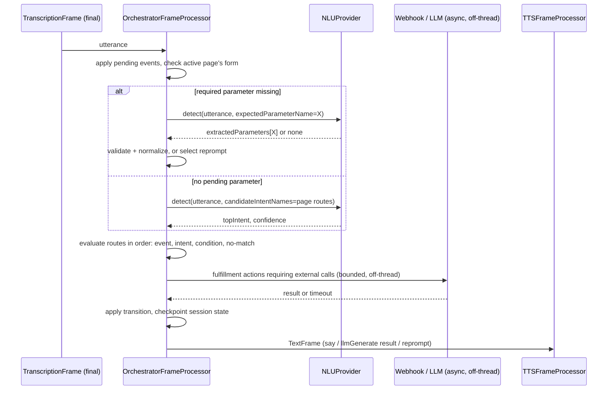

# RequestFlow: Conversation Orchestrator Spec

Reference target: RequestFlow, a deterministic, NLU-first flow/page/route orchestration layer for VASDK that is frame-native to the existing pipeline.

Status: **Draft v2.1** - protobuf/textproto config format. Domain model and mechanism are otherwise unchanged from Draft v2; see [§0](#0-what-changed-from-draft-v1) for the full history and [§0.1](#01-what-changed-in-draft-v21) for this revision specifically. `goal/` is untouched by this document: it keeps working as-is for the existing call center showcase, and this spec introduces a new, independent module rather than extending or migrating it. See [§3](#3-relationship-to-existing-vasdk-components) and [§17](#17-explicitly-out-of-scope-for-v1) for exactly what that means.

## 0. What changed from Draft v1

Draft v1 modeled the orchestrator as a superset of `goal/` (extend `GoalDefinition`, reuse `GoalManager`'s LLM-side-channel mechanism, add a migration adapter) and specified a full enterprise release surface (versioning, environment promotion, RBAC, audit trail, chaos testing) alongside it. Draft v2 changed both of those:

- **Mechanism**: the orchestrator is a real pipeline processor (`OrchestratorFrameProcessor`) that consumes `TranscriptionFrame`s and drives routing/prompts deterministically from config, using a new `NLUProvider` interface for intent/entity extraction. It does **not** require an LLM in the pipeline at all - the LLM becomes optional infrastructure, called out-of-band, only when a build actually wants LLM-backed NLU or generative fallback. This is closer to an NLU-first, page-based conversational architecture (NLU + deterministic pages, LLM optional) than to `goal/`'s "LLM drives every turn, tools update state" model.
- **Scope**: versioning/environment promotion, RBAC, audit trail, and chaos testing were dropped for v1 (see [§17](#17-explicitly-out-of-scope-for-v1)). Runtime robustness was kept and, in two places, increased: a richer condition/expression language and resilient webhook execution with retry/circuit-breaker ([§9.2](#92-callwebhook-execution-model)).
- **No migration path in v1**: `goal/` and the call center showcase are unaffected. The orchestrator ships as a new, additive capability with its own tests, not a breaking change to anything that exists today.

## 0.1 What changed in Draft v2.1

Draft v2 authored the Agent/Flow/Page/Route config as freeform JSON, validated against a hand-maintained JSON Schema at load time ([§15](#15-rollout-plan) Phase 1). Draft v2.1 replaces that with a `.proto`-defined schema, authored as textproto:

- **Structural validation becomes mostly free.** A `.proto` message definition *is* the schema - wrong types, unknown fields, and malformed nesting are parser errors, not something a hand-written JSON Schema has to separately encode and keep in sync. What's left for the [§15](#15-rollout-plan) Phase 1 validator is genuinely semantic: referential integrity (do all `target_id`s resolve), reachability, and handler coverage - none of which any schema language expresses on its own.
- **The condition/expression language is now CEL** (Common Expression Language, [google/cel-spec](https://github.com/google/cel-spec)) instead of a hand-rolled JSON tree. Once conditions live inside a proto schema they'd need a nested `oneof` expression message to stay JSON-shaped - which just re-derives, badly, something Google already built specifically to evaluate safe, sandboxed expressions against a typed/protobuf environment. This also resolves Draft v2's open question about the expression language's growth path, and - a genuine side benefit - collapses the old "Phase 2: richer expression language" rollout milestone entirely, since CEL already has full arithmetic and string functions from day one.
- **A latent inconsistency got fixed along the way.** Draft v1 and v2 both listed `NO_MATCH`/`NO_INPUT` as `Route` trigger types, while *also* describing dedicated page/flow/global `EventHandlers` as the actual no-match/no-input fallback mechanism ([§6](#6-route-evaluation-semantics) step 3). Those were always the same mechanism described twice; a proto `oneof` can't quietly carry a redundant enum value the way a duck-typed JSON object could, so `Route.trigger` now only has three shapes - `intent`, `condition_cel`, `event` - and no-match/no-input live exclusively in `EventHandlers`, matching what §6 already specified.
- **New dependencies: `protobuf` and `cel-cpp`**, `FetchContent`-pulled like every other VASDK dependency, each behind its own concern in the build. This is a deliberate, scoped exception to VASDK's `nlohmann::json` convention (used throughout `goal/`, metrics, `ConditionEvaluator`) - confined to the orchestrator module's config, NLU boundary, and session persistence. Nothing outside `va::orchestrator` changes.
- Not everything becomes a proto message. `OrchestratorConfig` (in-process engine tuning, never serialized) and `SlotValidationResult` (an in-process validator return, never crosses a boundary) stay plain C++ structs - proto is reserved for things that are actually authored as a file, cross the `NLUProvider` boundary, or get persisted. `callWebhook`'s HTTP request/response bodies also stay plain JSON ([§9.2](#92-callwebhook-execution-model)) - forcing an integrator's own REST backend to speak protobuf would be a much bigger imposition than adopting it for VASDK's own config. See [§13](#13-public-api-surface-proposed-c) for the rest of where the line falls.

## 1. Purpose and Scope

Define RequestFlow, a conversational orchestration system for VASDK: deterministic multi-turn task completion driven by an explicit flow/page/route graph, with probabilistic language understanding confined to well-defined extension points (NLU, optional generative fallback).

Primary goals:

- Move from intent-only, LLM-driven routing to explicit, deterministic, config-driven flow control that runs the same way every time given the same inputs.
- Let a build run entirely without an LLM: canned prompts, rule- or embedding-based NLU, deterministic routes.
- Keep validation and business actions deterministic in C++, evaluated in well under a turn's audio round-trip.
- Preserve VASDK's low-latency, frame-priority, barge-in-capable pipeline model - the orchestrator is a citizen of that pipeline, not a side-channel bolted onto the LLM stack.

Out of scope for v1 (see [§17](#17-explicitly-out-of-scope-for-v1) for the full list and rationale): versioning/environment promotion, RBAC/security hardening, audit trail, chaos testing, multi-session pooling, a graphical flow editor, cross-locale auto-translation, and any migration path off `goal/`.

## 2. Design Principles

- **Deterministic orchestration, probabilistic language understanding** - the LLM (if present at all) never decides what state the conversation is in; it only ever contributes an NLU classification or a piece of generated text that the orchestrator's deterministic logic consumes.
- **LLM-optional by construction** - a pipeline with no `LLMProcessor`, no `ToolDispatchProcessor`, and a rule-based `NLUProvider` is a fully supported, first-class deployment shape, not a degraded one.
- **Config-driven with strict validation** - flows are authored as data (textproto, against a `.proto` schema), with structural validation coming from the schema itself and semantic validation (referential integrity, reachability, handler coverage) run offline before a session ever loads a config.
- **Never block a processor thread on an external call** - webhook calls and any LLM-fallback calls run off-thread with hard timeouts; the pipeline never stalls behind a slow HTTP endpoint or model.
- **Reuse the pipeline's own recovery and instrumentation** - failures surface as `ErrorFrame` upstream (so the existing `RecoveryProcessor` catches them from one insertion point) and every processor's built-in latency/queue metrics apply automatically; no parallel error or metrics system.

## 3. Relationship to Existing VASDK Components

Reused as-is:

- `Frame` / `FrameProcessor` / `Pipeline` - the orchestrator is one more processor in the chain, nothing about the core needs to change.
- `TranscriptionFrame`, `TurnStateFrame`, `TextFrame`, `SynthesisStateFrame`, `ControlFrame::INTERRUPT`, `ErrorFrame` - existing frame types cover everything the orchestrator needs to consume and emit.
- `HttpInterface` / `CurlHttpProvider` (`network/`) - the transport `callWebhook` fulfillment calls through.
- `MetricsCollector` / `CallMetrics` (`metrics/`) - the sink for orchestrator-specific per-turn metrics ([§11](#11-observability)).
- The provider pattern itself (pure-virtual core + optional overrides, one CMake target per implementation) - `NLUProvider` follows the exact same shape as `VADProvider`/`TurnDetectionProvider`.
- The slot type/validation semantics from `goal/`'s `GoalSlot` (phone/email/date/enum/object/composite normalization, `condition`/`validator` escape hatches) - the logic is proven and generic, so it is ported into the new `Parameter` model rather than redesigned ([§7](#7-parameter-model-and-collection-policy)).
- The deterministic-simulator pattern from `GoalConversationSimulator` - same idea, new engine ([§12](#12-testing-strategy)).
- The three-method persistence contract from `GoalStatePersistence` (`save`/`load`/`clear`) and its dev-grade file-based implementation ([§10](#10-session-state-and-persistence)).
- The `fromFile`/`fromDirectory` split from `GoalDefinitionLoader` - `OrchestratorConfigLoader` mirrors it exactly so each vertical's flow can be authored, reviewed, and owned as its own file ([§13](#13-public-api-surface-proposed-c), [§14.1](#141-splitting-config-across-files)).

New to this module, not used elsewhere in VASDK:

- **`protobuf`** - schema and serialization for config, NLU results, and session snapshots ([§4](#4-domain-model), [§5](#5-nluprovider-interface), [§10](#10-session-state-and-persistence)).
- **`cel-cpp`** - the [§8](#8-condition--expression-language) expression evaluator for route conditions and computed parameter values.

Both are `FetchContent`-pulled and gated behind the orchestrator module's own CMake option, following the same one-target-per-dependency convention as every existing provider. Nothing outside `va::orchestrator` needs either.

Explicitly **not** reused or extended:

- `GoalManager`, `GoalState`, `IntentRouter` - the orchestrator does not wrap or attach to these. It is a standalone `va::orchestrator` module.
- `goal/`'s side-channel mechanism (registering prompt template variables and tools directly on `LLMTransport`/`ToolDispatchProcessor` so the LLM drives every turn) - the orchestrator drives turns itself; an LLM, if configured, is called *by* the orchestrator, not the other way around.

`goal/` and the call center showcase keep working unchanged. Whether `goal/` is deprecated later, coexists indefinitely for different use cases, or gets a migration path is an open decision ([§18](#18-open-decisions)), not something v1 decides.

## 4. Domain Model


The domain model *is* a `.proto` schema - not a prose field list validated separately, as Draft v2 had it:

```proto
syntax = "proto3";
package va.orchestrator;

import "google/protobuf/struct.proto";
import "google/protobuf/wrappers.proto";

message Agent {
  string id = 1;
  string display_name = 2;
  string default_locale = 3;
  repeated Flow flows = 4;
  EventHandlers global_handlers = 5;
}

message Flow {
  string id = 1;
  string display_name = 2;
  string description = 3;
  string start_page_id = 4;
  repeated Page pages = 5;
  EventHandlers flow_handlers = 6;
}

// The actual no-match/no-input/webhook-error/user-cancel fallback mechanism -
// see the §0.1 note on why these are not Route trigger types.
message EventHandlers {
  Fulfillment no_match = 1;
  Fulfillment no_input = 2;
  Fulfillment webhook_error = 3;
  Fulfillment user_cancel = 4;
}

message Page {
  string id = 1;
  string display_name = 2;
  Fulfillment entry_fulfillment = 3;
  repeated Parameter form = 4;
  repeated Route routes = 5;
  EventHandlers page_handlers = 6;
  bool generative = 7;
  GenerativeConfig generative_config = 8;   // required when generative is true
}

// The LLM-tool-loop escape hatch - see §9.4 for runtime mechanics, §21 for a worked example.
message GenerativeConfig {
  string system_prompt_template = 1;   // templated like `say` text, e.g. "{current_volume}"
  message ToolRef {
    string name = 1;
    bool terminal = 2;                 // calling this tool ends the loop
  }
  repeated ToolRef tools = 2;          // the *only* customTool handlers exposed to the LLM for this page
  int32 max_turns = 3;                 // 0 => use OrchestratorConfig::defaultGenerativeMaxTurns
  string exit_event = 4;               // defaults to "generative_exit" if empty
}

message Route {
  string id = 1;
  int32 priority = 2;                  // lower evaluates earlier
  Trigger trigger = 3;
  Fulfillment fulfillment = 4;
  Transition transition = 5;
  google.protobuf.BoolValue stop_evaluation = 6;   // unset => true; see the proto3-default note below
}

message Trigger {
  oneof kind {
    IntentTrigger intent = 1;
    string condition_cel = 2;          // a CEL expression, compiled once at load time - see §8
    EventTrigger event = 3;
  }
}

message IntentTrigger { string intent_name = 1; float min_confidence = 2; }
message EventTrigger  { string name = 1; }

message Parameter {
  enum Type {
    STRING = 0; PHONE = 1; EMAIL = 2; DATE = 3; TIME = 4; DATETIME = 5;
    NUMBER = 6; INTEGER = 7; BOOLEAN = 8; ENUM = 9; OBJECT = 10; COMPOSITE = 11;
  }
  string name = 1;
  Type type = 2;
  bool required = 3;
  Prompts prompts = 4;
  google.protobuf.Struct constraints = 5;   // shape depends on `type` - see §7
  string condition_cel = 6;                 // optional; empty = always required
  string validator_ref = 7;                 // optional; names a C++ validator registered on the engine
  bool redact_in_logs = 8;
}

message Prompts {
  string initial = 1;
  repeated string reprompts = 2;
  string escalation = 3;
}

message Fulfillment {
  repeated Action actions = 1;
}

message Action {
  oneof kind {
    SayAction say = 1;
    CallWebhookAction call_webhook = 2;
    SetParameterAction set_parameter = 3;
    ClearParameterAction clear_parameter = 4;
    EmitEventAction emit_event = 5;
    HandoffAction handoff = 6;
    CustomToolAction custom_tool = 7;
    LlmGenerateAction llm_generate = 8;
  }
}

message SayAction          { string text = 1; }                        // "{parameter_name}" substitution
message SetParameterAction { string name = 1; string value_cel = 2; }  // CEL, evaluated against session parameters
message ClearParameterAction { string name = 1; }
message EmitEventAction    { string name = 1; }
message HandoffAction      { string reason = 1; }
message LlmGenerateAction  { string prompt_template = 1; }
message CustomToolAction {
  string tool = 1;
  map<string, string> args_cel = 2;   // each value is a CEL expression, evaluated before the tool handler runs
}
message CallWebhookAction {
  string url = 1;
  string method = 2;        // default POST
  int32 timeout_ms = 3;     // 0 => use OrchestratorConfig::webhookTimeout
}

message Transition {
  enum TargetType { PAGE = 0; FLOW = 1; END_SESSION = 2; NONE = 3; }
  TargetType target_type = 1;
  string target_id = 2;
  google.protobuf.BoolValue preserve_parameters = 3;   // unset => true; see the proto3-default note below
}
```

Two things worth flagging about the schema itself, not just what it models:

- **The `Trigger` oneof replaces Draft v2's separate `triggerType` enum entirely.** There's no longer a way to set the discriminant to `CONDITION` while accidentally filling in `trigger.event` - the schema doesn't allow it, where a duck-typed JSON object could carry exactly that bug silently.
- **`google.protobuf.BoolValue`, not bare `bool`, for `stop_evaluation` and `preserve_parameters`.** Both fields want a default of `true` when the author leaves them unset - but a proto3 bare `bool` always defaults to `false` and can't distinguish "unset" from "explicitly false." The wrapper type lets the loader ask `has_stop_evaluation()` / `has_preserve_parameters()` and apply `true` only when the author genuinely left it out.

`CustomToolAction.args_cel` and `SetParameterAction.value_cel` are both CEL expression strings for the same reason: fulfillment actions need to reference values computed earlier in the same turn (like a `target_volume` set two actions ago - see [§21](#21-worked-example-nlu-only-vs-a-generative-page)), and CEL is already the evaluator on hand, so no separate templating mechanism was worth introducing for one field. `say.text` keeps its own lightweight `{parameter_name}` substitution instead of CEL, deliberately - it's prose with occasional variable interpolation, not a single-value computation, and CEL doesn't have a template-string feature that fits that job well.

### Session State

Also a proto message, since it crosses the [§10](#10-session-state-and-persistence) persistence boundary:

```proto
message SessionSnapshot {
  string session_id = 1;
  string active_flow_id = 2;
  string active_page_id = 3;
  map<string, google.protobuf.Value> parameters = 4;
  map<string, ParameterMeta> parameter_meta = 5;
  repeated string route_history = 6;      // bounded ring buffer, oldest-evicted at load/save time
  map<string, int32> event_counters = 7;
  bool awaiting_confirmation = 8;
  int32 confirmation_attempts = 9;
  int64 created_at_unix_ms = 10;
  int64 updated_at_unix_ms = 11;
}

message ParameterMeta {
  int32 attempts = 1;
  string source = 2;    // "nlu" | "prefill" | "webhook_patch" | ...
  int64 last_updated_unix_ms = 3;
}
```

## 5. NLUProvider Interface

New provider interface, same shape as every other provider in the core library: pure-virtual core, optional overrides, one CMake target per implementation, no ML framework dependency forced on anyone who doesn't build that target.

```proto
message NLUContext {
  string locale = 1;
  string active_flow_id = 2;
  string active_page_id = 3;
  optional string expected_parameter_name = 4;   // set during slot-filling
  repeated string candidate_intent_names = 5;    // from the active page's intent routes
}

message RankedIntent { string name = 1; float confidence = 2; }

message NLUResult {
  string top_intent = 1;      // empty string = no intent match
  float confidence = 2;
  repeated RankedIntent ranked_intents = 3;
  map<string, google.protobuf.Value> extracted_parameters = 4;
  google.protobuf.Struct raw_metadata = 5;
}
```

```cpp
namespace va {

class NLUProvider {
public:
    virtual ~NLUProvider() = default;
    virtual bool initialize(const google::protobuf::Struct& config) = 0;
    virtual void release() = 0;
    virtual va::orchestrator::NLUResult detect(const std::string& utterance,
                                                const va::orchestrator::NLUContext& context) = 0;
    virtual void setCandidateIntents(const std::vector<std::string>& names) {}  // optional: restrict/hint classification scope
};

}  // namespace va
```

v1 ships **two** implementations:

- An LLM-tool-backed `NLUProvider` that sends the utterance plus `candidate_intent_names` to a configured `LLMTransport` as a structured classification call (not a free-form chat turn) and parses the result into `NLUResult`. This is the only place an LLM enters a default v1 build, and only if the app actually wants LLM-backed NLU instead of a deterministic one.
- `TrainingPhraseNLUProvider` - a fully local, pattern-matching implementation with no model and no network call, compiled from curated example utterances ([§22](#22-nlu-training-data)). This is the concrete instance of "LLM-optional by construction" ([§2](#2-design-principles)), not just a hypothetical rule-based option.

Both read the same training data ([§22.2](#222-two-consumers-one-file-format)), so nothing in the interface assumes an LLM and a third, embedding-based implementation later is a natural extension.

`detect()` is also how parameter values get extracted from free text during slot-filling: `context.expected_parameter_name` tells the provider what it's being asked to extract, and a hit lands in `extracted_parameters[name]` for the orchestrator to validate against that `Parameter`'s type ([§7](#7-parameter-model-and-collection-policy)).

## 6. Route Evaluation Semantics

Runs inside `OrchestratorFrameProcessor::processFrame()` on every finalized `TranscriptionFrame` (and on internally re-entered turns from `emitEvent`):



If the active page has `generative: true`, none of the following applies - see [§9.4](#94-generative-pages) instead. Everything below describes a deterministic page.

Per turn:

1. Apply any pending internally-emitted events from the previous step.
2. If the active page's `form` has a required, currently-unfilled parameter (per its `condition_cel`), run parameter collection: extract via `NLUProvider.detect()`, validate, and either store the value or select the next reprompt. This step does not consult routes.
3. Otherwise, evaluate routes in strict order: `event` routes first, then `intent` routes, then `condition` routes, then the page's no-match fallback (`EventHandlers.no_match`, falling back to the flow's, then the agent's).
4. Execute the matched route's `fulfillment` actions in order, awaiting any async ones (bounded by `turnExternalCallBudget`, [§9.2](#92-callwebhook-execution-model)).
5. Apply the `transition`, if any.
6. Checkpoint session state and emit per-turn metrics.

The runtime also auto-emits a synthetic `page_enter` event the instant a page becomes active - on session start, or immediately after any transition into it, before waiting for user input. This is how a page's `entryFulfillment` (a `say`) can be followed by an `event`-triggered route that acts immediately, with no utterance in between (see the `triage` flow in [§19](#19-worked-example-turn-by-turn-flow)).

Tie-break rules: first matching route wins when `stop_evaluation` is true (the default when unset); if false, evaluation continues and later matches can still fire. No match and no explicit no-match route runs the page/flow/agent default handler chain.

## 7. Parameter Model and Collection Policy

Ported wholesale from `goal/`'s `GoalSlot` validation semantics, renamed to fit this module:

| Type | Validation / normalization |
| --- | --- |
| `STRING` | passed through |
| `PHONE` | normalized to `NXX-NXX-XXXX` (US) or `NXX-XXXX` |
| `EMAIL` | basic format check |
| `DATE` / `TIME` / `DATETIME` | ISO 8601 / `HH:MM`; a `mustBeFuture` constraint key is supported |
| `NUMBER` / `INTEGER` | optional `min`/`max` constraint keys |
| `BOOLEAN` | accepts yes/no/true/false/1/0 |
| `ENUM` | must match the `allowedValues` constraint list (case-insensitive); shown in the prompt |
| `OBJECT` | validated against an `objectSchema` constraint (a list of `{name, description, jsonType, required}`) |
| `COMPOSITE` | named sub-slots, filled one at a time via dot-path (`"vehicle.year"`) |

Same two escape hatches as `GoalSlot`: `condition_cel` (a CEL expression - only required when it evaluates true against live session state) and `validator_ref` (names a C++ validator registered on the engine, replaces built-in validation entirely; returns `SlotValidationResult{valid, normalizedValue, errorMessage}` - a plain C++ struct, not a proto message, since it's an in-process callback return that never crosses a serialization boundary).

`Parameter.constraints` is a `google.protobuf.Struct` rather than a typed sub-message, deliberately: the shape genuinely varies per `Parameter.Type` (`allowedValues` for `ENUM`, `min`/`max` for `NUMBER`, `objectSchema` for `OBJECT`, `mustBeFuture` for `DATE`), and giving every type its own message would mean a growing `oneof` for something that's fundamentally a small, per-type key/value bag. It's the one deliberate use of dynamic typing inside an otherwise fully static schema - whether it should eventually get a lightweight secondary schema of its own is tracked in [§18](#18-open-decisions).

Collection policy:

- Prompt order: `initial`, then `reprompts[0]`, `reprompts[1]`, ..., then `escalation` (default max 2 reprompts before escalation, configurable per-agent).
- Validation errors produce a machine-readable code plus a user-facing message (the message drives the reprompt).
- `COMPOSITE` parameters accept dot-path updates one sub-slot at a time; `OBJECT` parameters are validated whole against their schema before being accepted.

## 8. Condition / Expression Language

Route conditions (`Trigger.condition_cel`) and computed values (`SetParameterAction.value_cel`, `CustomToolAction.args_cel`) are [CEL](https://github.com/google/cel-spec) (Common Expression Language) expressions, evaluated against an activation built from session `parameters`, well-known context variables (`turnCount`, `repromptCount`, `sessionElapsedMs`), and - for the turn's winning route - `nlu.*` (that turn's `NLUResult.extracted_parameters`).

Compilation happens once, at config-load time: the expression is parsed and type-checked against the declared environment, and a malformed expression fails offline validation, never evaluation - the same "compile once, throw on malformed input at load time" rule this spec already committed to for the JSON DSL it replaces.

```text
// Route.trigger.condition_cel
visit_reason == "urgent"

// SetParameterAction.value_cel - absolute increase
current_volume + nlu.amount

// SetParameterAction.value_cel - percent increase
current_volume + current_volume * (nlu.amount / 100.0)

// A richer route condition
party_size >= 5 && visit_reason.contains("urgent")

// Parameter presence, CEL's own idiom for "exists"
has(visit_reason)
```

CEL ships with `contains`/`startsWith`/`endsWith`/`size`, full arithmetic, and `&&`/`||`/`!`/`==`/`>=` as native operators - an earlier draft of this spec hand-rolled a JSON function table (`{"fn": "contains", "args": [...]}`) for exactly this, which disappears entirely once CEL is in place. It was reinventing something that already exists and already fits.

`cel-cpp`'s evaluator is sandboxed by construction - no side effects, no unbounded loops, a fixed standard library - so config authors get a real expression language without the orchestrator taking on an arbitrary-code-execution surface from webhook-supplied or LLM-influenced input.

## 9. Fulfillment Actions and Execution Model

### 9.1 Non-blocking rule

No fulfillment action may block the processor thread `OrchestratorFrameProcessor` runs on. `say`, `setParameter`, `clearParameter`, `emitEvent`, and `customTool` (if the handler is fast/local) execute inline. `callWebhook` and `llmGenerate` execute on a small dedicated thread pool owned by the engine (`OrchestratorConfig::executorThreadPoolSize`, default 2), and the turn *waits* on the result with a hard timeout (`turnExternalCallBudget`, default 2000 ms) rather than either blocking the pipeline indefinitely or letting the conversation move on before the result is known - this keeps turn ordering simple at the cost of a bounded wait.

### 9.2 `callWebhook` execution model

- Request: session metadata, active flow/page, matched route id, current parameters snapshot, last user utterance, trace id (reuses `Frame::sourceId`/sequence for correlation, no new tracing system). **The request and response bodies are plain JSON over HTTP** - unlike the rest of this module, the webhook wire contract is not protobuf, since it talks to an integrator's own REST backend, which almost certainly already speaks JSON.
- Response: `messages[]?`, `parameterPatches[]?`, `transition?`, `emitEvents[]?`, `handoff?`, `endSession?`.
- Reliability: per-endpoint timeout (default 1500 ms), one retry on transient/network errors only (never on 4xx), a small circuit breaker per endpoint (failure-count threshold opens it for a cooldown window), idempotency key = `sessionId + turnIndex`.
- On failure after retries or on the outer `turnExternalCallBudget` timeout: emit the `webhook-error` event and re-enter route evaluation at step 3 of [§6](#6-route-evaluation-semantics) so `EventHandlers.webhook_error` (page, then flow, then agent) decides what happens next - no silent turn failure.
- Unrecoverable failures (circuit open, no handler defined) surface as `ErrorFrame` upstream so the existing `RecoveryProcessor` catches them the same way it catches STT/LLM/TTS failures.

### 9.3 `llmGenerate` and barge-in

Both `llmGenerate` and `callWebhook` calls are cancelled if an upstream `ControlFrame::INTERRUPT` arrives while they're in flight (the user barged in before the turn resolved) - the in-flight future is abandoned, its eventual result discarded, and no stale `TextFrame` is emitted for a turn the user has already moved past. `say`-only turns are unaffected by this; TTS playback of their output is interruptible the same way any other `SynthesisFrame` is, with no orchestrator-specific handling needed.

### 9.4 Generative pages

While the active page has `generative: true` ([§4](#4-domain-model)), `OrchestratorFrameProcessor` skips NLU-based intent/parameter extraction and steps 1-3 of [§6](#6-route-evaluation-semantics) entirely. Instead:

1. The page's `entryFulfillment` (if any) still runs once, on entry, exactly as for a deterministic page.
2. Each subsequent turn's utterance goes straight to the configured `LLMTransport`, with the conversation scoped to only the tools listed in `generativeConfig` - the LLM cannot see or call anything outside that list. This mirrors `goal/`'s `ToolDispatchProcessor` mechanism precisely, just scoped per-page instead of process-wide.
3. Every tool call the LLM makes still runs through the ordinary `customTool` handler registered via `OrchestratorEngine::setCustomToolHandler` - deterministic C++, validated the same as any other tool. State changes only ever happen this way; the LLM's free-form text becomes the next `TextFrame` to TTS, nothing more.
4. The loop ends the instant a `terminal: true` tool is called, or when `maxTurns` is reached - whichever comes first. Either way, the orchestrator emits `generativeConfig.exit_event` (default `generative_exit`) and resumes ordinary route evaluation at step 3 of [§6](#6-route-evaluation-semantics), so a page-defined event route decides what happens next (see [§21](#21-worked-example-nlu-only-vs-a-generative-page)).
5. The same non-blocking rule and barge-in cancellation from [§9.1](#91-non-blocking-rule) and [§9.3](#93-llmgenerate-and-barge-in) apply to every LLM call inside the loop - each one runs off-thread under `turnExternalCallBudget`, and an upstream `ControlFrame::INTERRUPT` cancels an in-flight call the same way.

A generative page never touches `NLUProvider` and its routes are never evaluated against the raw user utterance - only against the loop's exit event and safety-valve conditions (like a `turnCount >= maxTurns` condition route). That split is deliberate: it keeps "what did the LLM's tool calls actually do" fully auditable through the same `customTool` mechanism every other fulfillment action uses, even while the conversation itself is open-ended.

## 10. Session State and Persistence

Same three-method contract as `GoalStatePersistence`, new name to match the module, now typed against the proto `SessionSnapshot` from [§4](#4-domain-model) instead of a bare JSON blob:

```cpp
class SessionPersistence {
public:
    virtual ~SessionPersistence() = default;
    virtual bool save(const std::string& sessionKey, const SessionSnapshot& snapshot) = 0;
    virtual std::optional<SessionSnapshot> load(const std::string& sessionKey) = 0;
    virtual bool clear(const std::string& sessionKey) = 0;
};
```

`FileSessionPersistence` (one file per session key) serializes via `SessionSnapshot::SerializeToString()` (binary proto) by default, explicitly dev/test-grade like its `goal/` counterpart. A `--debug-text-sessions`-style engine option switches it to `TextFormat::PrintToString()` instead, trading a few bytes for a human-readable session file during development.

Checkpointing happens after every turn boundary (step 6 of [§6](#6-route-evaluation-semantics)); restoring a session requires the same `Agent` config the session started with (routes/pages/parameters aren't serialized, only runtime values - consistent with `goal/`'s "the app must supply the definition" rule, since there's no versioning system in v1 to resolve a stored config-version reference against).

## 11. Observability

Per-turn metrics into the existing `MetricsCollector`/`CallMetrics`: `route_eval_latency_ms`, `route_match_count`, `no_match_count`, `no_input_count`, `parameter_validation_failures`, `nlu_latency_ms`, `nlu_confidence_avg`, `webhook_latency_ms`, `webhook_error_count`, `handoff_count`, `completion_count`, `turns_to_completion`. `OrchestratorFrameProcessor` gets the same automatic latency/queue-wait/frame-count instrumentation every processor gets from the `FrameProcessor` base constructor, with nothing extra to wire up.

No separate tracing or logging system: correlation reuses `Frame::sourceId` and sequence IDs already threaded through every frame; logs redact any `Parameter` marked `redact_in_logs`. Full audit trails and a dedicated trace-export pipeline are out of scope for v1 ([§17](#17-explicitly-out-of-scope-for-v1)).

## 12. Testing Strategy

`OrchestratorConversationSimulator`, mirroring `GoalConversationSimulator`: scripts a conversation as turns of `{userUtterance, injectedNLUResult}` (a proto `NLUResult`, built via its generated builder or parsed from textproto - the injected result makes tests deterministic without a real model or an LLM call) and runs them against the real `OrchestratorEngine` - actual route evaluation, actual parameter validation, actual webhook-mock hooks. No model, no audio, fully deterministic, CI-friendly.

Coverage this needs to exercise: golden paths per flow, validation-failure/reprompt behavior, no-match/no-input escalation, webhook failure/retry/circuit-breaker behavior (via an injectable fake `HttpInterface`), cross-flow transitions with `preserveParameters`, and barge-in cancellation of an in-flight `callWebhook`/`llmGenerate` ([§9.3](#93-llmgenerate-and-barge-in)).

## 13. Public API Surface (proposed C++)

```cpp
namespace va::orchestrator {

// Plain C++ struct - in-process engine tuning, never serialized, so it stays outside the proto schema.
struct OrchestratorConfig {
    std::chrono::milliseconds webhookTimeout{1500};
    int webhookMaxRetries = 1;
    std::chrono::milliseconds turnExternalCallBudget{2000};
    size_t executorThreadPoolSize = 2;
    int defaultMaxReprompts = 2;
    int defaultGenerativeMaxTurns = 6;
};

// Loads and offline-validates an Agent from a .proto-schema'd config file (or a directory of them).
class OrchestratorConfigLoader {
public:
    static Agent fromTextprotoFile(const std::string& path);   // one self-contained file, human-authored, comments allowed
    static Agent fromBinaryFile(const std::string& path);      // compact, for generated/exported configs
    static Agent fromDirectory(const std::string& dirPath);    // composes agent.textproto + flows/*.textproto - see §14.1
    static ValidationReport validate(const Agent& agent);      // referential integrity (incl. cross-file flow ids), reachability, handler coverage
};

class OrchestratorEngine {
public:
    OrchestratorEngine(Agent agent, OrchestratorConfig config = {});

    void setNLUProvider(std::shared_ptr<va::NLUProvider> provider);
    void setLLMTransport(std::shared_ptr<va::LLMTransport> transport);  // optional: only needed for llmGenerate, an LLM-backed NLUProvider, or a generative page
    void setHttpInterface(std::shared_ptr<va::HttpInterface> http);
    void setCustomToolHandler(std::string name,
                               std::function<google::protobuf::Struct(const google::protobuf::Struct&, SessionState&)> handler);

    void setOnHandoff(std::function<void(const HandoffContext&)> cb);
    void setOnFlowComplete(std::function<void(const std::string& flowId, const SessionState&)> cb);

    TurnResult processTurn(const TurnInput& input);

    SessionSnapshot snapshot() const;
    bool restore(const SessionSnapshot& snapshot);
};

class OrchestratorFrameProcessor : public FrameProcessor {
public:
    explicit OrchestratorFrameProcessor(std::shared_ptr<OrchestratorEngine> engine);
    // consumes: TranscriptionFrame (isFinal), TurnStateFrame, ControlFrame::INTERRUPT
    // emits: TextFrame downstream (to TTS); ErrorFrame upstream on unrecoverable external-call failure
};

}  // namespace va::orchestrator
```

A `customTool` handler always receives `google::protobuf::Struct` args regardless of source - a route's `CustomToolAction.args_cel` (each value CEL-evaluated into a `Struct` field before the call), or a generative page's LLM tool-call (whose JSON arguments convert via `google::protobuf::util::JsonStringToMessage` into the same `Struct` type) - so a tool handler is written once and doesn't care which fulfillment path invoked it.

Single session per `OrchestratorEngine` instance in v1 - no `SessionHandle`/pooling API. A deployment needing concurrent calls runs one `OrchestratorEngine` + one `OrchestratorFrameProcessor` per pipeline instance, same as every other per-call pipeline component today; multi-session pooling is deferred ([§17](#17-explicitly-out-of-scope-for-v1)).

## 14. Config Format Example (textproto)

```textproto
# agents/appointments.textproto
agent {
  id: "appointments-agent"
  default_locale: "en-US"

  flows {
    id: "appointments"
    start_page_id: "collect_reason"

    pages {
      id: "collect_reason"
      form {
        name: "visit_reason"
        type: ENUM
        required: true
        constraints {
          fields {
            key: "allowedValues"
            value {
              list_value {
                values { string_value: "checkup" }
                values { string_value: "followup" }
                values { string_value: "urgent" }
              }
            }
          }
        }
        prompts {
          initial: "What is the reason for your visit?"
          reprompts: "I can help with checkup, followup, or urgent visits."
          reprompts: "Please say checkup, followup, or urgent."
          escalation: "Let me connect you with someone who can help."
        }
      }
      routes {
        id: "urgent_to_triage"
        priority: 5
        trigger { condition_cel: "visit_reason == \"urgent\"" }
        transition { target_type: FLOW target_id: "triage" }
      }
      routes {
        id: "to_collect_date"
        priority: 10
        trigger { condition_cel: "has(visit_reason)" }
        transition { target_type: PAGE target_id: "collect_date" }
      }
    }
  }

  flows {
    id: "triage"
    start_page_id: "confirm_urgent"

    pages {
      id: "confirm_urgent"
      entry_fulfillment {
        actions { say { text: "I understand this is urgent - connecting you now." } }
      }
      routes {
        id: "escalate"
        priority: 1
        trigger { event { name: "page_enter" } }
        fulfillment {
          actions { handoff { reason: "urgent_triage" } }
        }
      }
    }
  }
}
```

Compare this against the JSON version an earlier draft used: no quoting every key, `#`-style comments are legal (none shown here, but authors get them for free), and a typo'd field name is a parse error instead of a silently-ignored JSON key. `exists(visit_reason)` from the old hand-rolled DSL becomes CEL's own `has(visit_reason)` macro - not a coincidence, just CEL already having the operator this spec needed.

`Parameter.constraints` is the one place textproto's syntax gets genuinely noisy, since a `google.protobuf.Struct` literal has to spell out `fields`/`value`/`list_value`/`values` explicitly. Friendlier authoring tooling for that specific case (a small YAML-to-textproto convenience, say) is tracked as an open decision ([§18](#18-open-decisions)), not solved by the schema itself.

### 14.1 Splitting config across files

The `Agent` schema doesn't need a special "include" field for this - `Agent.flows` is already `repeated Flow`, so splitting is purely a loader-level composition step, not a domain-model concern. `OrchestratorConfigLoader::fromDirectory()` expects:

```text
agents/appointments/
  agent.textproto            # Agent-level only: id, default_locale, global_handlers - flows left empty here
  flows/
    appointments.textproto   # one `flow { ... }` message - the "appointments" vertical
    triage.textproto         # one `flow { ... }` message - the "triage" vertical
```

`agent.textproto` for the example above:

```textproto
# agents/appointments/agent.textproto
id: "appointments-agent"
default_locale: "en-US"
```

`flows/appointments.textproto` and `flows/triage.textproto` each hold exactly one top-level `Flow` message - the two `flows { ... }` blocks from [§14](#14-config-format-example-textproto), unwrapped one level (a flow file's top-level message *is* a `Flow`, not an `Agent` containing one):

```textproto
# agents/appointments/flows/appointments.textproto
id: "appointments"
start_page_id: "collect_reason"
pages {
  id: "collect_reason"
  # ... same content as §14 ...
}
```

`fromDirectory()` parses `agent.textproto` as an `Agent`, then parses every file under `flows/` as a `Flow` and appends it to `Agent.flows` - checking for `id` collisions against anything already there (whether inline in `agent.textproto` or from another file) and failing loudly rather than silently letting one vertical's flow shadow another's. Ordering across files is lexical by filename; ordering *within* a flow (route `priority`) is unaffected either way. `validate()` runs after composition, on the single assembled `Agent`, so a `triage.textproto` route that transitions into `appointments` (or a typo'd flow id that doesn't exist anywhere) is still caught by the same referential-integrity check §13 already specifies - splitting files doesn't weaken validation, since the engine never sees anything but a fully-merged `Agent`.

This gives each vertical - `appointments`, `triage`, a `volume_command`/`volume_calibration` pair, and so on - its own file to author, review, and (if the team structure calls for it) own independently, while `agent.textproto` stays the one place agent-wide identity and fallback handlers live. Whether a single large vertical's *pages* eventually need the same treatment (one file per page, mirroring this exact mechanism one level deeper) is tracked in [§18](#18-open-decisions) rather than solved now - nothing here precludes it later.

## 15. Rollout Plan

**Phase 1 - deterministic core.** `.proto` schema + generated C++ types + textproto/binary loader (`OrchestratorConfigLoader`), including directory-based composition (`fromDirectory`, [§14.1](#141-splitting-config-across-files)) so each vertical ships as its own file from day one, not a retrofit + offline semantic validator (referential integrity across files, unreachable-page detection, no-match/no-input handler coverage - structural correctness is inherited from the schema itself, not hand-written). `cel-cpp` integration for `condition`/`event` route triggers and `value_cel`/`args_cel` computed values ([§8](#8-condition--expression-language)) - needed from day one since even Phase 1's `condition`/`event` routes depend on it. `OrchestratorEngine` + `OrchestratorFrameProcessor` with `event`/`condition` routes only (no NLU yet). Full `Parameter` type/validation port. `SessionSnapshot` proto + `FileSessionPersistence` (binary by default, textproto in debug mode). `OrchestratorConversationSimulator`. Metrics wiring. A build using only Phase 1 has no LLM anywhere in it.

**Phase 2 - understanding.** `NLUProvider` interface + both shipped implementations: the LLM-tool-backed one and `TrainingPhraseNLUProvider` ([§22](#22-nlu-training-data), including the phrase-grammar compiler). `intent` routes. `llmGenerate` fulfillment for one-shot generative fallback text. Generative pages ([§4](#4-domain-model)/[§9.4](#94-generative-pages)) - the scoped LLM-tool loop for pages that need multi-turn negotiation rather than a single generated response.

**Phase 3 - external actions and hardening.** `callWebhook` with the full [§9.2](#92-callwebhook-execution-model) reliability model (timeout, retry, circuit breaker, idempotency key). `handoff`/escalation event handlers end-to-end. Cross-flow transition edge cases (`preserveParameters` interactions, mid-transition barge-in).

Multi-session pooling, versioning/environments, and RBAC are not phases of v1 - they're future work, tracked in [§18](#18-open-decisions).

## 16. Acceptance Criteria (v1)

- Models at least three flows with conditional branching, including at least one cross-flow transition, authored purely as textproto config - no C++ changes required to add a flow.
- A build with zero `LLMProcessor`/`ToolDispatchProcessor` in its pipeline and `TrainingPhraseNLUProvider` ([§22](#22-nlu-training-data)) runs a complete flow end-to-end.
- The shipped LLM-tool-backed `NLUProvider` is swappable behind the interface without touching `OrchestratorEngine` or `OrchestratorFrameProcessor`.
- At least one flow includes a generative page (LLM-tool loop) with a bounded exit, demonstrating that state still only ever changes via `customTool` calls even during open-ended conversation.
- Webhook fulfillment demonstrates retry and circuit-breaker behavior under simulated transient failures, exercised via `OrchestratorConversationSimulator` with a fake `HttpInterface` - no live endpoint required for CI.
- A session can be snapshotted mid-flow and restored (same `Agent` config) with parameters and active page intact.
- All of the above is exercised in CI via `OrchestratorConversationSimulator` with no live model, no live webhook, and no audio hardware.

## 17. Explicitly Out of Scope for v1

Carried over from Draft v1's enterprise surface, dropped deliberately rather than silently:

- **Versioning and environment promotion** (draft/publish, dev/stage/prod binding, rollback) - v1 loads one `Agent` config directly; revisit if/when a deployment actually needs safe hot-swapping of live flows.
- **RBAC / security hardening** (role-based config authoring access, signed artifacts, field-level encryption, least-privilege webhook identity) - `redact_in_logs` is the one privacy affordance kept, since it's cheap and orthogonal to the rest.
- **Audit trail** - no dedicated audit log system; existing frame metadata and metrics are what's available in v1.
- **Chaos testing** - deferred until there's a running system worth chaos-testing.
- **Multi-session pooling** (`SessionManager`/`ResourcePool` equivalent) - v1 is one `OrchestratorEngine` per pipeline instance; pooling is a natural but separate addition once the single-session engine is proven.
- **Migration off `goal/`** - no adapter, no forced rewrite of the call center showcase. `goal/` keeps working.
- Full graphical flow editor (or a visual/GUI textproto editor), cross-locale auto-translation, auto-generated intents from transcripts, human workforce management - unchanged from Draft v1's exclusions.

## 18. Open Decisions

- Whether `google.protobuf.Struct`-typed `constraints` needs a lightweight secondary schema (since `Struct` itself is untyped) once enough `Parameter.Type` combinations exist to make typos in constraint keys a real support cost, and whether friendlier authoring tooling (e.g. a YAML-to-textproto convenience) is worth building for that specific field.
- CEL standard library/macro scope - which functions to allow by default vs. restrict for sandboxing (e.g. whether `matches()` regex support should be enabled, given it's the one CEL macro with real complexity/DoS surface).
- Binary proto vs. textproto as the canonical on-disk format for a published agent - textproto for hand-authoring, binary for anything machine-generated or size-sensitive - and whether the loader should auto-detect or require an explicit choice.
- Canonical event taxonomy: closed enum (`no_match`, `no_input`, `webhook-error`, `user-cancel`, `page_enter`, `generative_exit`, ...) vs. an open string namespace apps can extend freely.
- Long-term relationship to `goal/`: eventual deprecation with a migration guide, or indefinite coexistence for two different use cases (open-ended LLM-driven assistant vs. deterministic, RequestFlow-style task completion)?
- Shape of multi-session pooling when it's built: reuse `SessionManager`/`ResourcePool` as-is, or redesign given that pooling now means "N independent `OrchestratorFrameProcessor` + pipeline instances" rather than one processor serving many sessions?
- Whether a management-plane/versioning story ever gets built, and what deployment need would actually trigger building it.
- Exact retry/backoff policy shape for `callWebhook` beyond "one retry on transient errors" - fixed delay vs. small exponential backoff.
- Whether generative-page turns need their own metrics (e.g. `generative_turns_used`, `generative_exit_reason`) beyond the ordinary per-turn set in [§11](#11-observability), and whether `maxTurns` should be a per-agent default with a per-page override rather than always explicit.
- Whether a single large vertical's *pages* eventually need the same file-splitting treatment as flows ([§14.1](#141-splitting-config-across-files)) - one file per page under a flow's own subdirectory - and if so, whether that should reuse the identical directory-composition mechanism or need something else once nesting goes two levels deep.
- Exact specificity-scoring formula `TrainingPhraseNLUProvider` ([§22](#22-nlu-training-data)) uses to rank multiple positive matches before falling back to negative examples for disambiguation - wildcard count and literal-word ratio are the obvious starting signals, but the precise formula isn't pinned down.
- Whether `training/*.textproto` files ([§22.3](#223-file-layout)) ever need their own per-page splitting the same way flows might ([§14.1](#141-splitting-config-across-files)), once a single vertical accumulates enough intents to make one training file unwieldy.
- Whether a single `entities.textproto` stays adequate once the dictionary grows, or needs the same directory-composition treatment as flows/training (an `entities/*.textproto` directory instead of one file) - and whether requiring `canonical` names to be unique *dictionary-wide* (not just per-group), so bare `{name}` references stay unambiguous, becomes a real authoring friction point at scale.

## 19. Worked Example: Turn-by-Turn Flow

Walking the [§14](#14-config-format-example-textproto) `appointments-agent` config through both branches, turn by turn, in terms of the [§6](#6-route-evaluation-semantics) steps.

### 19.1 Path A - normal path (checkup)

#### Turn 0 - session start

(`activeFlowId=appointments`, `activePageId=collect_reason`, `parameters={}`)

- No `entryFulfillment` on `collect_reason`. Runtime auto-emits `page_enter`; no route on this page listens for it.
- Step 2: `visit_reason` is required and unfilled -> emit `prompts.initial` as a `TextFrame`: *"What is the reason for your visit?"* `parameterMeta.visit_reason = {attempts: 0}`.

#### Turn 1 - user: "I need a checkup"

- Step 1: no pending events.
- Step 2: `visit_reason` still unfilled -> `NLUProvider.detect("I need a checkup", {expectedParameterName: "visit_reason", ...})` returns `extractedParameters: {"visit_reason": "checkup"}`. Validated against `ENUM{checkup, followup, urgent}` -> stored. Because the form is now satisfied, evaluation falls through to step 3 within the same turn.
- Step 3: routes on `collect_reason` evaluate in priority order - `urgent_to_triage` (5): `visit_reason == "urgent"` is false. `to_collect_date` (10): `has(visit_reason)` is true -> matched, `stop_evaluation` (default true) stops evaluation there.
- Step 4: no `fulfillment` on this route - nothing to execute.
- Step 5: transition to page `collect_date`, `preserve_parameters` (default true) -> `activePageId=collect_date`, `visit_reason` carried over.
- Step 6: checkpoint; `route_match_count=1`, `parameter_validation_failures=0`.
- `collect_date`'s own form has an unfilled required `appointment_date` (`DATE`) - the engine re-runs step 2 for the newly active page in the same `processFrame()` call, emitting its `prompts.initial`: *"What date works for your appointment?"*

#### Turn 2 - user: "Next Tuesday"

- Step 2: `appointment_date` unfilled -> `NLUProvider.detect(...)` returns `extractedParameters: {"appointment_date": "2026-09-15"}` (resolved to ISO 8601 by the provider, same normalization convention `goal/` uses for relative dates). Validated (`mustBeFuture` constraint) -> stored.
- Falls through to route evaluation on `collect_date` (not shown in §14's minimal example, but say it has one route matching once `appointment_date` exists, with a `say` fulfillment confirming the booking and a transition to `end_session`).
- Step 6: checkpoint, session ends; `setOnFlowComplete("appointments", state)` fires with `parameters = {visit_reason: "checkup", appointment_date: "2026-09-15"}`.

### 19.2 Path B - urgent path (cross-flow transition + immediate handoff)

#### Turn 1' - user: "It's urgent, I'm having chest pain"

(same starting state as Turn 0/1 above)

- Step 2: `NLUProvider.detect(...)` extracts `visit_reason: "urgent"` directly from the utterance - the interface doesn't care whether that took an exact string match or an LLM mapping "chest pain" to the `urgent` enum value. Validated, stored.
- Falls through to step 3: `urgent_to_triage` (priority 5) matches first this time - evaluation stops before `to_collect_date` is even considered.
- Step 5: transition `target_type=FLOW, target_id=triage`, `preserve_parameters` (default true) -> `activeFlowId=triage`, `activePageId=confirm_urgent` (its `startPageId`); `visit_reason=urgent` carries across the flow boundary.
- `confirm_urgent`'s `entryFulfillment` runs immediately: `say` *"I understand this is urgent - connecting you now."* -> `TextFrame` to TTS.
- The runtime's synthetic `page_enter` event fires for `confirm_urgent`. Its one route (priority 1, `event: page_enter`) matches immediately, in the same turn, with no further user input.
- Step 4: `fulfillment=[handoff(reason="urgent_triage")]` executes - `setOnHandoff` fires with the `HandoffContext`.
- Step 5/6: no transition specified on that route, so the session stays on `confirm_urgent` pending whatever the app does with the handoff (route audio to a human-agent transport, stop the pipeline, etc.).

Both paths show the same property: the LLM (if configured at all) only ever answers "what did the user mean" via `NLUProvider` - which page is active, which route fires, and what gets said next is 100% determined by the config and the current `parameters`, reproducible turn for turn.

## 20. Worked Example: API Usage

### 20.1 Wiring into a pipeline

```cpp
#include "VASDK/orchestrator/OrchestratorEngine.h"
#include "VASDK/orchestrator/OrchestratorFrameProcessor.h"
#include "VASDK/orchestrator/OrchestratorConfigLoader.h"
#include "VASDK/orchestrator/LLMBackedNLUProvider.h"
#include "VASDK/network/CurlHttpProvider.h"
#include "VASDK/llm/OpenAITransport.h"

using namespace va;
using namespace va::orchestrator;

// 1. Load and offline-validate the flow graph from a textproto file.
Agent agent = OrchestratorConfigLoader::fromTextprotoFile("agents/appointments.textproto");
auto report = OrchestratorConfigLoader::validate(agent);
if (!report.ok()) {
    spdlog::error("config invalid: {}", report.summary());
    return 1;
}

// 2. Wire an LLM only if something in this build actually needs one.
auto llmTransport = std::make_shared<OpenAITransport>(apiKey, model);
auto nlu = std::make_shared<LLMBackedNLUProvider>(llmTransport);

// 3. Build the engine.
OrchestratorConfig config;
config.webhookTimeout = std::chrono::milliseconds(1500);
config.turnExternalCallBudget = std::chrono::milliseconds(2000);

auto engine = std::make_shared<OrchestratorEngine>(agent, config);
engine->setNLUProvider(nlu);
engine->setLLMTransport(llmTransport);   // optional: only needed for llmGenerate, an LLM-backed NLUProvider, or a generative page
engine->setHttpInterface(std::make_shared<CurlHttpProvider>());

engine->setCustomToolHandler("lookup_slot_availability",
    [](const google::protobuf::Struct& args, SessionState& state) -> google::protobuf::Struct {
        google::protobuf::Struct result;
        (*result.mutable_fields())["available"].set_bool_value(true);   // deterministic C++ logic, no LLM involved
        return result;
    });

engine->setOnHandoff([](const HandoffContext& ctx) {
    spdlog::warn("Escalating session {} - reason: {}", ctx.sessionId, ctx.reason);
});

engine->setOnFlowComplete([](const std::string& flowId, const SessionState& state) {
    spdlog::info("Flow '{}' completed with params: {}", flowId, state.parameters.DebugString());
});

// 4. Drop it into the pipeline like any other processor - no LLMProcessor/ToolDispatchProcessor required.
Pipeline pipeline;
pipeline.addProcessor(vadProcessor);
pipeline.addProcessor(turnDetectionProcessor);
pipeline.addProcessor(transcriptionProcessor);
pipeline.addProcessor(std::make_shared<OrchestratorFrameProcessor>(engine));
pipeline.addProcessor(ttsProcessor);
pipeline.build();
pipeline.start();
```

A build that wants zero LLM dependency (per the [§16](#16-acceptance-criteria-v1) acceptance criterion) skips step 2 and `setLLMTransport` entirely and instead does `engine->setNLUProvider(std::make_shared<RuleBasedNLUProvider>(...))` - everything else is unchanged.

### 20.2 Deterministic testing via the simulator

`processTurn()` is public on `OrchestratorEngine` specifically so tests can drive it directly, bypassing `OrchestratorFrameProcessor`, frames, and audio entirely:

```cpp
#include "VASDK/orchestrator/OrchestratorConversationSimulator.h"

NLUResult checkupResult;
(*checkupResult.mutable_extracted_parameters())["visit_reason"].set_string_value("checkup");

NLUResult dateResult;
(*dateResult.mutable_extracted_parameters())["appointment_date"].set_string_value("2026-09-15");

OrchestratorConversationSimulator sim(agent);
sim.setInjectedNLUResult("I need a checkup", checkupResult);
sim.setInjectedNLUResult("next tuesday", dateResult);

auto result = sim.run({
    { "I need a checkup" },
    { "next tuesday" },
});

ASSERT_TRUE(result.completed);
ASSERT_EQ(result.finalState.active_flow_id(), "appointments");
ASSERT_EQ(result.finalState.parameters().at("visit_reason").string_value(), "checkup");
```

This is what makes the [§16](#16-acceptance-criteria-v1) CI requirement possible: no live model, no live webhook, no audio hardware, and the injected `NLUResult`s make the run bit-for-bit reproducible.

## 21. Worked Example: NLU-Only vs. a Generative Page

The clearest way to see where the [§2](#2-design-principles) "deterministic orchestration, probabilistic language understanding" line actually falls: it is not "LLM used vs. not used" - the shipped `NLUProvider` is itself LLM-backed by default. The real split is between a **bounded structured classification** (fixed output shape, no memory, cannot itself change anything) and an **open generative call** that produces the actual words said next and can decide what happens through tool calls.

### 21.1 NLU-only: "increase the volume by 15" / "by 20%"

A single, well-formed command resolves in one turn with no negotiation needed:

```textproto
pages {
  id: "volume_command"
  routes {
    id: "increase_volume_absolute"
    priority: 10
    trigger { intent { intent_name: "increase_volume_absolute" min_confidence: 0.6 } }
    fulfillment {
      actions {
        set_parameter { name: "target_volume" value_cel: "current_volume + nlu.amount" }
      }
      actions {
        custom_tool {
          tool: "apply_volume"
          args_cel { key: "value" value: "target_volume" }
        }
      }
      actions { say { text: "Volume set to {target_volume}." } }
    }
  }
  routes {
    id: "increase_volume_percent"
    priority: 11
    trigger { intent { intent_name: "increase_volume_percent" min_confidence: 0.6 } }
    fulfillment {
      actions {
        set_parameter {
          name: "target_volume"
          value_cel: "current_volume + current_volume * (nlu.amount / 100.0)"
        }
      }
      actions {
        custom_tool {
          tool: "apply_volume"
          args_cel { key: "value" value: "target_volume" }
        }
      }
      actions { say { text: "Volume set to {target_volume}." } }
    }
  }
}
```

User: *"turn up the volume by 15"* -> `NLUProvider.detect()` runs once, given `candidate_intent_names` drawn from this page's intent routes, and returns `top_intent="increase_volume_absolute", confidence=0.92, extracted_parameters={amount: 15}`. That is the *only* step touching anything resembling judgment. `nlu.amount` is addressable in that turn's `value_cel`/`args_cel` expressions - a short-lived per-turn namespace for the winning route's `extracted_parameters`, distinct from persistent session `parameters`, which only change via an explicit `setParameter`. Everything downstream of the NLU call is CEL arithmetic and a deterministic `customTool` call - `apply_volume`'s handler receives `args = {"value": <evaluated target_volume>}` as a `google.protobuf.Struct`, exactly like any other tool call. One bounded classification, zero negotiation, done.

### 21.2 Generative page: "turn it up until it sounds right"

No fixed target value exists to extract - the request only resolves through iterative feedback, which is exactly what [§9.4](#94-generative-pages) generative pages are for:

```textproto
pages {
  id: "volume_calibration"
  generative: true
  entry_fulfillment {
    actions { say { text: "Sure - tell me when it sounds right." } }
  }
  generative_config {
    system_prompt_template: "You're calibrating speaker volume. Current volume: {current_volume}. Call adjust_volume in response to feedback. Call confirm_volume once the user says it's good."
    tools { name: "adjust_volume" }
    tools { name: "confirm_volume" terminal: true }
    max_turns: 8
    exit_event: "generative_exit"
  }
  routes {
    id: "exit_calibration"
    priority: 1
    trigger { event { name: "generative_exit" } }
    transition { target_type: PAGE target_id: "main_menu" }
  }
  routes {
    id: "calibration_timeout"
    priority: 2
    trigger { condition_cel: "turnCount >= 8" }
    fulfillment {
      actions { say { text: "Let's leave it here - just say 'adjust volume' again anytime." } }
    }
    transition { target_type: PAGE target_id: "main_menu" }
  }
}
```

`adjust_volume` and `confirm_volume` are ordinary `customTool` handlers registered on the engine exactly like `apply_volume` in [§21.1](#211-nlu-only-increase-the-volume-by-15--by-20) - the LLM can converse freely turn after turn, but the *only* way it ever changes actual volume state is by calling `adjust_volume`, and the *only* way the conversation ends is `confirm_volume` (marked `terminal`) or hitting `maxTurns`. Either exit path emits `generative_exit`, handing control back to `exit_calibration` - an ordinary deterministic event route, no different from any other. The routes on this page never see the raw "turn it up a bit, no too much, yeah that's good" utterances at all; they only ever react to the loop's exit.

## 22. NLU Training Data

To be precise about the word "train" here: nothing gets gradient-descent fine-tuned. "Training" means curating example utterances per intent - textproto, split per vertical exactly like [§14.1](#141-splitting-config-across-files) - that either compile directly into a deterministic pattern matcher (no LLM, no network call) or get stitched into the LLM-backed `NLUProvider`'s classification prompt as few-shot grounding. The same file format serves both.

```proto
message TrainingSet {
  repeated IntentTrainingData intents = 1;
  EntityDictionary entities = 2;   // predefined placeholders resolve against this - see §22.1
}

message IntentTrainingData {
  string intent_name = 1;       // must match some Route's IntentTrigger.intent_name
  repeated string phrases = 2;  // pattern strings - see §22.1; a leading "!" marks a negative example
}

// A curated, reusable vocabulary - the "predefined placeholder" side of §22.1.
message EntityDictionary {
  repeated EntityGroup groups = 1;
}

message EntityGroup {
  string name = 1;              // e.g. "zone" - referenced as {zone:param_name}
  repeated EntityValue values = 2;
}

message EntityValue {
  string canonical = 1;         // e.g. "front_left" - referenced bare as {front_left} when unique across the whole dictionary
  repeated string synonyms = 2; // "front left", "driver's side front", "front-left vent"
}
```

### 22.1 Phrase grammar

Two families of placeholder, plus grouping - each symbol has one distinct job, deliberately not reused for a second meaning even where that might look tempting:

| Token | Meaning | Example |
| --- | --- | --- |
| plain word(s) | literal, case-insensitive | `cancel my appointment` |
| `*` | zero or more words | `turn * up` matches "turn it up", "turn the volume up", "turn up" |
| `.` | exactly one word (unnamed wildcard) | `turn . up` matches "turn it up" but not "turn up" or "turn the bass up" |
| `(...)` | a group - anything inside can itself contain literals, wildcards, or placeholders | `(by <delta:number>)` |
| `token?` / `(group)?` | the immediately **preceding** token or group is optional - `?` is always postfix, never prefix | `please? cancel` matches "cancel" and "please cancel"; `(by <delta:number>)?` matches with or without the whole "by ..." clause |
| `<type:name>` | **dynamic** capture - a built-in or page-declared type ([§7](#7-parameter-model-and-collection-policy)), open-ended, no fixed vocabulary; lands in `extracted_parameters[name]` | `by <number:amount>` captures "by 15" -> `amount: 15` |
| `{canonical}` | **predefined** placeholder, bare form - matches any synonym of one specific, uniquely-named `EntityValue` anywhere in the dictionary; no extraction, since the phrase is already specific to that one value | `turn on the {front_left} vent` matches "turn on the front left vent" and "turn on the driver's side front vent" alike |
| `{group:name}` | **predefined** placeholder, capturing form - matches any synonym of *any* value in that `EntityGroup`, and captures the matched value's `canonical` name into `extracted_parameters[name]` | `turn on the {zone:target_zone} vent` matches any known zone phrase and sets `target_zone` to whichever canonical value matched |
| leading `!` on a whole phrase | negative example - this intent must **not** match an utterance shaped like this | `!turn * up by <number:amount> percent` under an absolute-increase intent, so a near-miss doesn't steal a match belonging to the percent intent |

The choice between the two `{...}` forms is a real design decision, not just syntax: `{front_left}` (bare) fits a per-value intent (`turn_on_front_left_vent`, `turn_on_front_right_vent`, ...) - simpler grammar, more intents, no captured parameter needed. `{zone:target_zone}` fits one shared intent (`turn_on_vent`) whose fulfillment reads `nlu.target_zone` and calls one `customTool` for any zone - fewer intents, more general, and the natural choice once the number of values grows past a handful. [§22.4](#224-worked-example) shows both.

For an `<enum:name>` capture, the allowed values aren't restated in the training file - they're resolved at match time against the actual `Parameter` named `name` on whichever page has it in its `form` ([§7](#7-parameter-model-and-collection-policy)). A capture with no matching `Parameter` anywhere in the active flow just extracts the matched span as a plain typed value, same as `amount` in [§22.4](#224-worked-example) - never a page `form` parameter, just a one-shot argument to a route's fulfillment. `EntityDictionary` values are a separate, complementary mechanism from `Parameter` ENUMs: an ENUM's `allowedValues` lives with one specific `Parameter` on one page, while an `EntityGroup` is shared vocabulary any phrase in any vertical can reference - use whichever matches where the canonical list of values actually lives.

Validation, at `TrainingSet` load time: every `canonical` name must be unique across the *entire* dictionary (not just within its group) so a bare `{name}` reference is unambiguous; every `{canonical}` and `{group:name}` reference in a phrase must resolve to something the dictionary actually defines; and a group referenced with no matching `EntityGroup.name` is a load-time error, the same "fail loudly, not at match time" rule [§8](#8-condition--expression-language) already established for CEL.

When multiple phrases (across different intents) match the same utterance, `TrainingPhraseNLUProvider` ranks candidates by specificity - fewer `*`/`.` tokens and a higher literal-word ratio score higher - and reports that as `confidence`, the same `NLUResult` field the LLM-backed provider reports its own certainty through. `IntentTrigger.min_confidence` ([§4](#4-domain-model)) behaves identically regardless of which implementation produced the number. The exact scoring formula is tracked as an open decision ([§18](#18-open-decisions)); negative examples exist precisely to resolve the cases specificity scoring alone can't.

### 22.2 Two consumers, one file format

- **`TrainingPhraseNLUProvider`** - a fully local `NLUProvider` implementation ([§5](#5-nluprovider-interface)) that compiles every phrase into a small matcher at load time (the same "compile once, fail loudly on malformed input at load time" rule [§8](#8-condition--expression-language) already committed to for CEL) and matches utterances against them directly - no model, no network call, sub-millisecond classification. This is the concrete answer to [§2](#2-design-principles)'s "LLM-optional by construction" principle.
- **The shipped LLM-tool-backed `NLUProvider`** ([§5](#5-nluprovider-interface)) - the same phrases get stitched into its classification prompt as few-shot examples per intent, improving classification accuracy without hand-writing prompt text per agent. Negative phrases (leading `!`) become explicit "this is NOT an example of X" lines in the prompt.

Both read the identical `TrainingSet`, so switching between them - or running both, `TrainingPhraseNLUProvider` first with the LLM-backed provider as a fallback below its own confidence threshold - doesn't require maintaining two parallel sets of examples.

### 22.3 File layout

Training data is split per vertical exactly like flows ([§14.1](#141-splitting-config-across-files)):

```text
agents/appointments/
  agent.textproto
  entities.textproto          # shared EntityDictionary - "zone", "day_of_week", etc. - available to every vertical
  flows/
    appointments.textproto
    triage.textproto
  training/
    appointments.textproto    # TrainingSet.intents for the appointments vertical
    triage.textproto
```

`OrchestratorConfigLoader::loadTrainingSet(dirPath)` composes `training/*.textproto` the same way `fromDirectory` composes `flows/*.textproto` - merged, checked for duplicate `intent_name` entries - and attaches `entities.textproto` (if present) as the returned `TrainingSet.entities`, shared across every intent in every file rather than duplicated per vertical. The whole thing is cross-validated against the assembled `Agent`'s routes: an `IntentTrigger.intent_name` with no training phrases anywhere, or a `TrainingSet` entry naming an intent no route ever triggers, are both validation warnings, not hard failures - a route can still work against the LLM-backed provider's own judgment with zero examples, just less reliably. `{...}` placeholder resolution against `entities` happens as part of this same load step, so a phrase referencing an undefined entity fails here too, not at match time.

### 22.4 Worked example

The volume-control intents from [§21.1](#211-nlu-only-increase-the-volume-by-15--by-20), with training phrases:

```textproto
# agents/.../training/volume.textproto
intents {
  intent_name: "increase_volume_absolute"
  phrases: "turn * up by <number:amount>"
  phrases: "increase the volume by <number:amount>"
  phrases: "make it <number:amount> louder"
  phrases: "please? turn . up a little"
  phrases: "!turn * up by <number:amount> percent"
}
intents {
  intent_name: "increase_volume_percent"
  phrases: "turn * up by <number:amount> percent"
  phrases: "increase the volume by <number:amount>%"
  phrases: "make it <number:amount> percent louder"
}
```

`"turn * up by <number:amount>"` matches *"turn the volume up by 15"* with `amount: 15`. `"turn . up a little"` matches *"turn it up a little"* but not *"turn the volume up a little"* - `.` is exactly one word, `*` is zero-or-more, and this phrase is deliberately tighter for a vaguer phrasing that carries no number. The last phrase under `increase_volume_absolute` is the negative example doing real work: without it, *"turn the volume up by 15 percent"* could plausibly match the absolute intent's own `"turn * up by <number:amount>"` pattern too (`*` swallows nothing extra, `<number:amount>` captures "15", and "percent" just trails off unmatched) - the `!` phrase tells the matcher explicitly that shape belongs to the percent intent instead.

A more layered example - climate control, combining a predefined entity, a dynamic capture, and an optional group in one phrase:

```textproto
# agents/.../entities.textproto
groups {
  name: "zone"
  values { canonical: "front_left"  synonyms: "front left"  synonyms: "driver's side front" }
  values { canonical: "front_right" synonyms: "front right" synonyms: "passenger side front" }
  values { canonical: "rear_left"   synonyms: "rear left"   synonyms: "back left" }
  values { canonical: "rear_right"  synonyms: "rear right"  synonyms: "back right" }
}
```

```textproto
# agents/.../training/climate.textproto
intents {
  intent_name: "turn_on_vent"
  phrases: "turn on the {zone:target_zone} vent (and increase the temperature by <delta:number>)?"
  phrases: "{zone:target_zone} vent on"
}
```

This one shape covers a lot of ground: *"turn on the front left vent"* matches with `target_zone: front_left` and no `delta` (the whole `(and increase ... )?` clause is absent, so `nlu.delta` is simply unset - a route's fulfillment checks `has(nlu.delta)` in CEL, or a `customTool` handler just treats a missing field as "no change requested"). *"turn on the driver's side front vent and increase the temperature by 5"* matches the same phrase with `target_zone: front_left` (via the synonym) and `delta: 5`. One shared `turn_on_vent` intent and one `customTool` handler cover all four zones, with or without a temperature delta, because the group-capturing `{zone:target_zone}` and the optional group both generalize instead of requiring a separate phrase - or a separate intent - per combination.

If instead each zone genuinely needed its own distinct handling (not just a different argument to the same tool), the bare form fits better: `intent_name: "turn_on_front_left_vent"` with `phrases: "turn on the {front_left} vent"` and no capture at all - simpler per-intent grammar, at the cost of one intent (and one set of training phrases) per zone.
