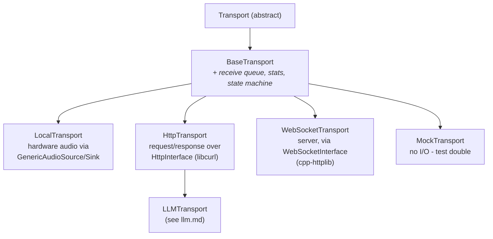

# Transports

*Reference for `va::transport::Transport` and its implementations. Header: [`Transport.h`](../../VASDK/include/VASDK/Transport.h) - the source of truth if this page and the code ever disagree.*

A transport answers *how frames get in and out of the process*: local hardware, HTTP, WebSocket, or nothing at all (tests). The pipeline itself is transport-agnostic - swap the transport and the same processor chain serves a desktop mic, a network stream, or a unit test.



## The Transport interface

| Group | Members | Notes |
| --- | --- | --- |
| Identity | `getName()`, `getDescription()` | Debugging/logs. |
| Lifecycle | `initialize()`, `start()`, `stop()`, `release()` | Same shape as processors and providers - the whole SDK uses this four-step lifecycle. |
| Connection | `isConnected()`, `getState()` | `TransportState`: `DISCONNECTED → CONNECTING → CONNECTED → DISCONNECTING`, plus `ERROR`. |
| Frame I/O | `receiveFrame(timeoutMs)`, `sendFrame(frame)`, `hasFrames()` | `receiveFrame`: blocking pull (`0` = no wait, `-1` = infinite). In pipelines you'll rarely call it - see the callback below. |
| Callbacks | `onConnected`, `onDisconnected`, `onError(code, msg)`, `onFrameReceived(frame)` | Public `std::function` members. `onFrameReceived` is the push-mode alternative to `receiveFrame()` - `TransportInputProcessor` wires it so frames enqueue straight into the pipeline with no polling thread. |
| Stats | `getStats()`, `resetStats()` | `TransportStats`: frames/bytes sent+received, errors, dropped frames. |

**`BaseTransport`** is the class to actually derive from: it implements the receive queue (bounded, thread-safe, condition-variable signaled), state tracking, stats counters, and the metrics hookup (`setMetrics`/`setMetricsConfig`). Your subclass calls the protected helpers - `enqueueReceivedFrame()`, `setState()`, `updateSentStats()`, `incrementErrorCount()` - and implements `sendFrame()` plus the lifecycle.

## LocalTransport

([`LocalTransport.h`](../../VASDK/include/VASDK/LocalTransport.h)) The hardware transport: a capture thread pulls from a [`GenericAudioSource`](providers.md#genericaudiosource), writes samples into the shared [`AudioRingBuffer`](../../README.md#the-audio-ring-buffer), and emits lightweight `AudioFrame`s (offsets, not samples). Outbound `SynthesisFrame`s are written to the [`GenericAudioSink`](providers.md#genericaudiosink).

Configuration before `initialize()`:

- `setInputAudioConfig` / `setOutputAudioConfig` - capture and playback formats (they can differ; e.g. 16 kHz mono in, TTS-native rate out).
- `setFrameSize(samples)` - capture granularity (default 2000 samples = 125 ms at 16 kHz). Smaller = lower latency, more per-frame overhead.
- `setRingBuffer(buffer)` - the shared ring buffer that VAD/STT will read; without it an internal buffer is used and nothing else can share the audio.

Barge-in support: `getPendingOutputAudioBytes()` reports unplayed audio and `flushOutputAudio()` fades (~50 ms ramp) and discards it - `TTSFrameProcessor::setPlaybackFlush` is typically wired to this. Capture-side metrics (callback jitter, underruns) are built in.

## HttpTransport

([`HttpTransport.h`](../../VASDK/include/VASDK/HttpTransport.h)) Request/response networking over a pluggable [`HttpInterface`](#the-network-provider-seam) (libcurl by default, `CurlHttpProvider`). Mostly used through its subclass [`LLMTransport`](llm.md#llmtransport), which adds conversation history, prompt templating, and streaming-response parsing on top.

## WebSocketTransport

([`WebSocketTransport.h`](../../VASDK/include/VASDK/WebSocketTransport.h)) A WebSocket **server** transport backed by a `WebSocketInterface` provider (cpp-httplib implementation ships in `network/providers`; built when `VASDK_ENABLE_WEBSOCKET_SERVER=ON`, the default). Lets external clients stream frames in and out - remote UIs, browser demos, integration harnesses. Frame serialization uses nlohmann/json when built with `VASDK_HAS_JSON`.

## MockTransport

([`MockTransport.h`](../../VASDK/include/VASDK/MockTransport.h)) The test double - no I/O at all:

| Member | Purpose |
| --- | --- |
| `injectFrame(frame)` | Simulate the receive side: the frame enters the pipeline as if it arrived from outside. |
| `getSentFrames()` / `getSentFramesByType(type)` / `getSentFrameCount()` | Everything the pipeline tried to send, captured for assertions. |
| `clearSentFrames()` | Reset between test cases. |
| `setAutoRespond(...)`, `setSimulatedLatency(ms)`, `simulateError(...)`, `simulateDisconnect()` | Scripted behaviors for failure-path tests. |

Full walkthrough: [testing-with-mock-transport.md](../examples/testing-with-mock-transport.md).

## TransportFactory

([`TransportFactory.h`](../../VASDK/include/VASDK/TransportFactory.h)) A by-name registry (`registerTransport(name, creator)` / `createTransport(name)`) with a `TransportRegistrar<T>` helper for static-initialization registration:

```cpp
static va::transport::TransportRegistrar<MyCustomTransport> reg("mycustom");
```

Useful when the transport choice comes from configuration rather than code. The showcase apps construct transports directly and don't use the factory - it's there for config-driven deployments.

## The network provider seam

Transports don't talk to sockets directly; they go through interfaces in [`network/`](../../VASDK/include/VASDK/network/), which is what makes the networking stack replaceable per platform:

- **`HttpInterface`** - `post()` (with optional streaming `onChunk` callback - this is how LLM token streaming arrives), `get()`, and `sendText`/`sendBytes` convenience wrappers; `HttpResponse{statusCode, body, headers, error}`. Implementation: `CurlHttpProvider` (built with `VASDK_ENABLE_HTTP_TRANSPORT=ON`, the default).
- **`WebSocketInterface`** - server-side: `listen(port, host)`, `sendText`/`sendBytes` per connection, `broadcastText`/`broadcastBytes`, connection callbacks. Implementation: `CppHttpLibWebSocketProvider`.

To port VASDK to a platform with its own networking stack (automotive middleware, a sandboxed OS), implement these two interfaces - no transport or pipeline code changes.

## Writing a custom transport

1. Derive from **`BaseTransport`** (not `Transport`) to inherit the queue/stats/state machinery.
2. Implement `initialize/start/stop/release`, `getName/getDescription`, and `sendFrame()` - where outbound frames leave the process.
3. On inbound data, build the right frame type and call `enqueueReceivedFrame(frame)`; it lands in the receive queue and fires `onFrameReceived`.
4. Keep state honest with `setState()` and count failures with `incrementErrorCount()` / `incrementDroppedFrameCount()` - the built-in metrics and any monitoring dashboards read these.
5. Register with `TransportFactory` only if you need name-based creation.
