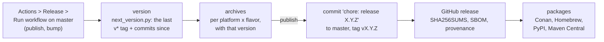

# Releasing VASDK

*How a version of VASDK is cut and published, for maintainers. The workflows are [`.github/workflows/`](../.github/workflows/); the version is [`VERSION`](../VERSION); what a consumer gets is [Using VASDK in your project](integrating.md).*

## The version

[`VERSION`](../VERSION) holds the one version, `MAJOR.MINOR.PATCH` ([Semantic Versioning](https://semver.org)):

- **CMake:** both projects and Android's (`project(... VERSION ${VASDK_VERSION})`), `<VASDK/version.h>` and `vasdk_version()` read it.
- **Library:** the C library's file version follows it (`libvasdk_c.so.1.2.3`).
- **Bindings:** the Kotlin binding reads it. The Python binding states it in `pyproject.toml`; `cmake/check_versions.py --set` writes both.
- **Check:** `ctest` (`vasdk_versions`, [`cmake/check_versions.py`](../cmake/check_versions.py)) fails when any of them disagrees.

Nobody edits it by hand: a release raises it from the [Conventional Commits](https://www.conventionalcommits.org) since the last release ([`cmake/next_version.py`](../cmake/next_version.py)). So the commit subject, or the pull request title of a squash merge, says what changed:

| Change | Commit | Version |
| --- | --- | --- |
| A fix, docs, build, a refactor | `fix(tts): …`, `docs: …`, anything else | `PATCH` |
| Something new: a C function, a provider, an option, a field | `feat(engine): …` | `MINOR` |
| A C function changed or removed, a type's layout changed | `feat!: …`, or a `BREAKING CHANGE:` footer | `MAJOR`, and `VASDK_C_API_VERSION` with it, so the soname changes too ([C API, Stability](reference/c-api.md#stability)) |

The highest one since the last release wins. The C++ API has no compatibility promise: a change there alone is `feat`, not breaking. The first release, before any `v*` tag, is `VERSION` as it is (1.0.0). A `VERSION` raised by hand above the computed one wins.

## Cutting a release

A release only happens when a maintainer starts one: nothing runs on a merge.

1. **Start it.** GitHub, Actions, **Release**, Run workflow, on `master` ([`release.yml`](../.github/workflows/release.yml)). From the command line: `gh workflow run release.yml -f publish=true`.
   - **publish** unticked is a dry run: it builds every archive with the next version and keeps them as the run's artifacts, publishing nothing. Do one before a release whose build changed.
   - **bump** is `auto` (from the commits), or `patch`, `minor` or `major` to force it.
   - The run's summary says the version and why ("minor from 12 commits since v1.0.0: 0 breaking, 3 feat, 9 other").
2. **The archives.** Each platform and flavor is built with the `release` presets and installed. Each archive is `vasdk-<flavor>-<version>-<platform>.tar.gz` (`.zip` on Windows), holding the install prefix ([layout](integrating.md#prebuilt-with-find_package-or-pkg-config)).
3. **Publication,** with publish ticked, once every `core` and `default` archive is built:
   - **The version commit:** `chore: release X.Y.Z` on `master`, raising `VERSION` and `pyproject.toml`, so the tag holds the version it releases. It's pushed only as a fast-forward: if `master` moved while the archives were built, the run stops before tagging, and you run it again. The first release has `VERSION` right already, and adds no commit.
   - **The tag** `vX.Y.Z` on that commit.
   - **The GitHub release:** the archives, `SHA256SUMS`, a CycloneDX SBOM and [build provenance](https://docs.github.com/actions/security-for-github-actions/using-artifact-attestations) (`gh attestation verify <file> --repo fatehmtd/VASDK`), with notes GitHub writes from the merged pull requests.
4. **The packages:** see [Channels](#channels).

| Platform | Runner | Note |
| --- | --- | --- |
| `linux-x64`, `linux-arm64` | Ubuntu 24.04 | Needs the system's OpenSSL (libssl 3) and glibc 2.39. A manylinux_2_28 container comes next, for older distributions |
| `macos-arm64`, `macos-x64` | macOS 15 (Apple silicon, Intel) | |
| `windows-x64` | Windows Server 2022, MSVC | curl over Schannel. The remote control's HTTPS uses the runner's OpenSSL, whose two DLLs ship beside `vasdk_c.dll` |

The `full` flavor carries many third-party clients. A failure there doesn't hold the other archives.

## Channels

| Channel | Built from | Credentials | State |
| --- | --- | --- | --- |
| GitHub release | `release.yml` | `GITHUB_TOKEN` | Ready |
| Conan | [`conanfile.py`](../conanfile.py) in the repository, built by CI | None | Ready ([Conan](integrating.md#conan)) |
| Conan Center | The same recipe, in a pull request to conan-center-index | None | Planned: Conan Center builds offline, so ONNX Runtime and the providers' sources must come from Conan first |
| Homebrew | A formula in a tap, from the source archive | A tap repository | Planned |
| PyPI | cibuildwheel wheels with the C library inside | Trusted publishing (OIDC), no token | Planned |
| Maven Central | `com.vasdk:vasdk-android`, `com.vasdk:vasdk-jvm` | The `com.vasdk` namespace (verified by a DNS TXT record on vasdk.com) and a signing key | Planned |

Each channel's page goes into [Using VASDK in your project, Packages](integrating.md#packages) as it ships.

## Checklist

- **CI passes on `master`:** every platform, the exports check and the subproject build.
- **Licenses recorded:** `THIRD_PARTY_NOTICES.md` and "Sources and licenses" in the [provider catalog](provider-catalog.md) list every new library and model, since the archives ship the notices.
- **The dry run is green,** and its summary's version is right for what changed (table above). Otherwise run with a forced bump.
- **After the release:** it lists all archives, `SHA256SUMS` matches them, and its notes read well (GitHub lists the merged pull requests; add words where they need them).
