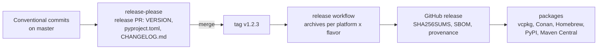

# Releasing VASDK

*How a version of VASDK is cut and published, for maintainers. The workflows are [`.github/workflows/`](../.github/workflows/); the version is [`VERSION`](../VERSION); what a consumer gets is [Using VASDK in your project](integrating.md).*

## The version

[`VERSION`](../VERSION) holds the one version, `MAJOR.MINOR.PATCH` ([Semantic Versioning](https://semver.org)):

- **CMake:** both projects and Android's (`project(... VERSION ${VASDK_VERSION})`), `<VASDK/version.h>` and `vasdk_version()` read it.
- **Library:** the C library's file version follows it (`libvasdk_c.so.1.2.3`).
- **Bindings:** the Kotlin binding reads it. The Python binding states it in `pyproject.toml`, which release-please updates in the same commit.
- **Check:** `ctest` (`vasdk_versions`, [`cmake/check_versions.py`](../cmake/check_versions.py)) fails when any of them disagrees.

| Change | Version |
| --- | --- |
| A fix | `PATCH` |
| Something new: a C function, a provider, an option, a field | `MINOR` |
| A C function changed or removed, a type's layout changed | `MAJOR`, and `VASDK_C_API_VERSION` with it, so the soname changes too ([C API, Stability](reference/c-api.md#stability)) |

The C++ API has no compatibility promise. A change there alone is `MINOR`.

## Cutting a release

1. **The release PR.** Commits on `master` follow [Conventional Commits](https://www.conventionalcommits.org) (`feat(engine): …`, `fix(tts): …`, `feat!: …` for a breaking change). [release-please](https://github.com/googleapis/release-please) keeps a pull request open with the next version in `VERSION` and `bindings/python/pyproject.toml`, and the changelog in `CHANGELOG.md` ([`release-please.yml`](../.github/workflows/release-please.yml), [`release-please-config.json`](../release-please-config.json)).
2. **The tag.** Merging that pull request tags `v<VERSION>`. The repository secret `RELEASE_PLEASE_TOKEN` must be a token other than `GITHUB_TOKEN`, so the tag can start a workflow. Without it, push the tag by hand.
3. **The archives.** The tag runs [`release.yml`](../.github/workflows/release.yml):
   - **Version check:** `cmake/check_versions.py --tag` fails the release when the tag and `VERSION` differ.
   - **Archives:** each platform and flavor is built with the `release` presets and installed. Each archive is `vasdk-<flavor>-<version>-<platform>.tar.gz` (`.zip` on Windows), holding the install prefix ([layout](integrating.md#prebuilt-with-find_package-or-pkg-config)).
   - **Publication:** `SHA256SUMS`, a CycloneDX SBOM and [build provenance](https://docs.github.com/actions/security-for-github-actions/using-artifact-attestations) (`gh attestation verify <file> --repo fatehmtd/VASDK`) go on the GitHub release with the archives.

   A `workflow_dispatch` run with a tag that wasn't pushed is a dry run: it builds every archive and publishes nothing.
4. **The packages:** see [Channels](#channels).

| Platform | Runner | Note |
| --- | --- | --- |
| `linux-x64`, `linux-arm64` | Ubuntu 24.04 | Needs the system's OpenSSL (libssl 3) and glibc 2.39. A manylinux_2_28 container comes next, for older distributions |
| `macos-arm64`, `macos-x64` | macOS 14, macOS 13 | |
| `windows-x64` | Windows Server 2022, MSVC | curl over Schannel, no OpenSSL |

The `full` flavor carries many third-party clients. A failure there doesn't hold the other archives.

## Channels

| Channel | Built from | Credentials | State |
| --- | --- | --- | --- |
| GitHub release | `release.yml` | `GITHUB_TOKEN` | Ready |
| vcpkg | A port pointing at the tag's source archive, `VASDK_DEPENDENCY_SOURCE=SYSTEM` | A pull request to microsoft/vcpkg | Planned |
| Conan Center | `conanfile.py`, a pull request to conan-center-index | None | Planned |
| Homebrew | A formula in a tap, from the source archive | A tap repository | Planned |
| PyPI | cibuildwheel wheels with the C library inside | Trusted publishing (OIDC), no token | Planned |
| Maven Central | `com.vasdk:vasdk-android`, `com.vasdk:vasdk-jvm` | The `com.vasdk` namespace (verified by a DNS TXT record on vasdk.com) and a signing key | Planned |

Each channel's page goes into [Using VASDK in your project, Packages](integrating.md#packages) as it ships.

## Checklist

- **CI passes on `master`:** every platform, the exports check and the subproject build.
- **Licenses recorded:** `THIRD_PARTY_NOTICES.md` and "Sources and licenses" in the [provider catalog](provider-catalog.md) list every new library and model, since the archives ship the notices.
- **Release PR reviewed:** the version is right for what changed (table above), and the changelog reads well.
- **After the tag:** the release lists all archives, and `SHA256SUMS` matches them.
