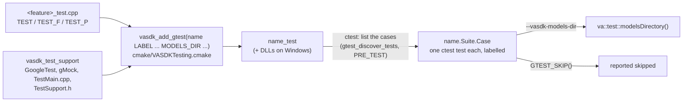

# Testing VASDK

How VASDK is tested: the layers, the frameworks, how to run a subset, and what CI runs. How to *write* a test, step by step, is the [vasdk-testing skill](../skills/vasdk-testing/SKILL.md); `skills/vasdk-testing/check_tests.py` holds every test to it. Source of truth: [`cmake/VASDKTesting.cmake`](../cmake/VASDKTesting.cmake) and [`VASDK/tests/support/TestSupport.h`](../VASDK/tests/support/TestSupport.h).

## Layers and labels

Every test carries exactly one label, its layer; `vasdk_test_labels` fails on a test without one.

| Label | What | Framework | Needs |
| --- | --- | --- | --- |
| `unit` | deterministic logic: expressions, goals, WAV files, scoring, features against golden data | GoogleTest | nothing |
| `timing` | threads and real time: TTS turns, transports, LLM streaming; one at a time (`RUN_SERIAL`) | GoogleTest | nothing |
| `integration` | sessions, the C API, the engine with fakes, the catalog (a spoken conversation) | GoogleTest | models, for some |
| `model` | a provider on its model | GoogleTest | the model (skipped without) |
| `agent` | agents' scripted conversations (`.txtpb`) | `<app>_agentc test` | nothing |
| `eval` | quality on real speech against [baselines](evaluation.md) | `vasdk_provider_eval` | the evaluation set (skipped without) |
| `binding` | Python, Kotlin and C over the C library | pytest, kotlin.test, C | the binding switched on |
| `packaging` | consumer builds, model downloads, version and rule checkers | CMake scripts, Python | nothing |

## Running tests

```bash
cmake --preset dev && cmake --build --preset dev     # VASDK_BUILD_TESTS is on in the dev and ci presets
ctest --preset dev                                   # everything
ctest --preset unit                                  # the fast loop: -L unit
ctest --preset offline                               # everything that needs no download: not model, not eval
ctest --preset dev -L timing                         # one layer
ctest --preset dev -R vasdk_tts_turn                 # one program's cases
ctest --preset dev -R "TtsTurn.PauseHoldDelaysCompleted"   # one case
```

A GoogleTest case is its own ctest test, named `<program>.<Suite>.<Case>` (`vasdk_tts_turn.TtsTurn.PauseHoldDelaysCompleted`; a parameterized one ends in its parameter's name, `.../Queued`). Skipped cases (no model, a provider not built) are reported as skipped. The programs take GoogleTest's flags too:

```bash
build/dev/VASDK/vasdk_tts_turn_test --gtest_filter='TtsTurnDuckTest.*' --gtest_repeat=20 --gtest_shuffle
VASDK_TEST_MODELS_DIR=/path/to/models build/dev/VASDK_3P_IMPL/MiniLmNlu/vasdk_minilm_nlu_test   # other models
```

## How a test is built and run



- **GoogleTest and gMock** (v1.15.2) are fetched only with `VASDK_BUILD_TESTS`, by `vasdk_add_test_support()`, the same way as VASDK's other dependencies (a parent project's, or the system's under `VASDK_DEPENDENCY_SOURCE`). They are never installed or shipped.
- **The shared support** (`VASDK/tests/support`): the tests' `main` (GoogleTest's flags, then `--vasdk-models-dir`), `va::test::waitUntil`, `va::test::UniqueTemporaryDirectory`, `va::test::modelsDirectory()` and `VA_REQUIRE_FILE`.
- **Cross-compiled** (Android), a program is one ctest test with the same arguments, which [`VASDK_ANDROID/run-tests-on-device.sh`](../VASDK_ANDROID/run-tests-on-device.sh) runs on a device or emulator ([Android](apps/android.md)).
- **Other tests** (agent suites, evaluation runs, scripts) keep their own runners and are labelled with `vasdk_label_tests(<label> <test>...)`.

## Writing a timing test

Real time is where tests turn flaky: a shared CI runner sleeps longer than asked, never shorter.

- Wait for what you check: `va::test::waitUntil(condition, timeout)` returns as soon as the condition holds and fails only at the deadline.
- A fixed wait is only part of the scenario (the user cuts in 50 ms into a sentence) or a check that something does *not* happen; it says so, `// fixed wait: <why>`.
- An upper bound is measured from the time that really passed, not assumed from a sleep.
- A scenario the machine couldn't stage because it overslept skips (`GTEST_SKIP() << "the machine overslept"`) rather than failing.

## What CI runs

| Job | Runs |
| --- | --- |
| `build` (linux-x64, linux-arm64, macos-arm64, windows-x64) | `ctest --preset ci`: every layer, with the default providers' models and the evaluation set cached; macOS retries a failed test once (`--repeat until-pass:2`) until the timing tests are all converted |
| `checks` | `check_skills.py`, `check_rules.py`, `check_tests.py` (and its self-test), `check_versions.py`, `next_version.py --self-test`, `check_parity.py` |
| `subproject`, `conan` | the consumer programs against VASDK built as a subproject and as a Conan package |

## The migration

GoogleTest arrived after 85 hand-written test programs. They are converted in phases, one pull request each; until then they are listed in `NOT_YET_CONVERTED` in `check_tests.py`, which only shrinks.

| Phase | What | State |
| --- | --- | --- |
| 0 | GoogleTest, `vasdk_add_gtest`, the shared support, labels on every test, the checker and the skill; five pilots (`expression`, `tts_turn`, `webrtc_transport`, `minilm_nlu`, `offline_conversation`) | done |
| Python | the binding's and the Python app's tests to pytest (`vasdk_add_pytest`, `conftest.py`) | next |
| 1 | the timing and threaded tests in `VASDK/tests`, then the macOS retry removed | |
| 2 | the rest of `VASDK/tests` (`vasdk_c_test.c` stays C: it proves the header compiles as C) | |
| 3 | the provider tests in `VASDK_3P_IMPL`, the car verticals and the call center | |
| CI | a sanitizers job (ASan and UBSan, TSan on the timing tests), the Kotlin binding's tests on Linux, and an Android emulator job | |
