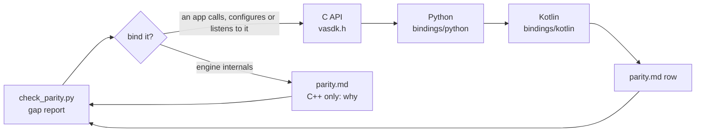

# Binding parity: C, Python and Kotlin level with C++

[vasdk-bindings](../vasdk-bindings/SKILL.md) takes **one** feature to every platform. This skill finds **every** place where a binding lags the C++ and closes it. "Done" is the check below passing, so it can't drift: ctest runs it as `vasdk_binding_parity` when a binding is on (`-DVASDK_BUILD_PYTHON_BINDING=ON` / `-DVASDK_BUILD_KOTLIN_BINDING=ON`), for C and the bindings that are on. With both off it isn't registered and configure warns; run the script by hand then.

| File | What |
| --- | --- |
| [`check_parity.py`](check_parity.py) | The check: audited C++ against [`parity.md`](parity.md), and the C API against what each binding declares. `--bindings c,python` leaves Kotlin out; `--self-test` runs it on `skills/vasdk-binding-parity/tests/fixture` |
| [`parity.md`](parity.md) | The manifest: the audited classes, one row per capability, and the C functions the bindings leave out on purpose |

## Steps

1. **Get the report:** `python3 skills/vasdk-binding-parity/check_parity.py`. Each line is a gap:
   - `X: public C++ with no row`: a new public method or interface. Add a row.
   - `X: no <binding> binding`: a row with `—` where a name belongs.
   - `<binding> has no Y`: a row names something that doesn't exist (renamed, or not written yet).
   - `vasdk_x: C function <binding> doesn't declare`: the C API grew and a binding didn't follow.
2. **Decide for each C++ gap.** Bind it when an app could call it, configure it or listen to it ([house rule 5](../../AGENTS.md#house-rules)). Mark it `C++ only: <why>` when it is engine plumbing an app never touches (`Session::pipeline`, the hooks `FlowRuntime` gets from `Session`). Before marking something C++-only, check the Android app's JNI (`VASDK_ANDROID/app/src/main/cpp/vasdk_jni.cpp`): if it calls the method, an app needs it.
3. **C first** ([vasdk-bindings](../vasdk-bindings/SKILL.md#steps)), in `VASDK/include/VASDK/c/vasdk.h`, implemented in `VASDK/src/c/`. Prefer, in this order:
   - a new field in a message that already crosses: `vasdk.engine.Command` (session controls), `vasdk.flow.ConversationInput` (conversation turns), `vasdk.flow.StepOutcome` (what a step does). Then no binding needs a new function: `send` and `apply` carry it.
   - a new `*_message` function taking and giving protos, plus a JSON twin only when plain C needs it (list the twin under "C functions the bindings leave out").
   - for an interface the app implements (a provider, a processor, a context source), callbacks with a `user` pointer, as `vasdk_registry_add_tool` does: a `create`/`destroy` pair per session, never one global instance.
4. **Python** in `bindings/python/vasdk/__init__.py`: `_declare` the function, wrap it in a method with the manifest's name, and keep callbacks alive while C holds them (`_keep`).
5. **Kotlin** in `bindings/kotlin/src/main/kotlin/com/vasdk/`: declare the function on the JNA interface in `Native.kt`, wrap it in its class (`Session.kt`, `Agent.kt`, `Providers.kt`, `Vasdk.kt`) with the manifest's camelCase name, and hold callback objects for as long as C may call them (`keep`, which also keeps the calling thread attached to the JVM).
6. **Tests** for each layer ([vasdk-bindings](../vasdk-bindings/SKILL.md#tests)): a C test in `VASDK/tests/`, the same scenario in `bindings/python/tests/` and in `bindings/kotlin/src/test/kotlin/com/vasdk/` (ctest: `vasdk_kotlin`). The binding tests run only with `-DVASDK_BUILD_PYTHON_BINDING=ON` / `-DVASDK_BUILD_KOTLIN_BINDING=ON` (both off by default), so turn them on for this work.
7. **Manifest:** fill the row, then re-run the check until it prints `bindings at parity`.

## Pitfalls

- **Callback lifetime.** C keeps raw function pointers. A ctypes `CFUNCTYPE` or a JNA `Callback` that the garbage collector frees crashes the next call: keep it referenced by the object that registered it, for as long as that object lives.
- **Threads.** Callbacks run on SDK threads (pipeline, events, tools). Python takes the GIL per call. Kotlin must hop to its own dispatcher before touching UI or shared state.
- **Memory.** Everything VASDK returns as `char*` or `void*` goes back through `vasdk_free`, including errors.
- **Formats.** Bindings use `VASDK_FORMAT_BINARY` and their generated proto classes; JSON is for C.
- **Never change a C signature.** Add a function; the old one stays for compiled callers.
- **The scan reads headers line by line.** A public method declared across several lines is still found by its first line. A method hidden behind a macro isn't: write a row for it by hand and check it exists.

## Done when

`check_parity.py` passes with every binding, `--self-test` passes, the new C, Python and Kotlin tests pass in `ctest` with both bindings on, and the [definition of done](../../AGENTS.md#definition-of-done) holds for each new call: documented in [the C API reference](../../docs/reference/c-api.md), the Python README and the Kotlin README.
