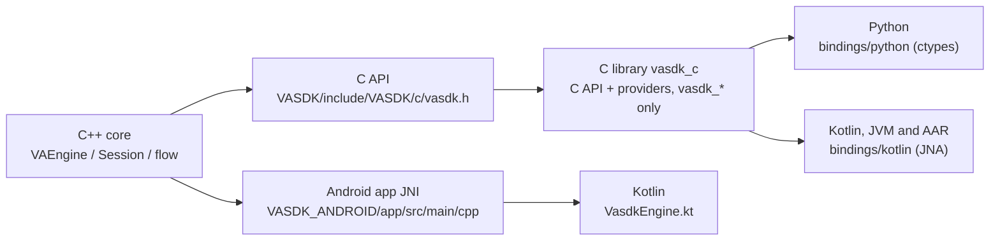

# Bindings: C, Python, Android

A feature isn't in the SDK until every platform can use it ([house rules](../../AGENTS.md#house-rules)). The C API is the one stable surface ([Stability](../../docs/reference/c-api.md#stability)). The C library, `vasdk_c` (`cmake/c_library/CMakeLists.txt`), exports it and nothing else; Python and Kotlin load that library, and the packages ship it ([integrating](../../docs/integrating.md)). The Android app still links the C++ directly through its own JNI.

| Layer | Files | Reference | Tests |
| --- | --- | --- | --- |
| C API | `VASDK/include/VASDK/c/vasdk.h`, `VASDK/include/VASDK/c/vasdk_c_export.h` (`VASDK_C_API`), `VASDK/include/VASDK/c/vasdk_cpp.h`, `VASDK/src/c/vasdk_c.cpp`, `VASDK/src/c/vasdk_c_session.cpp` | [the C API](../../docs/reference/c-api.md) | `vasdk_c` (`VASDK/tests/vasdk_c_test.c`), `vasdk_c_session` (`VASDK/tests/c_session_test.cpp`) |
| Providers from C | `VASDK/include/VASDK/c/vasdk_providers.h` (`vasdk_providers_add_all`), built into the C library from `VASDK_3P_IMPL/ProviderCatalog/ProvidersShared.cpp` | [spoken sessions](../../docs/reference/c-api.md#spoken-sessions) | `vasdk_offline_conversation` |
| Python | `bindings/python/vasdk/__init__.py` | `bindings/python/README.md`, [Python app](../../docs/apps/python.md) | `bindings/python/tests/` (`vasdk_python_garage`, `vasdk_python_extensions`), `VASDK_PYTHON_APP/tests/` (`vasdk_python_kitchen`, `vasdk_python_session`) |
| Kotlin (JVM, Android AAR) | `bindings/kotlin/src/main/kotlin/com/vasdk/` (`Native.kt`, the JNA declarations), `VASDK_ANDROID/vasdk/` | [Kotlin](../../docs/reference/kotlin.md) | `vasdk_kotlin` (`bindings/kotlin/src/test/kotlin/com/vasdk/`), on a device with `:vasdk:connectedAndroidTest` |
| Android app | `VASDK_ANDROID/app/src/main/cpp/vasdk_jni.cpp`, `VASDK_ANDROID/app/src/main/kotlin/com/vasdk/android/VasdkEngine.kt` | [Android](../../docs/apps/android.md) | [tests on a device](../../docs/apps/android.md#tests-on-a-device) |

The bindings are optional and off by default: configure with `-DVASDK_BUILD_PYTHON_BINDING=ON` (and `-DVASDK_BUILD_KOTLIN_BINDING=ON`) to run their tests. To find every gap at once rather than one feature's, use [vasdk-binding-parity](../vasdk-binding-parity/SKILL.md).

## Steps

1. **C API:** add the function or callback to `vasdk.h` with a doc comment (who owns memory, which thread calls back, what errors return), marked `VASDK_C_API` and named `vasdk_*` (the C library exports nothing else). Plain C types only; structured data crosses as protobuf bytes, as events and snapshots do. Never change an existing signature or a type's layout: add a new function ([Stability](../../docs/reference/c-api.md#stability)). Implement it in `VASDK/src/c/`.
2. **Python:** declare it in `bindings/python/vasdk/__init__.py` (ctypes `argtypes`/`restype`, callbacks kept alive while registered), wrap it in a Pythonic method, and decode protobuf payloads to messages.
3. **Kotlin:** declare it in `bindings/kotlin/src/main/kotlin/com/vasdk/Native.kt` and wrap it in its class, as the [parity skill](../vasdk-binding-parity/SKILL.md#steps) says; the AAR builds the same sources. The Android app's own JNI (until it moves onto the AAR): the JNI entry in `vasdk_jni.cpp` (conversions with `VASDK_ANDROID/app/src/main/cpp/JniUtils.h`, callbacks attached to the JVM thread) and the Kotlin API in `VasdkEngine.kt`; settings the user can change go through the app's preferences.
4. **Docs:** the C reference, the Python README and the Android guide each show it with a short example.

## Pitfalls

- Callbacks from C arrive on SDK threads: Python callbacks take the GIL (ctypes does it per call), Kotlin must hop to its own dispatcher before touching UI.
- Strings are UTF-8 both ways; lengths are explicit where binary data crosses.
- A provider setting needs no new function: it goes in the provider's options message (`VASDK_3P_IMPL/ProviderCatalog/proto/vasdk/providers/options.proto`), and every binding sets it in an engine config built in code (`vasdk_session_create_config`, Python `vasdk.Session(EngineConfig)`, Kotlin `Session(EngineConfig)` with `toAny()`).
- A feature that can't work on a platform (a device API missing on desktop, say) states so in its docs and logs a warning when used there.

## Tests

How to write, label and register them: [vasdk-testing](../vasdk-testing/SKILL.md).

- **Unit:** a C test in `VASDK/tests/vasdk_c_test.c` or `VASDK/tests/c_session_test.cpp` covering the new call, its errors, and its callback.
- **Integration:** the same scenario from Python in `bindings/python/tests/` (registered with `VASDK_LIBRARY` set, as `vasdk_python_garage` is in `VASDK_APP/CMakeLists.txt`), and on Android in the device suite.

## Done when

The [definition of done](../../AGENTS.md#definition-of-done) holds, and the feature is callable, documented and tested in C, Python and Kotlin, or the gap is documented and warned.
