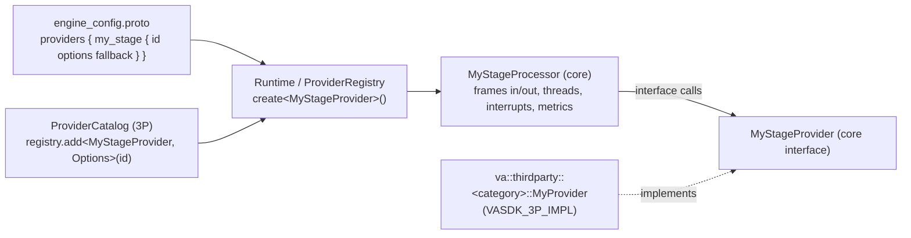

# A new core component

The core holds the generic parts; third-party code only implements an interface. Follow the shape of what is already there, so a new stage looks and behaves like the others.

## The shape of a stage

- **The provider interface** (`VASDK/include/VASDK/<Stage>Provider.h`): a pure-virtual core plus optional virtuals with safe defaults; `getName()` defaulting to `shortTypeName`; `AudioConfig` given at `initialize()` and validated there; a listener for asynchronous results. It knows nothing about frames or pipelines.
- **The processor** (`VASDK/include/VASDK/<Stage>Processor.h`): a `FrameProcessor` that drives any implementation. It owns the frames, the threads, timing, interrupt and barge-in handling, and metrics, so implementations don't each re-do them.
- Generic means: two very different implementations (a local model and a cloud API, say) fit the interface without a cast, a flag or a special case in the processor.

Templates, in the order to read them:
1. **Wake word**: the newest stage done end to end. `VASDK/include/VASDK/WakeWordProvider.h`, `VASDK/include/VASDK/WakeWordProcessor.h`, the `wake_word` field in `VASDK/proto/vasdk/engine/engine_config.proto`, `_registry.create<audio::WakeWordProvider>` in `VASDK/src/engine/Runtime.cpp`, and the fake in `VASDK/tests/activation_test.cpp`.
2. **Speaker identification**: the smallest interface + processor pair, with enrollment state in the processor and none in the provider. `VASDK/include/VASDK/SpeakerEmbeddingProvider.h`, `VASDK/include/VASDK/SpeakerIdentificationProcessor.h`.

## Steps

1. **Interface and processor** as above. Contracts and threading: [the FrameProcessor contract](../../docs/reference/processors.md#the-frameprocessor-contract), [threading](../../docs/reference/processors.md#threading-model-in-one-paragraph).
2. **A new frame type**, only if no existing frame fits: [adding a new frame type](../../docs/reference/frames.md#adding-a-new-frame-type).
3. **Selectable in the engine config:** a `ProviderSpec` field in `Providers` in `VASDK/proto/vasdk/engine/engine_config.proto` (append; never renumber), created in `VASDK/src/engine/Runtime.cpp` with `_registry.create<...>()`, so `fallback` and the "first one built in" default work like every other stage.
4. **Wired into the engine:** where the processor goes in the standard pipeline ([the pipeline](../../docs/reference/engine.md#the-pipeline)); events, if apps need them ([events](../../docs/reference/engine.md#events)).
5. **Every platform:** [vasdk-bindings](../vasdk-bindings/SKILL.md) (C API, Python, Android).
6. **The first implementation:** the stage skill for its kind, or a new one in `skills/`, and [vasdk-provider](../vasdk-provider/SKILL.md).
7. **Its doc page:** a section in the reference page that owns its family, or `docs/reference/<component>.md` linked from `docs/README.md`, from [component-doc-template.md](component-doc-template.md): what it is, its interface and config, a usage example in C++ and C or Python, and a mermaid flow.
8. **Skills:** a new stage gets its own `skills/vasdk-<stage>/SKILL.md` (copy [vasdk-vad](../vasdk-vad/SKILL.md) for the layout), a row in `skills/README.md`, and a row in the table in `AGENTS.md`.

## Rules

- [House rules](../../AGENTS.md#house-rules): headers are the truth, optional virtuals with defaults, every platform, full names.
- No third-party dependency in the core. A library goes behind an interface (as `VASDK/include/VASDK/network/` does for HTTP, WebSocket and WebRTC) and is implemented in `VASDK_3P_IMPL/`.
- No `static` variables in source files; several sessions share a process ([many conversations at once](../../docs/reference/engine.md#many-conversations-at-once)).

## Tests

How to write, label and register them: [vasdk-testing](../vasdk-testing/SKILL.md).

- **Unit** (`VASDK/tests/<component>_test.cpp`, registered in `VASDK/CMakeLists.txt` like the others): the processor driven by a fake provider (put shared fakes in `VASDK/tests/engine_test_fakes.h`), covering normal flow, interrupt, stop while busy, and a provider that fails to initialize.
- **Integration:** a `Session` built from an engine config that selects the stage (`vasdk_engine_assembly`, `vasdk_session` show how), plus the C API (`vasdk_c_session`) and Python (`bindings/python/tests/`) paths from [vasdk-bindings](../vasdk-bindings/SKILL.md).

## Done when

The [definition of done](../../AGENTS.md#definition-of-done) holds: the interface and processor are generic, the stage is selectable in the config, it reaches C, Python and Android, and it has its own doc section with an example and a mermaid flow.
