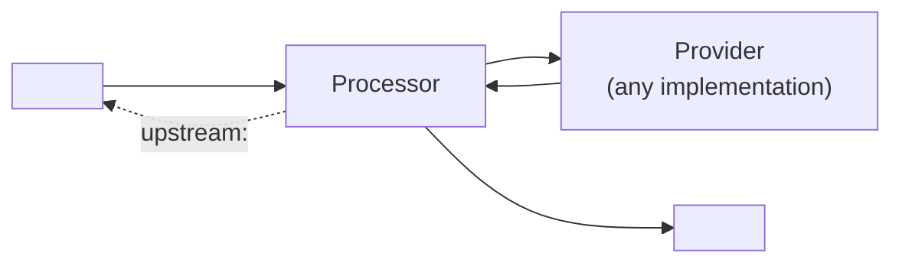

# <Component>

*Core component. Interface: [`<Component>Provider.h`](../../VASDK/include/VASDK/<Component>Provider.h). Processor: [`<Component>Processor.h`](../../VASDK/include/VASDK/<Component>Processor.h). Config: `providers { <stage> }` in [`engine_config.proto`](../../VASDK/proto/vasdk/engine/engine_config.proto). The headers are the source of truth.*

<What it does for the conversation in two sentences, and when an app wants it.>

## Where it sits



<Threads: which thread calls the provider, which thread results arrive on. What happens on interrupt and on stop.>

## The interface

| Member | Required | Contract |
| --- | --- | --- |
| `initialize(config)` | yes | <validate, return false on what it can't handle> |
| `<call>` | yes | <...> |
| `<optional call>` | no, default <...> | <...> |

## Configuration

```textproto
providers { <stage> { id: "<id>" options { [type.googleapis.com/vasdk.providers.<Options>] { ... } } fallback: "<id>" } }
```

| Field | Default | Meaning |
| --- | --- | --- |
| `<field>` | `<default>` | <...> |

## Usage

C++:

```cpp
<the smallest program that uses it, through VAEngine/Session or a pipeline>
```

C or Python:

```python
<the same through the binding>
```

## Implementations

| Id | Where | Notes |
| --- | --- | --- |
| `<id>` | [`VASDK_3P_IMPL/<Name>/`](../../VASDK_3P_IMPL/<Name>/) | [its page](../providers/<id>.md) |

Writing one: the [`vasdk-<stage>`](../../skills/vasdk-<stage>/SKILL.md) skill.

## Tests

| Test | Kind | What it covers |
| --- | --- | --- |
| `vasdk_<component>` | unit | processor with a fake provider: flow, interrupt, stop, failed init |
| `<integration>` | integration | a session from an engine config, the C API, Python |
