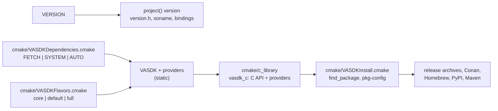

# Packaging: how other projects get VASDK

VASDK reaches another project in two forms ([Using VASDK in your project](../../docs/integrating.md)):

- **The C library, `vasdk_c` (`VASDK::c`):** one shared library with the C API and the providers built in, exporting `vasdk_*` only. It is what `cmake --install`, the release archives, every package and every binding carry.
- **The C++ libraries from source (`VASDK::VASDK`, `VASDK::providers`, `VASDK::<provider>`):** added with FetchContent or `add_subdirectory`.

| Part | File | Reference |
| --- | --- | --- |
| Version | `VERSION`, `VASDK/cmake/version.h.in` | [Versions](../../docs/integrating.md#versions-and-compatibility) |
| The C library | `cmake/c_library/CMakeLists.txt`, `cmake/c_library/vasdk_c.map`, `cmake/c_library/vasdk_c.exported_symbols`, `cmake/c_library/VASDKCopyRuntime.cmake` (`vasdk_copy_runtime`, Windows' DLLs), `VASDK/include/VASDK/c/vasdk_c_export.h` | [C API, Stability](../../docs/reference/c-api.md#stability) |
| Install, `find_package`, pkg-config | `cmake/VASDKInstall.cmake`, `cmake/VASDKConfig.cmake.in`, `cmake/vasdk.pc.in` | [Prebuilt](../../docs/integrating.md#prebuilt-with-find_package-or-pkg-config) |
| Dependencies | `cmake/VASDKDependencies.cmake`, `VASDK/cmake/VASDKProtobuf.cmake`, `VASDK/cmake/VASDKCurl.cmake`, `VASDK_3P_IMPL/cmake/FindONNXRuntime.cmake` | [Dependencies](../../docs/building.md#dependencies) |
| Flavors | `cmake/VASDKFlavors.cmake` | [Flavors](../../docs/integrating.md#flavors) |
| Presets | `CMakePresets.json` | [Presets](../../docs/building.md#presets) |
| The C API in C++ | `VASDK/include/VASDK/c/vasdk.hpp` (header-only, over `vasdk.h`) | [C API, From C++](../../docs/reference/c-api.md#from-c-vasdkhpp) |
| Models | `VASDK/include/VASDK/ModelStore.h`, `VASDK/src/c/vasdk_c_models.cpp`, `VASDK_3P_IMPL/models/manifest.json` (built in), `VASDK_3P_IMPL/models/generate_manifest.py`; at configure time `VASDK_3P_IMPL/cmake/VASDKModels.cmake` (`vasdk_download_model`), which the `Download*.cmake` scripts call | [Models](../../docs/models.md) |
| The command | `VASDK/tools/vasdk/main.cpp` (`vasdk models ...`, installed in `bin/`), `cmake/c_library/test_vasdk_command.cmake` | [Models, The command](../../docs/models.md#the-command) |
| Another project's view | `tests/consumer/c_library/` (C and `vasdk.hpp`), `tests/consumer/run_consumer_test.cmake` | |
| Conan | `conanfile.py` (the C library from this tree, dependencies from Conan), `test_package/` | [Conan](../../docs/integrating.md#conan) |

## Rules

1. **Embeddable.** VASDK may be a subdirectory of another project. Paths come from `VASDK_ROOT_DIR`, `VASDK_ROOT_BINARY_DIR` or `CMAKE_CURRENT_*`, never `CMAKE_SOURCE_DIR` or `CMAKE_BINARY_DIR`. A global setting (`BUILD_SHARED_LIBS`, compile flags) is saved and put back, never forced into the cache. Apps, tests and model downloads stay off when VASDK isn't top-level.
2. **The C library exports `vasdk_*` and nothing else.** A new C function is `VASDK_C_API` and named `vasdk_*`, or it doesn't reach a program. Dependencies are linked in hidden, so they can't clash with the program's own.
3. **Pinned.** Every download has a tag, a commit or a SHA-256. A branch name is never enough.
4. **System dependencies work.** A new library dependency goes through `vasdk_dependency()` (`FIND` and `DECLARE`), so `VASDK_DEPENDENCY_SOURCE=SYSTEM` builds with Conan or distro packages and never downloads.
5. **A plain install is the SDK.** The sample apps (`COMPONENT apps`) and the C++ libraries (`COMPONENT vasdk_cpp_development`) are `EXCLUDE_FROM_ALL`. The C library, its headers and its runtime files (ONNX Runtime, DLLs it imports) are in.
6. **One version.** Only `VERSION` holds it. CMake, `<VASDK/version.h>`, the soname and the bindings read it. A file that must state it (`pyproject.toml`) is in `release-please-config.json` and `cmake/check_versions.py`.
7. **No model in a package.** Packages ship the library; models come from the model store, pinned in the manifest. A new model goes in `generate_manifest.py`, never in an archive. The build's own downloads read the same manifest (`vasdk_download_model`): no URL or hash in a `Download*.cmake` script.
8. **Loads into any host.** On Windows the library runs in processes with an older `msvcp140.dll` of their own (a JVM): the root `CMakeLists.txt` defines `_DISABLE_CONSTEXPR_MUTEX_CONSTRUCTOR` before any dependency is added. Keep it there.

## Steps

- **A new dependency:** `vasdk_dependency(<package> TARGET <target> FIND CONFIG DECLARE <FetchContent arguments>)` in the file that needs it, and the same version in `conanfile.py`'s `requirements()` when Conan Center has it. A prebuilt library is an `IMPORTED` target with its hash, as `VASDK_3P_IMPL/cmake/FindONNXRuntime.cmake` does. A shared one the C library loads gets installed beside it in `cmake/VASDKInstall.cmake`.
- **A new C function:** follow [vasdk-bindings](../vasdk-bindings/SKILL.md). The version script and exported symbols list cover `vasdk_*` already.
- **A breaking change to the C API:** only in a new major version. Raise `VASDK_C_API_VERSION` (the soname follows) and the major in `VERSION`.
- **A new provider:** add it to a flavor ([vasdk-provider](../vasdk-provider/SKILL.md), row 17). Its `VASDK::<name>` alias and its `find_package` component come from the catalog.
- **A new channel (a package manager, a language store):** build it from `cmake --preset release` (or `system-deps` for one that provides the dependencies), install the C library, and write its page in [docs/integrating.md](../../docs/integrating.md#packages).

## Tests

- **Integration:** `vasdk_consumer_install` installs this build into a fresh prefix, checks that no app is in it, runs the installed `bin/vasdk`, and builds and runs `tests/consumer/c_library` (C, and C++ through `vasdk.hpp`) against it with `find_package(VASDK)`. `vasdk_consumer_build_tree` does the same from the build tree (`VASDK_DIR`).
- **Models:** `vasdk_model_store` (offline), `vasdk_model_store_network` (skipped without network), `vasdk_command`, `vasdk_model_downloads` (the configure-time downloads, and every id they use is in the manifest).
- **Exports:** `dumpbin /exports vasdk_c.dll` (Windows), `nm -D --defined-only libvasdk_c.so` (Linux) or `nm -gU libvasdk_c.dylib` (macOS) lists `vasdk_*` only.
- **Subproject:** a FetchContent build of VASDK from another project configures with no app, test or model download.
- **Conan:** `conan create . -s compiler.cppstd=17 --build=missing` builds the package and runs `test_package/` (CI's `conan` job).

## Done when

The [definition of done](../../AGENTS.md#definition-of-done) holds, `vasdk_consumer_install` and `vasdk_consumer_build_tree` pass, the exports list only `vasdk_*`, and [docs/integrating.md](../../docs/integrating.md) shows the change.
