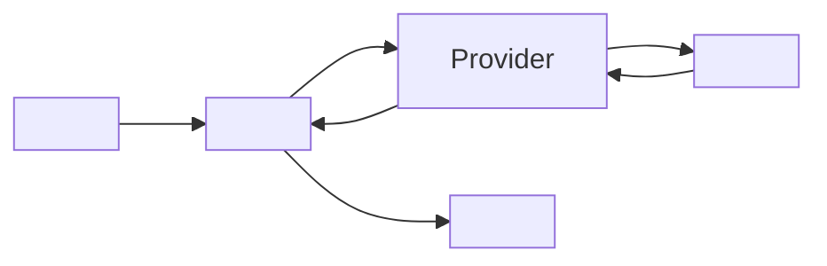

# <Display name>

*<Stage> provider, config id `<id>`, target `vasdk_<name>`, build flag `-DVASDK_BUILD_<NAME>=ON`. Source: [`VASDK_3P_IMPL/<Name>/`](../../VASDK_3P_IMPL/<Name>/). Interface: [`<Interface>.h`](../../VASDK/include/VASDK/<Interface>.h).*

<Two or three sentences: what it is (local model or cloud service), what it is good at, what it costs (latency, memory, network, price), and when to pick it over the others in its stage.>

## Platforms

| macOS | Linux | Windows | Android |
| --- | --- | --- | --- |
| yes | yes | yes | yes |

<For any "no": why, and what CMake and the runtime print.>

## Options

Set in an engine config (`providers { <stage> { id: "<id>" options { [type.googleapis.com/vasdk.providers.<Name>Options] { ... } } } }`) or in C++ through `<Name>Options`. Every field is optional.

| Field | Environment variable | Default | Meaning |
| --- | --- | --- | --- |
| `<field>` | `<NAME>_<FIELD>` | `<default>` | <what it changes> |

## Models and licenses

| File | Source | License | Downloaded by |
| --- | --- | --- | --- |
| `<file>` | [<repo>](<url>) (revision `<sha>`) | <license> | manifest id `<id>`: `Download<Name>Model.cmake` (`VASDK_DOWNLOAD_<NAME>_MODELS`), `vasdk models pull <id>` |

Library: [<upstream>](<url>), <license>. Both are listed in [THIRD_PARTY_NOTICES.md](../../THIRD_PARTY_NOTICES.md).

## Usage

From an engine config:

```textproto
providers {
  <stage> {
    id: "<id>"
    options { [type.googleapis.com/vasdk.providers.<Name>Options] { <field>: <value> } }
    fallback: "<other id>"
  }
}
```

From C++:

```cpp
#include "<Name>/<Name>Provider.h"

va::thirdparty::<category>::<Name>Options options;
options.<field> = <value>;
auto provider = std::make_shared<va::thirdparty::<category>::<Name>Provider>(options);
// hand it to the stage's processor, or register it: registry.add<...>("<id>", ...)
```

## How it works



<Threads: which thread calls in, which thread calls back. Cancellation and barge-in. Anything the stage's contract leaves to the provider.>

## Tests

| Test | Kind | Needs | Run |
| --- | --- | --- | --- |
| `<name>_<what>` | unit | <model / key, or nothing> | `ctest --test-dir build -R <name>` |
| `<integration test>` | integration | <model / key> | `ctest --test-dir build -R <name>` |

Without the model or key, both report "skipped".
